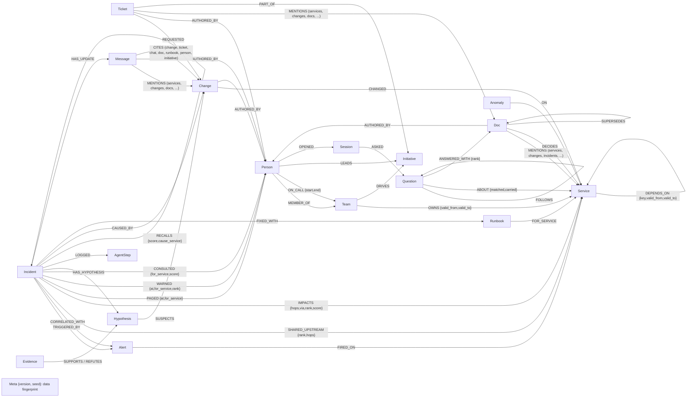
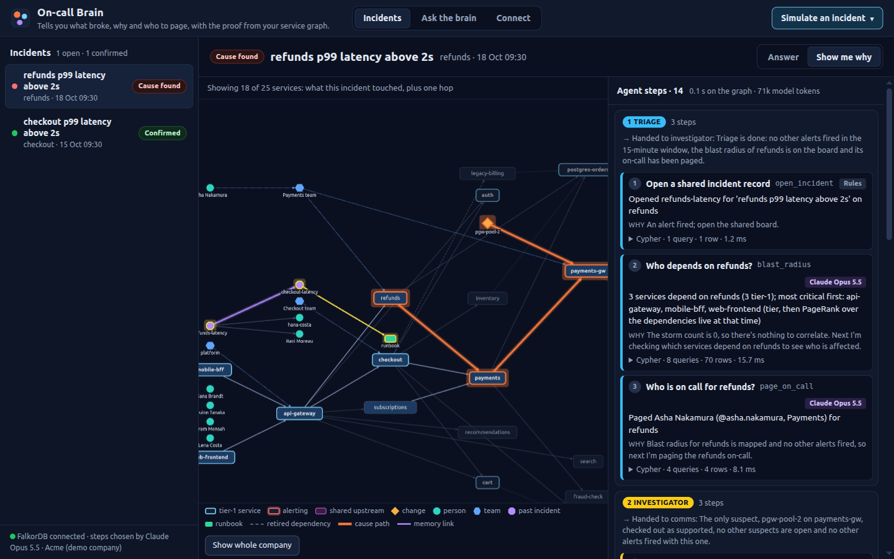

# On-call Brain

An AI on-call teammate. When an alert fires, it tells you what broke, why, who is paged and the fix, with the proof
from your company's graph. It remembers the causes you confirm.

**In one breath:** three agent roles (triage, investigator, comms) work the incident through one shared FalkorDB
graph. They find the change that broke it and rule out the other recent changes a change log would blame. You confirm
the cause, the graph keeps the fix, and the next similar incident takes 3 investigator steps instead of 6. It is an MCP
server first (Claude Code, Claude Desktop, any MCP client), plus an alert webhook, Slack, and a web inbox onto the same
graph.

- **Problem:** when checkout slows down, the newest deploy is rarely the cause. The cause sits somewhere on the dependency path, and it matters whether that dependency was live at the time.
- **Result:** in the demo, every change-log method blames the wrong change (one blames a service checkout stopped calling three days ago). The graph agent names the payments-gw config change two hops upstream, with the path and sources. On 200 generated incidents it is right 186 times; the best non-graph method, 134 times.
- **How:** temporal multi-hop Cypher traversals, a hypothesis board the roles hand off through, and episodic and procedural memory, all in one graph per company. With `LLM_PROVIDER=anthropic` and a key, Claude chooses every step after the incident opens (60/60 decisions, 0 fallbacks: [docs/LLM_RUN.md](docs/LLM_RUN.md)). A deterministic planner runs the tests and key-less demos.

**Tracks entered:** 01 Agents That Act on Connected Data, 02 Agent Memory and Coordination, 03 Company Brain.
Built for Graph Hacks (WeMakeDevs x FalkorDB), October 2026. All data is synthetic (seeded generator, fake names).

**Demo video:** https://youtu.be/eriObL8LlsQ

**Live:** https://13-127-186-74.sslip.io/ . One AWS box runs the app: the web UI, the three agents on Claude Opus 5.5
and the MCP server at `/mcp` (judges get the token with the submission). Its graphs live on FalkorDB Cloud (Free tier,
ap-south-1). Press **Simulate an incident** and watch the agents work. The limits that keep a public demo affordable
are in [docs/SECURITY.md](docs/SECURITY.md).

**Without a server:** when no backend is reachable, the web UI replays the three incidents from recorded runs (Claude
Opus 5.5 choosing the steps). The GitHub Pages build of `web/` (`.github/workflows/pages.yml`) does this:
https://harz05.github.io/oncall-brain/ (`?offline=1` does the same on the live site). For live runs, use the
[quick start](#quick-start-local-no-docker); for Claude Code, see [Use it from Claude Code](#use-it-from-claude-code-in-one-minute).


## Architecture

![Architecture: four surfaces (the Claude Code plugin over MCP, Slack /oncall, the alert webhook and the web UI) call one tool registry of 31 graph tools. The registry runs the triage, investigator and comms agents, which ask Claude Opus 5.5 or the rules planner for each next step and share an incident board in the graph. Every tool runs named Cypher against FalkorDB Cloud, which holds one tenant graph per company, a coordination graph for locks, throttles and the LLM budget, and two UDF libraries the queries call, oncall and FLEX](docs/img/architecture.png)

Every surface goes through one tool registry (`agents/registry.py`). Each tool is defined once and runs named,
parameterised Cypher from `queries/*.cypher`, so the MCP server, the HTTP API and the agent loop share it. The
agents keep no incident state in Python: before each step they re-read the incident board from the graph and ask the
planner (Claude, or the deterministic rules when no key is set) what to do next. Each company gets its own graph.
Locks, throttles and the LLM budget live in a separate coordination graph. Design detail is in
[docs/ARCHITECTURE.md](docs/ARCHITECTURE.md).

## The story the demo tells

**Act 1, 09:30: "checkout p99 latency above 2s".**
- Triage walks `DEPENDS_ON` backwards: checkout, api-gateway, web-frontend and mobile-bff are hurt. It pages whoever is on call for checkout (rotation edges in the graph).
- The investigator recalls past incidents first. An old checkout incident was caused by inventory, but inventory has no change today, so it moves on.
- It lists every change from the last 2 hours on services checkout depends on at alert time, plus the newest changes anywhere (what a flat change log would blame). Each suspect becomes a `Hypothesis` on the incident and is tested against the graph:

| Suspect | Verdict | Graph fact that decided it |
|---|---|---|
| search deploy, 8 min before (the newest change anywhere) | refuted | no `DEPENDS_ON` path from checkout to search |
| legacy-billing deploy | refuted | checkout's dependency on it was retired 3 days ago (`valid_to`) |
| pricing deploy | refuted | rolled back before the alert |
| cart deploy | refuted | cart shows no anomaly after the change |
| **payments-gw config change** (pool 200 -> 20) | **supported** | anomaly propagates payments-gw -> payments -> checkout, two hops |

- Both change logs without the graph get it wrong. The flat one blames the newest change (search). One that also watches anomalies blames legacy-billing: it deployed at 08:40 and threw errors at 08:45, before payments-gw went red. But checkout stopped calling legacy-billing 3 days ago, and only the temporal edge knows that.
- Comms pages the payments team and asks the graph who knows payments-gw best (`who_knows`, recorded as `CONSULTED`). It sends a heads-up to the on-call of the most critical impacted teams nobody paged (`warn_owners`) and writes the status update for #incidents. The update is stored on the incident as a `Message` that `CITES` its sources, and is posted to Slack only when `SLACK_WEBHOOK_URL` is set. From `make demo`:

```text
[checkout p99 latency above 2s] status: cause identified, fix pending
Impact: api-gateway, checkout, mobile-bff, web-frontend
Likely cause: config change on payments-gw by Sana Brandt: "Lower payments-gw HTTP pool max_connections 200 -> 20 (cost cleanup)"
Behind it: CR-881 is part of 'Q4 cost review' (Payments, led by Lena Costa, due 2026-12-31)
Context: Q4 cost review: payments gateway idle connections (design); Postmortem: payments gateway pool exhausted in the peak load test (postmortem)
Ruled out: legacy-193 (dependency retired), search-420 (no dependency path), pricing-2140 (rolled back), cart-310 (no anomaly after it)
Paged: @asha.nakamura (Payments), @ravi.moreau (Checkout)
Heads-up (most relied-on first): @hana.costa (Platform) for api-gateway, @kiri.novak (Storefront) for mobile-bff
Also at risk: refunds, subscriptions
Ask: Sana Brandt (@sana.brandt, Payments) knows payments-gw best
Sources: msg:pay-deploys-1, ticket:CR-881, doc:cost-review-pgw
```

- A human confirms. The incident gets `CAUSED_BY` the change, a `Runbook` is learned for (payments-gw, config), and the update is rewritten as "resolved, cause confirmed". The human's call wins: confirming a different change than the agents picked makes that change the cause.

**Act 2, three days later: "refunds p99 latency above 2s".**
Recall finds act 1 by structure: payments-gw is on refunds' live dependency path and the symptom is the same. Text
similarity plays no part. Act 1's runbook is for config changes on payments-gw, so the investigator tests the new
payments-gw config change first and confirms it in one check. **The same incident replayed without act 1's memory takes
6 investigator calls and finds the culprit on check 2; with the memory it takes 3 calls and check 1** (the UI shows
both, via `?compare=memory`). Without memory, nearest-first checking tries a newer, healthy payments deploy
(`chg:pay-77`, 1 hop away) first. The update adds "Next action: Revert the config change on payments-gw (this runbook
worked 1 of 1 times)". An anomaly-aware change log also gets act 2 right (the payments-gw change is the first to go
red), so act 2 shows memory making the investigation shorter, not beating that baseline.

**Act 3, two days later: three alerts in 4 minutes** (checkout, refunds, subscriptions).
- Triage sees other recent alerts on the board and calls `correlate_alerts` first. It walks each alerting service's upstream over edges live at alert time and notes which services went red. It projects the alerting services and their red upstreams into a scratch graph, and `algo.WCC` says which alerts are one incident: the origin's component is folded in (`CORRELATED_WITH`), chains included, and the other components are separate storms. An alert that only shares a quiet cache is not connected and stays its own incident.
- The services all three reach are the shared upstream, ranked by convergence (fewest total hops from the alerting services first: payments, then postgres-orders, ...) and stored as `SHARED_UPSTREAM {rank, hops}`. The investigator checks suspects there first.
- The postgres-orders config change (max_connections 500 -> 150) is supported on check 1 and explains all 3 alerting services. The subscriptions deploy, 5 minutes before it, is supported too (subscriptions blipped right after it) but explains only subscriptions. `conclude` keeps one leading cause and records the other as outranked: "chg:pg-conn-3 explains every alerting service this change does (1) and 2 more".
- Related alerts need not share one cause: a suspect that explains an alerting service the leader cannot is kept as a co-cause (its team is paged, the update says "Also contributing"), not ruled out (`tests/integration/test_storms.py`).
- Both change logs are wrong here: the flat one blames a search deploy, the anomaly-aware one blames the subscriptions deploy because it went red first. Without correlation, the same planner blames the subscriptions deploy too (`make demo` prints this ablation).


## Why the graph is not decoration

| What the agents do | FalkorDB feature doing the work | Without it |
|---|---|---|
| Blast radius, suspects, recall | Variable-length `DEPENDS_ON` walks that keep only edges live at alert time (`valid_from`/`valid_to`). Two run as FalkorDB user-defined functions in JavaScript (`src/oncall_brain/adapters/falkordb/udf/oncall.js`): `oncall.live_upstream` walks the callers breadth-first for `blast_radius` and drops a dead edge when it meets it; `oncall.live_reach` gives the fewest live hops to each suspect in `path_suspects` and `recall_similar`. The queries match their plain-Cypher reference forms row for row on 20 generated companies and a 100-service graph with cycles (`tests/integration/test_query_equivalence.py`) | no multi-hop suspects; retired dependencies blamed |
| Name resolution | Every service argument, on every surface, is resolved against the graph before a tool runs (`registry.call`, query `resolve_service`): an exact id or name, else the closest services by shared words or by FalkorDB's FLEX `flex.text.jaroWinkler` (`kafak` gets `svc:kafka`). An unknown name is refused with those suggestions | "0 services depend on payment-service", about a service that does not exist |
| Is there a way around a service? | `independent_routes`: `algo.maxFlow` on a projection of the live dependencies, every edge capacity 1, counts the routes that share no dependency edge (checkout reaches payments-gw one way only, through payments) | no answer to "will traffic go around it" |
| Refute "no path" suspects | `shortestPath` in `WITH` | the flat baseline's wrong answer stands |
| Alert storms | each alerting service's upstream closure over live edges; `algo.WCC` over the alerting services and their red upstreams decides which alerts are one incident; the shared upstream ranked by total hops; suspects come from every folded alert, and each records which alerting services it can reach | each alert is investigated alone, and act 3 blames the subscriptions deploy |
| Cascade victim vs cause | `depends_among`: live `DEPENDS_ON*` among the supported suspects' services; an upstream suspect already red when a nearer change landed takes the lead | a deploy on a service already failing from upstream gets blamed because it is nearest |
| Shared state and handoffs | the `Incident` board: `Hypothesis`, `Evidence` (`SUPPORTS`/`REFUTES`), `AgentStep` nodes, re-read before every decision | agents can't coordinate; the planner has nothing to decide from |
| Memory | `RECALLS` -> `FIXED_WITH` -> `Runbook` -`FOR_SERVICE`-> service picks the first suspects; `uses`/`successes` set the runbook's confidence; persisted per tenant | the same incident takes 6 investigator calls instead of 3 |
| Company brain | `ask`: FalkorDB full-text indexes on `Doc`, `Ticket` and `Message` find the sources, then `MENTIONS`, `DECIDES`, `SUPERSEDES`, `AUTHORED_BY`, `CHANGED` and `OWNS` name the services, changes, teams and people, and flag docs a newer one superseded. `who_knows` ranks people; `change_story` traces a change to its ticket, chat, docs, author and incidents. Per-engineer conversation memory (`Session`, `Question`) and `Initiative` nodes that tie people, tickets, changes and decisions together | keyword hits with no owner, no "is this still current?", nobody to ask, no memory of what you asked, no project behind a change |
| Keeping knowledge current | event tools write changes, anomalies, alerts, docs, chat, tickets, ownership and dependency start/end as they happen. Facts carry valid time and `recorded_at` (when the graph learned them), and the outcome lists `learned_late` facts | the next investigation works from stale facts; a late report silently rewrites what the agents knew |
| Locks, throttles, LLM budget | the coordination graph `oncall_brain_coord`: a run lock is a `Lease` node that a UNIQUE constraint makes exclusive (16 racing clients, one winner); a throttle or budget is a `Counter` node one atomic `MERGE ... SET` updates. No Redis key commands, so it runs on FalkorDB Cloud as is | two runs on one incident redo each other's work; no shared limits across the API and MCP |
| Safety, multi-tenancy, repeatable demo | every read is `GRAPH.RO_QUERY` with a 3 s timeout; one graph per tenant; a seed is built on `seeding_<t>` and published under the tenant lock (`GRAPH.COPY` to `pristine_<t>`, then `RENAME` over `tenant_<t>`), and a reset copies the pristine graph back the same way; UNIQUE `id` on every label, a UNIQUE and MANDATORY `key` on `DEPENDS_ON`, and MANDATORY `valid_from` on `DEPENDS_ON` and `OWNS`, so the database refuses a duplicate node, a duplicate dependency or an undated one | duplicates, undated edges, readers seeing a half-built tenant |

All of the cause-finding is Cypher traversal: temporal variable-length paths, `shortestPath`, and intersecting
upstream closures. Two graph algorithms take part in decisions. `algo.WCC` splits an alert storm (above).
`algo.pageRank` ranks criticality: `blast_radius` orders the impacted services by tier, then PageRank over the
dependencies live at alert time, and comms' `warn_owners` sends a heads-up to the on-call of the most critical impacted
teams nobody paged. FalkorDB's algorithms walk every edge, and the tenant graph keeps retired dependencies as history,
so the live edges are projected into a scratch graph first, the algorithm runs there, and the projection is dropped
(`tests/integration/test_algorithms.py` plants a retired and a future dependency from every service and shows the order
does not move). `algo.betweenness` is not used: its scores are sampled, so changing `samplingSeed` reorders the
services even with `samplingSize` above the node count, and a score that blames a change has to be exact.

The full query catalogue is in [docs/QUERIES.md](docs/QUERIES.md); the data model in [docs/DATA_MODEL.md](docs/DATA_MODEL.md).

### The tutorial's five techniques, in this repo

WeMakeDevs' guide for this hackathon, [How to build an agent that reasons over a graph](https://www.wemakedevs.org/blogs/how-to-build-an-agent-that-reasons-over-a-graph),
names five techniques and four outcomes. Where each one lives here:

| Technique | In On-call Brain |
|---|---|
| Model the question, not the data | The model is shaped by the on-call questions: `DEPENDS_ON`, `OWNS` and `ON_CALL` carry validity windows, so "what was live at alert time" is one filter, and the `Incident` board holds hypotheses and evidence, so "what is ruled out" is a read ([DATA_MODEL.md](docs/DATA_MODEL.md)). |
| A fixed tool catalogue beats generated queries | 33 tools over 120 named, parameterised `.cypher` statements ([QUERIES.md](docs/QUERIES.md)). Claude picks tools and arguments; it never writes Cypher. Reads run as `GRAPH.RO_QUERY`. |
| Resolve names against the database | `resolve_service` runs before every tool, on every surface, and inside `ask`: `payment-service` gets "No service named 'payment-service' in the graph; did you mean svc:payments, svc:payments-gw?", and `payments-gw` or `Payments-GW` resolve to `svc:payments-gw`. |
| Memory is more nodes | Episodic (`Incident`, `CAUSED_BY`, `RECALLS`), procedural (`Runbook`, `FIXED_WITH`, its `uses` and `successes`) and conversation memory (`Session`, `Question`) are nodes and edges in the tenant graph, read by the next run: act 2 takes 3 investigator steps instead of 6. |
| Return the path with the answer | Every answer carries its trace (tool, Cypher, parameters, rows, reason) and the evidence path, which the UI highlights; the status update cites its sources with `CITES` edges. |

| Outcome | Where you see it |
|---|---|
| Answered with a path | Act 1: the payments-gw config change, with the path payments-gw -> payments -> checkout and when each hop slowed. |
| Answered from memory | Act 2: "Solved from memory", the confirmed fix tested first. |
| Not in the graph | An empty blast radius says no live `DEPENDS_ON` edge is recorded, "not proof nothing breaks"; `ask` says when nothing in docs, tickets or chat mentions the words. |
| Unknown service | "No service named ... in the graph", with the closest real ones. |

The guide's demo move, the same question at depth 1 and then depth 4, is the `max_hops` argument of `blast_radius`
(the hop limit of the `oncall.live_upstream` UDF): over MCP, `blast_radius {"service": "payments-gw", "max_hops": 1}`
returns the direct callers, `"max_hops": 4` the services further out.

### In FalkorDB's terms

FalkorDB describes a context layer as "a persistent, queryable, relationship-aware store of organizational knowledge
that sits between the agent and the LLM" ([FalkorDB, Oct 14](https://www.falkordb.com/reference/enterprise-ai-agents-context-layer/)).
In On-call Brain, each company's FalkorDB graph is that layer. The agents, whether Claude or the rules planner, never
see raw records and never write Cypher. They call named, parameterised queries, and each call returns rows together
with the Cypher that produced them. Without FalkorDB the agents have nothing to reason over.
[docs/FALKORDB_NOTES.md](docs/FALKORDB_NOTES.md) lists the FalkorDB behaviour behind each design choice.

FalkorDB's production readiness checklist ([FalkorDB, Oct 14](https://www.falkordb.com/reference/why-rag-projects-never-reach-production/)):

| Criterion | In this repo |
|---|---|
| Freshness | Event tools write facts as they happen (`record_change`, `record_anomaly`, `raise_alert`, `add_dependency`, `retire_dependency`, `transfer_ownership`, `record_doc`, `record_message`, `record_ticket`). `DEPENDS_ON` and `OWNS` edges are closed with `valid_to`, never deleted, and a MANDATORY constraint refuses one without `valid_from`. Facts carry two times: when they were true and when the graph learned them (`recorded_at`). A suspect change or an anomaly on the evidence paths, inside the alert window, that the graph learned after the incident opened is used and listed as `learned_late`. Tests: `test_live_events_drive_a_new_investigation`, `test_transfer_ownership_flips_who_owns_but_not_who_owned_at_the_time`, `test_the_database_refuses_an_undated_dependency_or_owner`, `test_a_change_reported_after_the_incident_opened_is_used_and_marked_learned_late` |
| Entity resolution | Every service argument, on every surface, is resolved against the graph before a tool runs (`registry.call`, query `resolve_service`). An unknown name is refused with the closest ids, typos included through FalkorDB's FLEX library (`flex.text.jaroWinkler`: `kafak` gets `svc:kafka`). Every label has a UNIQUE `id` constraint, and every dependency a UNIQUE key. Tests: `test_a_service_the_graph_does_not_hold_is_named_unknown_not_answered_about`, `test_every_label_has_a_unique_id_constraint_that_reset_keeps_and_the_database_enforces` |
| Answer traceability | Every tool call puts its queries (name, Cypher, parameters, rows, ms) in the trace. Each `AgentStep` node keeps the query names, parameters, row counts, timings and a hash of the Cypher. Evidence stores the live path it was judged on (`Evidence.path`). The status update cites its sources through `CITES` edges. Each query row in the UI shows FalkorDB's own execution time and whether the plan came from its cache; the Plan button (tool `query_plan`) shows `GRAPH.PROFILE` for a read and `GRAPH.EXPLAIN` for a write. Tests: `test_agent_steps_persist_in_the_graph_and_respond_is_idempotent`, `test_the_update_cites_the_decision_history_behind_the_cause` |
| Multi-hop reasoning | `blast_radius` walks up to 6 hops of live `DEPENDS_ON` edges in a UDF (`oncall.live_upstream`), and the fewest live hops to each suspect comes from a second one (`oncall.live_reach`). `shortestPath` lists the live paths a check judges and refutes decoys; `algo.pageRank`, `algo.WCC` and `algo.maxFlow` run on point-in-time projections. Tests: `tests/integration/test_query_equivalence.py`, `test_act1_finds_the_planted_cause_and_refutes_every_decoy` |
| Access control | Partly done. Each company is its own graph (`test_tenants_are_isolated`). Reads go through `GRAPH.RO_QUERY` (`test_read_tools_cannot_write`). `/mcp` needs a bearer token. Conversation memory is kept per user (`test_memory_is_per_user_and_per_session`). Not done: a FalkorDB user per tenant, and permissions at node or edge level |

The hackathon brief, mapped to this repo:

| The brief | In this repo |
|---|---|
| Follow connections across data | `blast_radius`, `path_suspects`, `storm_upstream` over live `DEPENDS_ON` edges (`test_query_equivalence.py`, `tests/integration/test_storms.py`) |
| Remember across sessions | Act 2 recalls act 1 through `RECALLS`, `CAUSED_BY` and `FIXED_WITH` a `Runbook` that counts `uses` and `successes` (`test_act2_is_solved_from_act1_memory_and_slower_without_it`). `Session` and `Question` nodes keep each engineer's conversation (`test_a_follow_up_says_it_and_what_did_i_ask_is_answered_from_the_graph`) |
| Share state between agents | Three roles hand off through the `Incident` board and its `AgentStep` nodes (`test_concurrent_responders_do_not_duplicate_work_or_edges`). Leases and counters live in the `oncall_brain_coord` graph (`tests/integration/test_coordination.py`) |
| Connect people, projects, and decisions | `who_knows`; `Initiative` with `DRIVES`, `LEADS` and `PART_OF`; `DECIDES` and `SUPERSEDES`; `OWNS` with its history (`test_ask_walks_an_initiative_to_its_tickets_changes_people_and_decisions`, `test_ask_why_names_the_decision_of_record_and_flags_what_it_superseded`) |
| Show the path behind an answer | The Cypher behind every step is in the trace, `blast_radius` returns each caller's path, `Evidence.path` is stored, and updates carry `CITES` edges (see Answer traceability above) |
| "Which accounts are linked to this flagged transaction?" | The graph has no accounts. The equivalent is "which alerts are linked to this alert": `correlate_alerts` runs `algo.WCC` on a projection of the alerting services and their red upstreams to decide which alerts form one incident (`test_a_chained_storm_is_one_incident_by_wcc_and_the_far_cause_is_a_co_cause`) |
| "What did this customer ask for last month, and was it resolved?" | The graph has no customers. The equivalents are an engineer's own questions ("what did I ask about payments-gw", `Session`/`Question`; `test_a_follow_up_says_it_and_what_did_i_ask_is_answered_from_the_graph`) and whether an incident was resolved, and by which change and runbook (`list_incidents`, `CAUSED_BY`, `FIXED_WITH`; `test_list_incidents_finds_the_ids_an_outside_agent_needs`) |
| "Who on the team has worked on this system before?" | `who_knows` ranks people by current and former ownership, the changes they made, the incidents they were paged for, and the docs they wrote (`test_company_brain_who_knows_and_change_sources`, `test_who_knows_counts_doc_authorship_and_change_story_cites_docs`) |
| "What breaks if this service goes down?" | `blast_radius` returns every service that depends on it over live edges, with paths, ordered by tier and by PageRank on a projection of the live edges (`test_the_same_question_at_depth_1_then_4`, `test_criticality_comes_from_the_dependencies_live_at_alert_time_not_from_history`) |

### Evaluation

200 generated incidents: a random alert service, a random cause 0-3 hops upstream, planted decoys of every kind
above, noise anomalies in the window, a silent middle hop in some seeds and a cascade victim that deploys after the
cause went red in others. Results from [docs/EVAL.md](docs/EVAL.md):

| method | uses the graph | correct |
|---|---|---|
| **On-call Brain** (deterministic planner) | yes | **186/200 (93%)** |
| anomaly-aware change log: change behind the first service to go red | no | 134/200 (fooled by the retired-dependency decoy *d* 55 times, by decoy *c* made red by noise 11 times) |
| keyword match: change summary vs alert name | no | 57/200 |
| flat change log: newest change in the window | no | 0/200 (its pick is always a planted decoy) |

Read this as "the checks hold up on this data", not as a blind test: the scenarios are synthetic, I wrote them and
the checks, and I tuned the ranking knowing the perturbations. EVAL.md has the per-perturbation table and every miss
with the trace text that explains it.

What fails: 14 misses. 12 are seeds where a random blip landed on decoy *c*'s service after its change, so *c* looks
like a real, supported cause (26/38 correct on those seeds); 2 combine a silent middle hop with a cascade victim, whose
complete chain then outranks the truth's gapped one. On the 66 seeds with only the planted story it is 66/66; with
unrelated noise 82/94; with a silent middle hop 9/13; with a cascade victim 47/51.

The eval has single-alert incidents only. Act 3's storm is checked by `make demo` and
`test_act3_alert_storm_is_correlated_and_only_then_solved`; five more storms (two independent causes, alerts on one
service, a quiet shared cache, memory that explains part of a storm, two changes on one service) by
`tests/integration/test_storms.py`; a cascade victim and a monitoring gap by `tests/integration/test_causality.py`. A
whole incident (three agent roles, all reads and writes) takes a median 105 ms on the deterministic planner (p95
152 ms); per-tool timings are in EVAL.md. The hot traversals avoid enumerating paths (candidates from the time indexes,
`shortestPath` checked against edge validity, breadth-first walks in UDFs): on a hub-heavy 1,000-service graph, the
breadth-first Cypher form of `blast_radius` on the hub takes 45 ms instead of 2.6 s for the path-enumerating form,
with identical results; the product runs that walk as the `oncall.live_upstream` UDF ([docs/PERF.md](docs/PERF.md)).

## Graph data model



- **Episodic memory:** `Incident` + `CAUSED_BY` + its `AgentStep` history. **Semantic:** the org, ownership and dependency facts, with `valid_from`/`valid_to` so the agents use what was true at alert time, plus the docs, tickets and chat about them. **Procedural:** `Runbook` + `FIXED_WITH`, with `uses`/`successes` counts.
- **Two times on a fact:** valid time (`at`, `valid_from`, `valid_to`) and, for facts a tool writes, transaction time (`recorded_at`: when the graph learned it) on `Change`, `Anomaly`, a new `DEPENDS_ON` and `Incident`. Seeded facts have none.
- One graph per tenant (`tenant_<name>`), plus `pristine_<name>` for resets and the shared `oncall_brain_coord` graph for leases and counters. The single `Meta` node fingerprints the seed data, so a reset never restores a copy made by an older generator.
- Every label except `Meta` is indexed on `id` and has a UNIQUE constraint on it, so FalkorDB refuses a duplicate even from a raw query. `Change.at`, `Anomaly.at` and `Alert.at` have range indexes for the alert-window filters. `Doc(title, text)`, `Ticket(title, text)` and `Message(text)` have FalkorDB full-text indexes for `ask`.
- Every label, property and relationship, with who writes it: [docs/DATA_MODEL.md](docs/DATA_MODEL.md).

### How the agents query it



Each agent step is one tool, and each tool runs named Cypher from `src/oncall_brain/adapters/falkordb/queries/*.cypher`
(all of them, with parameters and purpose, in [docs/QUERIES.md](docs/QUERIES.md)). The planner reads what came back
and picks the next step from it.

| Step | What it asks the graph | Query | Graph feature |
|---|---|---|---|
| Triage: blast radius | Which services depend on the alerting one through dependencies live at alert time, ranked by criticality | `blast_radius`, `criticality` | the `oncall.live_upstream` UDF: a breadth-first walk inside FalkorDB that skips edges not live at alert time; `algo.pageRank` on a point-in-time projection |
| Triage: page | Who is on call now for the team that owned the service at alert time | `on_call_for` | `OWNS` and `ON_CALL` validity windows |
| Triage: storm | Which other alerts are the same incident | `storm_upstream`, `storm_components` | shared red upstreams; `algo.WCC` on a projection |
| Investigator: recall | Past incidents whose cause sat on this alert's live dependency path, and the runbook that fixed them | `recall_similar`, `memory_suspects` | episodic `CAUSED_BY` + procedural `FIXED_WITH`; `oncall.live_reach` for the path |
| Investigator: suspects | Every change in the window on a service the alerting services depend on | `path_suspects` (`oncall.live_reach` UDF for the distance) | multi-hop traversal from the `Change.at` range index |
| Investigator: check | Did the anomaly travel from the suspect's service to the alert along a live path, and was that service already red before its change | `live_paths`, `anomalies_between`, `red_before` | `shortestPath`-ordered live paths; refutation when none exists |
| Comms: heads-up | The on-call of the most critical impacted teams nobody paged | `warn_candidates` | PageRank rank joined to ownership at alert time |
| Comms: update | The facts and sources the status update cites | `update_facts`, `post_update` | `CITES` edges to every source node |
| Ask (company brain) | Who owns or knows a service, why a decision was made, what an initiative changes, what "it" meant in the last question | `ownership`, `who_knows`, `initiative_story`, `session_context` | `DECIDES`/`SUPERSEDES`, `PART_OF`, `Session`/`Question` memory |

## Quick start (local, no Docker)

Needs Python 3.12 (or `uv`, which fetches it), `make`, and either glibc >= 2.39 (uses the `falkordblite` wheel) or gcc (builds redis and fetches the official FalkorDB module).

```bash
make setup     # venv + deps; FalkorDB binaries via falkordblite or scripts/falkordb_bin.sh
make db        # FalkorDB on :6379 (make db-stop saves and stops it)
make seed      # rebuild graph tenant_acme from scratch with the synthetic company (+ a pristine copy for resets)
make demo      # all three acts and both ablations in the terminal, with the trace; exits non-zero if the story breaks
make dev       # API + web UI on http://localhost:8000
make test      # unit + integration tests (integration tests skip if FalkorDB is not running)
```

No LLM key is needed: by default one deterministic planner plays all three roles, choosing each step by fixed rules
from what the graph returns. To let an LLM choose the tools, set `LLM_PROVIDER` (anthropic, openai, gemini, groq,
openrouter, ollama) and a key in `.env` (see `.env.example`). If the model picks an unknown tool, invalid arguments or
a repeated step, or the API fails, that step falls back to the deterministic planner and the trace says so.
The 200-incident eval numbers come from the deterministic planner.

## Use it from Claude Code in one minute

```bash
make setup && make db && make seed                     # the venv, FalkorDB and the demo company
claude --plugin-dir ./plugin                           # Claude Code with the oncall-brain plugin, from this checkout
```

Or, with nothing local, point the plugin at a deployed instance ([docs/DEPLOY.md](docs/DEPLOY.md)): its second server
entry, `oncall-brain-remote`, connects over Streamable HTTP with the URL and token from your environment.

```bash
ONCALL_BRAIN_URL=https://oncall.example.com ONCALL_BRAIN_TOKEN=<its MCP_TOKEN> claude --plugin-dir ./plugin
```

Or install it from the marketplace this repo carries (Claude Code 2.1.275 or later):

```
/plugin install oncall-brain --marketplace harz05/oncall-brain
```

An installed plugin has no checkout next to it, so set `ONCALL_BRAIN_HOME=/path/to/checkout` for the local server, or
the two variables above for a deployment.

The plugin (`plugin/`, details in [plugin/README.md](plugin/README.md)) ships the MCP server and three skills:
`/oncall-brain:incident alert:checkout-latency`, `/oncall-brain:who-owns kafka`,
`/oncall-brain:ask why was legacy-billing retired from the checkout path`. Without the plugin, the server alone:
`claude mcp add --transport stdio oncall-brain -- <venv>/bin/python -m oncall_brain.mcp_server`.
`tests/integration/test_plugin.py` validates the manifests, drives the server through the plugin's launcher following
the who-owns skill, and reaches a local `--http` server through the remote entry.

Then, in Claude Code: *"checkout is slow and alert:checkout-latency just fired on tenant acme. Find out why."* Claude
calls `respond_to_alert`, reads the outcome (likely cause with a confidence label, who was paged, what was ruled out
and why, the fix, the status update) and, when you say the cause is right, `resolve_incident` so the fix is remembered.
*"Who owns kafka?"*, *"why was legacy-billing retired?"* go to `ask`. The server also publishes two prompts
(`work_alert`, `company_question`) that script those two workflows.
For Claude Desktop and other clients,
see [docs/MCP.md](docs/MCP.md).

## Using it

- **Web inbox** (`make dev`, then http://localhost:8000): the inbox lists each alert with its state (Investigating, Firing: cause found, Needs a human, Confirmed). **Simulate an incident** runs one of the three scripted alerts, or a custom alert on any service, with the agents working live. The incident leads with the answer: the cause with a confidence label, **Confirm cause** / **Wrong cause**, where it travelled, who is paged, the fix, what was ruled out and why, facts learned late, what a change log alone would have blamed, the sources and the status update. **Show me why** is the proof: the incident subgraph (or the whole company), and the steps grouped by agent (Triage, Investigator, Comms), each with who chose it (Claude or the rules), its one-line reason and the exact Cypher, with FalkorDB's execution time and a **Plan** button per query. Act 2 shows the memory moment ("Solved from memory": 3 investigator steps instead of 6). **Ask the brain** is a chat with sources; **Connect** shows the webhook, MCP, Slack and your-own-data hooks. With no reachable API (`?offline=1`, or the GitHub Pages build) the UI replays recorded runs. Asset URLs carry a version, so a redeploy is never served from a stale browser cache.
- **Headless:** `POST /api/tenants/{t}/alerts?respond=true` with `{service, symptom, name}` records an alert, runs the agents, stores the incident and its update in the graph and, with `SLACK_WEBHOOK_URL`, posts the update to Slack. `POST .../alerts/{alert_id}/respond/stream` streams the run step by step (NDJSON); `GET .../incidents/{id}` returns a stored incident with its outcome and steps, each step with the named queries it ran (`GET /api/queries/{name}` serves a query's Cypher).
- **Slack:** `/oncall <question>` asks the brain; `/oncall incident checkout latency` runs the agents and posts the answer with **Confirm cause** and **Wrong cause** buttons that write back to the graph ([docs/SLACK.md](docs/SLACK.md)).
- **HTTP API:** `GET /api/tools` lists every tool with its JSON schema; `POST /api/tenants/{tenant}/tools/{name}` runs one. Use-case endpoints: `POST /api/tenants/{t}/reset`, `POST /api/tenants/{t}/alerts/{alert_id}/respond` (add `?compare=memory` to also get `ablation.without_memory`: the same alert replayed on a scratch copy of the pristine graph, dropped afterwards), `POST /api/tenants/{t}/incidents/{id}/resolve`.
- **MCP:** the same 31 registry tools, plus `respond_to_alert` and `reset_tenant` (33 in all), every argument described, two prompts, for any MCP client. Agent runs are offered 17 of the registry tools: `resolve_incident`, `my_questions`, `list_incidents`, `query_plan`, `independent_routes` and the nine event tools are for humans and outside clients only, so an agent can neither confirm its own fix nor invent graph facts (the agent loop also refuses them if a planner names one). Run `make mcp` for stdio, or `make mcp-http` for Streamable HTTP on :8001 (bearer token when `MCP_TOKEN` or `API_TOKEN` is set). Details in [docs/MCP.md](docs/MCP.md).
- **Company brain** tools: `ask` answers a free-form question from docs, tickets and chat (full-text search, then the graph around the hits, then an answer assembled from those facts with every source cited; no LLM). `who_knows` ranks who knows a service by ownership, changes they authored, incidents they were paged for and, capped at 3, docs, tickets and chat they wrote about it. `change_story` traces a change to its ticket, chat, docs, author and the incidents it caused. For example, `ask` "Why was the payments gateway pool lowered?" leads with the Q4 cost review design note by Sana Brandt ("Decision: lower the pool max_connections from 200 to 20, which cuts the gateway bill by about 40%"), links `chg:pgw-pool-1`, and lists the peak load test postmortem that warned against it among its sources. Given a `user`, `ask` remembers each question in that person's session: "and who is on call for it?" is read as the previous question's service, and `my_questions` (or asking "what did I ask about payments-gw") lists earlier questions with their sources.
- **Live events**, as tools: `record_change`, `record_anomaly`, `raise_alert`, `add_dependency`, `retire_dependency`, `record_doc`, `record_message`, `record_ticket`, `transfer_ownership`. Push a change and an anomaly, raise an alert, then respond to it: the agents use the new facts at once. A recorded doc, message or ticket is in the next `ask` answer (`test_a_recorded_ticket_shows_in_its_change_and_initiative_stories`). After `transfer_ownership`, an alert pages the team that owned the service at the alert's time (`tests/integration/test_ownership.py`).
- **Exposure:** the API checks the `Host` header (`ALLOWED_HOSTS`) and refuses cross-origin POSTs. `API_TOKEN` optionally requires a bearer token on `/api/*` (not `/api/health`; the bundled UI does not send it). There is no per-user auth: anyone who can reach the API can address any tenant. Keep it on localhost unless you set these.


## Docker

```bash
docker compose up --build    # falkordb/falkordb:v4.22.0 + the app on :8000 (+ FalkorDB Browser on :3000)
```

Ports are published on 127.0.0.1 only. The app container seeds the default tenant if its graph is missing, then serves
the UI and API, the MCP endpoint at `/mcp` (with `MCP_TOKEN` set) and `/health` on `$PORT` (default 8000) from one
process (`oncall_brain.serve`). For a live deployment (the AWS box with FalkorDB Cloud that the live site runs, Render
via `render.yaml`, or any Docker VM), see [docs/DEPLOY.md](docs/DEPLOY.md).

To look at the graph itself, open FalkorDB Browser at http://localhost:3000 (no login), pick `tenant_acme` and paste:

```cypher
// act 1's live path: checkout -> payments -> payments-gw, every edge live
MATCH p = (:Service {id: 'svc:checkout'})-[:DEPENDS_ON*1..3]->(:Service {id: 'svc:payments-gw'})
WHERE all(r IN relationships(p) WHERE r.valid_to IS NULL) RETURN p
// the dependency checkout stopped calling three days before the alert (a change log still blames it)
MATCH p = (:Service {id: 'svc:checkout'})-[d:DEPENDS_ON]->(:Service {id: 'svc:legacy-billing'}) RETURN p, d.valid_to
// after act 1 has run: the incident board, every hypothesis with the evidence for or against it
MATCH p = (:Incident {id: 'inc:checkout-latency'})-[:HAS_HYPOTHESIS]->(:Hypothesis)<-[:SUPPORTS|REFUTES]-(:Evidence)
RETURN p
```

## Runs on FalkorDB Cloud

The live site's graphs are on a FalkorDB Cloud instance (Free tier, AWS ap-south-1, next to the app box). The app
needs only a connection string (`FALKORDB_URL`); the same code runs on a plain FalkorDB locally and in Docker, and
nothing branches on where the database is. Three things make that work:

- **Coordination in the graph.** Cloud users get the graph commands, not Redis's string, counter or script commands
  (`SET`, `INCR`, `EVAL`). So the run lock, the throttles and the LLM budget are nodes in the `oncall_brain_coord`
  graph (`adapters/falkordb/coordination.py`, `queries/coordination.cypher`). They rest on two database guarantees,
  both tested on Cloud with 16 racing clients: a UNIQUE constraint lets exactly one concurrent
  `CREATE (:Lease {key})` succeed, and each write query applies atomically, so no increment is lost.
- **User-defined functions:** my `oncall` library (`live_upstream`, `live_reach`) and FalkorDB's FLEX (vendored, MIT;
  `flex.text.jaroWinkler` for typo-tolerant names). The app loads them on first use: one lock, LOAD only a missing
  library, REPLACE only changed code.
- **Self-healing.** The Free tier keeps nothing across a restart and stops an instance unused for a day. The
  container's health check (`/api/health`, every 5 seconds) pings FalkorDB and reads the LLM budget counter from the
  coordination graph. Once a minute the watchdog (`serve.tend`) puts
  back what a restart lost: the coordination constraints (repaired if a restart left duplicates) and the demo company,
  seeded on a staging graph and swapped in whole. A query that finds a UDF library missing reloads it and runs again
  (`test_a_restarted_database_heals_within_one_tend`).

## How each track is covered

**01 Agents That Act on Connected Data**
- Multi-hop `DEPENDS_ON*` suspects with temporal edge filters; `shortestPath` refutations; the planner branches on what each query returns.
- Alert storms: `algo.WCC` on a projection of the alerting services and their red upstreams decides which alerts are one incident, chains included (`test_a_chained_storm_is_one_incident_by_wcc_and_the_far_cause_is_a_co_cause`). The shared upstream is ranked by convergence, and `conclude` keeps the cause that explains the most alerting services plus any co-cause (`test_act3_alert_storm_is_correlated_and_only_then_solved`, `tests/integration/test_storms.py`).
- Causality: a deploy on a cascade victim loses to the upstream change that was already red when it landed; a silent middle hop is weaker support, named as a monitoring gap, not a refutation (`tests/integration/test_causality.py`).
- Criticality: `algo.pageRank` on a point-in-time projection of the live dependencies decides which impacted teams get the heads-up first (`warn_owners`, `test_criticality_comes_from_the_dependencies_live_at_alert_time_not_from_history`).
- More graph tools over MCP: `independent_routes` (`algo.maxFlow` on the live projection, `test_independent_routes_counts_live_routes_with_max_flow`), `query_plan` (`GRAPH.PROFILE` for a read, `GRAPH.EXPLAIN` for a write; the UI's Plan button), `list_incidents`.
- Actions written back: incident, impacts, pages, heads-ups, hypotheses, evidence, the consulted expert, the status update; live events written through the event tools.
- Every service name resolved against the graph before a tool runs, typos through FalkorDB's FLEX library (`test_a_service_the_graph_does_not_hold_is_named_unknown_not_answered_about`). Every step's Cypher is in the trace.

**02 Agent Memory and Coordination**
- Three roles hand off through the shared `Incident` board, with no in-process state (by default one deterministic planner plays all three roles); `AgentStep` history persisted per incident.
- Episodic, semantic and procedural memory; the runbook decides which suspects memory proposes and loses confidence when refuted. Act 2 recalls act 1; replayed on a copy of the pristine graph it takes 6 investigator calls and finds the culprit on check 2, with memory 3 calls and check 1 (`?compare=memory`, shown in the UI).
- Conversation memory per engineer and per session: `Session` and `Question` nodes with `FOLLOWS`, `ABOUT` and `ANSWERED_WITH`, so a follow-up's "it" resolves and "what did I ask about payments-gw" is a query, isolated per user and cleared by a tenant reset (`tests/integration/test_sessions.py`).
- One graph per tenant (`test_tenants_are_isolated`).
- Concurrency, measured: unique `id` constraints on every label, a per-tenant lease around agent runs and write tools, reads that never wait, and seeds and resets that swap graphs atomically (`GRAPH.COPY` + `RENAME`). 8 tenants at once, 1,548 reads during locked agent runs with 0 errors, 400 contended writes with 0 duplicates; p50/p95/p99 in [docs/PERF.md](docs/PERF.md#concurrency) (`tests/integration/test_concurrency.py`).
- Coordination is graph state: leases (a UNIQUE constraint as the mutex) and counters in the `oncall_brain_coord` graph, repaired after a database restart (`tests/integration/test_coordination.py`). Every dependency carries a UNIQUE key, so racing writers record it once without a lock (`test_racing_writers_record_one_dependency_once_without_any_lock`).
- Facts carry valid time and transaction time, and the outcome lists what was learned after the incident opened (`test_a_change_reported_after_the_incident_opened_is_used_and_marked_learned_late`).

**03 Company Brain**
- A synthetic corpus in the same graph as the services and incidents: 35 docs (postmortems, design notes, decision records, runbook pages), 41 chat messages, 21 tickets and 3 initiatives, linked by `MENTIONS`, `AUTHORED_BY`, `DECIDES`, `SUPERSEDES`, `REQUESTED` and `PART_OF`.
- `ask` answers a free-form question from FalkorDB full-text search plus graph expansion, puts a current doc before the one it superseded, and cites every source (`tests/integration/test_brain.py`). Answers are assembled from graph facts and quoted sentences, not written by an LLM. `who_knows` and `change_story` count docs too. All three are in the UI's Ask tab.
- Ownership with history: `OWNS {valid_from, valid_to}` and `transfer_ownership`, so "who owns" flips, "who owned payments-gw at the time of inc:0911" does not, and `who_knows` still credits the team that ran it (`tests/integration/test_ownership.py`).
- People, projects and decisions: "what is the Q4 cost review changing and who is on it" is a walk over `Initiative`, `PART_OF`, `REQUESTED`, `CHANGED`, the blamed incidents, `LEADS`, `AUTHORED_BY` and `MENTIONS`, and every status update names the initiative behind its cause (`tests/integration/test_initiatives.py`).
- Keeping knowledge current: temporal dependencies and event tools that record changes, anomalies, alerts and retired dependencies as they happen (`test_live_events_drive_a_new_investigation`). `record_doc` writes a new decision record with what it supersedes, so `ask` puts it first and flags the old one at once (`test_a_new_decision_record_flips_the_ask_answer_and_flags_the_old_one`). `record_message` and `record_ticket` bring in chat and tickets the same way; an unknown id is refused before anything is written. `recorded_at` beside valid time makes a late report visible as late (`learned_late`).
- Every status update cites its sources and the person to ask (`CITES` edges).

## Repo layout

```
src/oncall_brain/
  domain/        pure logic: planner, hypothesis verdicts, update templates, models
  ports/         Protocols: GraphRepository, GraphStore, LLMProvider
  adapters/      falkordb/ (repository, coordination graph, queries/*.cypher, udf/*.js), llm/ (mock,
                 openai_compat, anthropic), slack
  services/      use cases: respond and resolve, seeding, the tool implementations, board loader, brain (`ask`),
                 sessions, limits
  agents/        tool registry and the agent loop
  api/           FastAPI app (also serves web/), Slack app
  mcp_server/    MCP server generated from the same registry
  serve.py       one process for a deployment: UI + API, /mcp, /health, the tend watchdog
  datagen.py     the seeded synthetic company, its docs, tickets and chat, and the planted three-act story
  scenarios.py   randomised incidents for the eval
web/             no-build UI (Cytoscape.js vendored in web/vendor)
plugin/          the Claude Code plugin: MCP server entries and three skills
deploy/          AWS one-box scripts and the Slack app manifest
scripts/         seed, demo, eval, bench, concurrency, headless, gen_queries_doc, gen_fixtures,
                 FalkorDB runners
tests/           unit/ (no DB), integration/ (real FalkorDB)
docs/            architecture, data model, queries, eval, perf, MCP, deploy, security, walkthrough, ADRs, AI usage
```

## More

- [docs/ARCHITECTURE.md](docs/ARCHITECTURE.md): design (HLD/LLD), diagrams, trade-offs
- [docs/DATA_MODEL.md](docs/DATA_MODEL.md): every label and relationship
- [docs/QUERIES.md](docs/QUERIES.md): every Cypher query the product runs (generated)
- [docs/EVAL.md](docs/EVAL.md): graph agent vs baselines on generated incidents
- [docs/PERF.md](docs/PERF.md): query timings from 25 to 1,000 services, concurrency, algorithms on a projection
- [docs/FALKORDB_NOTES.md](docs/FALKORDB_NOTES.md): the FalkorDB behaviour behind each design choice
- [docs/MCP.md](docs/MCP.md): use the same tools from any MCP client
- [docs/SLACK.md](docs/SLACK.md): the `/oncall` command and status updates in Slack
- [docs/DEPLOY.md](docs/DEPLOY.md): live deployment (AWS + FalkorDB Cloud, Render, or any Docker VM)
- [docs/SECURITY.md](docs/SECURITY.md): what protects a public deployment, and the limits
- [docs/AI_USAGE.md](docs/AI_USAGE.md): how AI assistants were used
