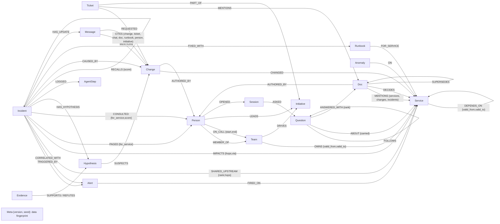

# On-call Brain

An AI on-call teammate. An alert fires; it tells you what broke, why, who is paged and the fix, with the proof from
your company's graph, and it remembers what you confirmed.

**In one breath:** an alert fires; three agent roles (triage, investigator, comms) work the incident through one
shared FalkorDB graph and find which change broke it, ruling out the other recent changes a change log would blame;
you confirm the cause, the graph remembers the fix, and the next similar incident is solved in 3 steps instead of 6.
It is an MCP server first (Claude Code, Claude Desktop, any MCP client), a webhook-in / Slack-out headless flow, and
a web inbox that is one window onto the same brain.

- **Problem:** when checkout slows down, the newest deploy is rarely the cause. The cause sits somewhere on the dependency path, and whether a dependency was even live at the time matters.
- **Result:** in the demo, every change-log method blames the wrong change (one blames a service checkout stopped calling three days ago); the graph agent names the payments-gateway config change two hops upstream, with the path and sources. On 200 randomised incidents it is right 186 times; the best non-graph method, 134.
- **How:** temporal multi-hop Cypher traversals, a hypothesis board the roles hand off through, and episodic + procedural memory, all in one graph per company. Claude chooses every step when a key is present (60/60 decisions, 0 fallbacks, see [docs/LLM_RUN.md](docs/LLM_RUN.md)); a deterministic planner runs the tests and key-less demos.

**Tracks entered:** 01 Agents That Act on Connected Data, 02 Agent Memory and Coordination, 03 Company Brain.
Built for Graph Hacks (WeMakeDevs x FalkorDB), October 2026. All data is synthetic (seeded generator, fake names).

<!-- DEMO VIDEO LINK: add after recording -->

**Live:** https://13-127-186-74.sslip.io/ runs the real thing on one AWS box: FalkorDB, the three agents on Claude
Opus 5.5 and the MCP server at `/mcp` (judges get the token with the submission). Press **Simulate an incident** and
watch the agents work; the limits that keep a public demo affordable are in [docs/SECURITY.md](docs/SECURITY.md).

**Try it without the server:** the web UI replays all three incidents from recorded runs (Claude Opus 5.5
choosing every step) when no backend is reachable, so the GitHub Pages build of `web/` (`.github/workflows/pages.yml`)
is a zero-setup look at the product; `?offline=1` does the same on the live site. For live runs, use the quick start below; to use it from Claude Code, see
[Use it from Claude Code](#use-it-from-claude-code-in-one-minute).


## The story the demo tells

**Act 1, 09:30: "checkout p99 latency above 2s".**
- Triage walks `DEPENDS_ON` backwards: checkout, api-gateway, web-frontend and mobile-bff are hurt. It pages whoever is on call for checkout (rotation edges in the graph).
- The investigator recalls past incidents first. An old checkout incident was caused by inventory, but inventory has no change today, so it moves on.
- It lists every change from the last 2 hours on services checkout depends on at alert time, plus the newest changes anywhere (what a flat change log would blame). Each suspect becomes a `Hypothesis` on the incident and is tested against the graph:

| Suspect | Verdict | Graph fact that decided it |
|---|---|---|
| search deploy, 8 min before (the newest change anywhere) | refuted | no `DEPENDS_ON` path from checkout to search |
| legacy-billing deploy | refuted | checkout's dependency on it was retired 3 days ago (`valid_to`) |
| pricing deploy | refuted | rolled back before the alert |
| cart deploy | refuted | cart shows no anomaly after the change |
| **payments-gw config change** (pool 200 -> 20) | **supported** | anomaly propagates payments-gw -> payments -> checkout, two hops |

- Both change logs without the graph get it wrong. The flat one blames the newest change (search). One that also watches anomalies blames legacy-billing: it deployed at 08:40 and threw errors at 08:45, before payments-gw went red. But checkout stopped calling legacy-billing 3 days ago, and only the temporal edge knows that.
- Comms pages the payments team, asks the graph who knows payments-gw best (`who_knows`, recorded as `CONSULTED`), warns refunds and subscriptions (they depend on the same gateway), and writes the status update for #incidents. It is stored on the incident as a `Message` that `CITES` its sources; nothing is sent to Slack. From `make demo`:

```text
[checkout p99 latency above 2s] status: cause identified, fix pending
Impact: api-gateway, checkout, mobile-bff, web-frontend
Likely cause: config change on payments-gw by Sana Brandt: "Lower payments-gw HTTP pool max_connections 200 -> 20 (cost cleanup)"
Ruled out: legacy-193 (dependency retired), search-420 (no dependency path), pricing-2140 (rolled back), cart-310 (no anomaly after it)
Paged: @asha.nakamura (Payments), @ravi.moreau (Checkout)
Also at risk: refunds, subscriptions
Ask: Sana Brandt (@sana.brandt, Payments) knows payments-gw best
Sources: msg:pay-deploys-1, ticket:CR-881, doc:cost-review-pgw
```

- A human confirms. The incident gets `CAUSED_BY` the change, a `Runbook` is learned for (payments-gw, config), and the update is rewritten as "resolved, cause confirmed". The human's call wins: confirming a different change than the agents picked makes that change the cause and outranks theirs.

**Act 2, three days later: "refunds p99 latency above 2s".**
Recall finds act 1 by structure, because payments-gw is on refunds' live dependency path and the symptom is the same. Text similarity plays no part. The runbook that fixed act 1 is for config changes on payments-gw, so the investigator suspects the new payments-gw config change first and confirms it in one check. **The same incident replayed without act 1's memory takes 6 investigator calls and finds the culprit on check 2; with the memory it takes 3 calls and finds it on check 1** (the UI shows both, via `?compare=memory`). The update adds "Next action: Revert the config change on payments-gw (this runbook worked 1 of 1 times)". Without the memory, nearest-first checking tries a newer, healthy payments deploy (`chg:pay-77`, 1 hop away) before the culprit. An anomaly-aware change log also gets act 2 right (the payments-gw change is the first to go red), so act 2 shows memory making the investigation shorter, not beating that baseline.

**Act 3, two days later: three alerts in 4 minutes** (checkout, refunds, subscriptions).
- Triage sees other recent alerts on the board and calls `correlate_alerts` first. It walks each alerting service's upstream services over edges live at alert time, notes which went red, projects the alerting services and their red upstreams into a scratch graph and lets `algo.WCC` say which alerts are one incident: the origin's component is folded in (`CORRELATED_WITH`), chains included, and the other components are separate storms. An alert that only shares a quiet cache is not connected at all and stays its own incident.
- The services all three reach are the shared upstream, ranked by convergence, the fewest total hops from the alerting services (payments 3, postgres-orders 5, ...), stored as `SHARED_UPSTREAM {rank, hops}`. The investigator checks suspects there first.
- The postgres-orders config change (max_connections 500 -> 150) is supported on check 1 and explains all 3 alerting services. The subscriptions deploy 30 minutes earlier is supported too (subscriptions blipped right after it), but explains only subscriptions. `conclude` keeps one leading cause and records the other as outranked: "chg:pg-conn-3 explains every alerting service this change does (1) and 2 more".
- Related alerts need not share one cause: a suspect that explains an alerting service the leader cannot is kept as a co-cause (its team is paged, the update says "Also contributing"), not ruled out (`tests/integration/test_storms.py`).
- Both change logs are wrong here: the flat one blames a search deploy, the anomaly-aware one blames the subscriptions deploy because it went red first. Without correlation, the same planner blames the subscriptions deploy too (`make demo` prints this ablation).


## Why the graph is not decoration

| What the agents do | FalkorDB feature doing the work | Without it |
|---|---|---|
| Blast radius, suspects, recall | variable-length `DEPENDS_ON*` traversals filtered per relationship by `valid_from`/`valid_to` at alert time | no multi-hop suspects; retired dependencies blamed |
| Refute "no path" suspects | `shortestPath` in `WITH` | the flat baseline's wrong answer stands |
| Alert storms | each alerting service's upstream closure over live edges; `algo.WCC` over the alerting services and their red upstreams decides which alerts are one incident (chains included, the rest are separate storms); the shared upstream ranked by total hops; suspects come from every folded alert, and each records which alerting services it can reach | each alert is investigated alone, and act 3 blames the subscriptions deploy |
| Cascade victim vs cause | `depends_among`: live `DEPENDS_ON*` among the supported suspects' services; an upstream suspect already red when a nearer change landed takes the lead | a deploy on a service that was already failing from upstream gets blamed because it is nearest |
| Shared state and handoffs | the `Incident` board: `Hypothesis`, `Evidence` (`SUPPORTS`/`REFUTES`), `AgentStep` nodes, re-read before every decision | agents can't coordinate; the planner has nothing to decide from |
| Memory | `RECALLS` -> `FIXED_WITH` -> `Runbook` -`FOR_SERVICE`-> service picks the first suspects; `uses`/`successes` set the runbook's confidence; persisted per tenant | the same incident takes 6 investigator calls instead of 3 |
| Company brain | `ask`: FalkorDB full-text indexes on `Doc`, `Ticket` and `Message` find the sources, then `MENTIONS` / `DECIDES` / `SUPERSEDES` / `AUTHORED_BY` / `CHANGED` / `OWNS` name the services, changes, teams and people, and flag docs a newer one superseded; `who_knows` (ownership + authored changes + incidents paged for + docs written, capped); `change_story` (ticket, chat, docs, author, incidents); conversation memory per engineer: given a `user`, `ask` keeps each question in the graph (`Session`, `Question`, `ABOUT`, `ANSWERED_WITH`), reads a follow-up's "it" as the previous question's subject, and answers "what did I ask about payments-gw" (`my_questions`); `Initiative` nodes connect people, projects and decisions: "what is the Q4 cost review changing and who is on it" walks its tickets to the changes they requested, the incidents those are blamed for, the people and the ADRs, and the status update says which project the cause was made for | keyword hits with no owner, no "is this still current?", nobody to ask, no memory of what you asked, no project behind a change |
| Keeping knowledge current | event tools write changes, anomalies, alerts and dependency start/end (`valid_from`/`valid_to`) as they happen | the next investigation works from stale facts |
| Safety, multi-tenancy, repeatable demo | `GRAPH.RO_QUERY` for every read, one graph per tenant, `GRAPH.COPY` for resets | |

All of the cause-finding is Cypher traversal: temporal variable-length paths, `shortestPath`, and intersecting upstream closures. Two graph algorithms take part in decisions: `algo.WCC` splits an alert storm (above), and criticality. `blast_radius` runs `algo.pageRank` over the dependency graph as it was at alert time and orders the impacted services by it (tier 1 first), and comms' `warn_owners` sends a heads-up to the on-call of the most critical impacted teams that nobody paged, before their own customers page them. The procedure never sees the tenant graph: FalkorDB's algorithms walk every edge, and the tenant graph keeps retired dependencies as history, so the live edges are projected into a scratch graph first, PageRank runs there, and the projection is dropped (`tests/integration/test_algorithms.py` plants a retired and a future dependency from every service and shows the order does not move). We tried `algo.betweenness` for ranking a storm's shared upstream and dropped it: its scores are sampled, so changing `samplingSeed` reorders the services even with `samplingSize` above the node count, and a score that blames a change has to be exact.

The full query catalogue is in [docs/QUERIES.md](docs/QUERIES.md); the data model in [docs/DATA_MODEL.md](docs/DATA_MODEL.md).

### Evaluation

On 200 generated incidents (random alert service, random cause 0-3 hops upstream, planted decoys of every kind above, plus noise anomalies in the window, a silent middle hop in some seeds and a cascade victim that deploys after the cause went red in others), from [docs/EVAL.md](docs/EVAL.md):

These scenarios are synthetic and written by the same team as the checks, so read the graph agent's score as "the checks hold up on this data", and the baselines' scores as what each shortcut gets wrong. The perturbations were added after mock judges called the first version (200/200) built to be passed, and the agent's ranking changed in the same round, by people who knew the perturbations: this is not a blind test. [docs/EVAL.md](docs/EVAL.md) has the per-perturbation table and every miss in the agent's own words.

| method | uses the graph | correct |
|---|---|---|
| **On-call Brain** (deterministic planner) | yes | **186/200 (93%)** |
| anomaly-aware change log: change behind the first service to go red | no | 134/200 (fooled by the retired-dependency decoy *d* 55 times, by decoy *c* made red by noise 11 times) |
| keyword match: change summary vs alert name | no | 57/200 |
| flat change log: newest change in the window | no | 0/200 (its pick is always a planted decoy) |

What fails: 14 misses. 12 are seeds where a random blip landed on decoy *c*'s service after its change, so *c* looks like a real, supported cause (26/38 correct on those seeds); 2 combine a silent middle hop with a cascade victim, whose complete chain then outranks the truth's gapped one. On the 66 seeds with only the planted story it is 66/66; with unrelated noise 82/94; with a silent middle hop 9/13; with a cascade victim 47/51.

The eval has single-alert incidents only; act 3's storm is checked by `make demo` and `test_act3_alert_storm_is_correlated_and_only_then_solved`, five more storms (two independent causes, alerts on one service, a quiet shared cache, memory that explains part of a storm, two changes on one service) by `tests/integration/test_storms.py`, and a cascade victim and a monitoring gap by `tests/integration/test_causality.py`. A whole incident (three agent roles, all reads and writes) takes about 85 ms (median over the eval, p95 126 ms) on the deterministic planner; a single tool's queries take 1-8 ms. At scale, the hot traversals avoid enumerating paths (candidates from the time indexes, `shortestPath` checked against edge validity, per-hop-filtered fallbacks, breadth-first closures with `CALL {}`): on a hub-heavy 1,000-service graph, `blast_radius` on the hub went from 2.6 s to 45 ms with identical results ([docs/PERF.md](docs/PERF.md)).

## Graph data model



- **Episodic memory:** `Incident` + `CAUSED_BY` + its `AgentStep` history. **Semantic:** the org, ownership and dependency facts, with `valid_from`/`valid_to` so the agents use what was true at alert time, plus the docs, tickets and chat about them. **Procedural:** `Runbook` + `FIXED_WITH`, with `uses`/`successes` counts.
- One graph per tenant (`tenant_<name>`), plus `pristine_<name>` for resets. The single `Meta` node fingerprints the seed data, so a reset never restores a copy made by an older generator.
- Every label except `Meta` is indexed on `id` and has a unique constraint on it, so FalkorDB refuses a duplicate even from a raw query; `Change.at` and `Anomaly.at` have range indexes for the alert-window filters; `Doc(title, text)`, `Ticket(title, text)` and `Message(text)` have FalkorDB full-text indexes for `ask`.
- Every label, property and relationship, with who writes it: [docs/DATA_MODEL.md](docs/DATA_MODEL.md).

### How the agents query it

Each agent step is one tool, and each tool runs named Cypher from `src/oncall_brain/adapters/falkordb/queries/*.cypher`
(all of them, with parameters and purpose, in [docs/QUERIES.md](docs/QUERIES.md)). The planner reads what came back
and picks the next step from it.

| Step | What it asks the graph | Query | Graph feature |
|---|---|---|---|
| Triage: blast radius | Which services depend on the alerting one through dependencies live at alert time, ranked by criticality | `blast_radius`, `criticality` | variable-length `DEPENDS_ON*` with `valid_from`/`valid_to` filters; `algo.pageRank` on a point-in-time projection |
| Triage: page | Who is on call now for the team that owned the service at alert time | `on_call_for` | `OWNS` and `ON_CALL` validity windows |
| Triage: storm | Which other alerts are the same incident | `storm_upstream`, `storm_components` | shared red upstreams; `algo.WCC` on a projection |
| Investigator: recall | Past incidents whose cause sat on this alert's live dependency path, and the runbook that fixed them | `recall_similar`, `memory_suspects` | episodic `CAUSED_BY` + procedural `FIXED_WITH` |
| Investigator: suspects | Every change in the window on a service the alerting services depend on | `path_suspects` | multi-hop traversal from the `Change.at` range index |
| Investigator: check | Did the anomaly travel from the suspect's service to the alert along a live path, and was that service already red before its change | `live_paths`, `anomalies_between`, `red_before` | `shortestPath`-ordered live paths; refutation when none exists |
| Comms: heads-up | The on-call of the most critical impacted teams nobody paged | `warn_candidates` | PageRank rank joined to ownership at alert time |
| Comms: update | The facts and sources the status update cites | `update_facts`, `post_update` | `CITES` edges to every source node |
| Ask (company brain) | Who owns or knows a service, why a decision was made, what an initiative changes, what "it" meant in the last question | `ownership`, `who_knows`, `initiative_story`, `session_context` | `DECIDES`/`SUPERSEDES`, `PART_OF`, `Session`/`Question` memory |

## Quick start (local, no Docker)

Needs Python 3.12 (or `uv`, which fetches it), `make`, and either glibc >= 2.39 (uses the `falkordblite` wheel) or gcc (builds redis and fetches the official FalkorDB module).

```bash
make setup     # venv + deps; FalkorDB binaries via falkordblite or scripts/falkordb_bin.sh
make db        # FalkorDB on :6379 (make db-stop saves and stops it)
make seed      # rebuild graph tenant_acme from scratch with the synthetic company (+ a pristine copy for resets)
make demo      # all three acts and both ablations in the terminal, with the trace; exits non-zero if the story breaks
make dev       # API + web UI on http://localhost:8000
make test      # unit + integration tests (integration tests skip if FalkorDB is not running)
```

No LLM key is needed: by default one deterministic planner plays all three roles, choosing each step by fixed rules from what the graph returns. To let an LLM choose the tools instead, set `LLM_PROVIDER` (gemini, openai, groq, openrouter, ollama, anthropic) and a key in `.env` (see `.env.example`). If the model picks an unknown tool, invalid arguments or a repeated step, or the API fails, that step falls back to the deterministic planner and the trace says so. With Claude Opus 5.5 or Sonnet 5.5 choosing every step, the full story (acts 1-3, 60 decisions) finds the right cause in all four runs with zero fallbacks: [docs/LLM_RUN.md](docs/LLM_RUN.md). The 200-incident eval numbers come from the deterministic planner.

## Use it from Claude Code in one minute

```bash
make setup && make db && make seed                     # the venv, FalkorDB and the demo company
claude --plugin-dir ./plugin                           # Claude Code with the oncall-brain plugin, from this checkout
```

Or, with nothing local, point the plugin at a deployed instance ([docs/DEPLOY.md](docs/DEPLOY.md)): its second server
entry, `oncall-brain-remote`, connects over Streamable HTTP with the URL and token from your environment.

```bash
ONCALL_BRAIN_URL=https://oncall.example.com ONCALL_BRAIN_TOKEN=<its MCP_TOKEN> claude --plugin-dir ./plugin
```

Or install it from the marketplace this repo carries (Claude Code 2.1.275 or later), then start `claude` anywhere:

```
/plugin install oncall-brain --marketplace <owner>/<repo>
```

The plugin (`plugin/`) ships the MCP server (launched over stdio by `plugin/bin/oncall-brain-mcp`; set
`ONCALL_BRAIN_HOME` to the checkout when the plugin lives elsewhere; or reached over Streamable HTTP by the
`oncall-brain-remote` entry when `ONCALL_BRAIN_URL` and `ONCALL_BRAIN_TOKEN` are set) and three skills:
`/oncall-brain:incident alert:checkout-latency`, `/oncall-brain:who-owns kafka`,
`/oncall-brain:ask why was legacy-billing retired from the checkout path`. Without the plugin, the server alone:
`claude mcp add --transport stdio oncall-brain -- <venv>/bin/python -m oncall_brain.mcp_server`.
`tests/integration/test_plugin.py` validates the manifests (with `claude plugin validate --strict` when the CLI is
installed), drives the server through the plugin's launcher with an MCP client, following the who-owns skill, and
reaches a local `--http` server started with `API_TOKEN` through the remote entry, expanded as Claude Code expands it.

Then, in Claude Code: *"checkout is slow and alert:checkout-latency just fired on tenant acme. Find out why."* Claude
calls `respond_to_alert`, reads the outcome (likely cause with a confidence label, who was paged, what was ruled out
and why, the fix, the status update) and, when you say the cause is right, `resolve_incident` so the fix is remembered.
*"Who owns kafka?"*, *"why was legacy-billing retired?"* go to `ask`. The server also publishes two prompts
(`work_alert`, `company_question`) that script those two workflows. Given only the tool list, Claude Opus 5.5 picks the
right tool for 17 of 17 plain requests ([docs/MCP_PICK.md](docs/MCP_PICK.md)). For Claude Desktop / claude.ai use the
Streamable HTTP transport with `API_TOKEN`; everything is in [docs/MCP.md](docs/MCP.md).

## Using it

- **Web inbox** (`make dev`, then http://localhost:8000): the inbox on the left lists incidents with their state (Investigating, Cause found, Needs a human, Confirmed). **Simulate an incident** (top right) runs one of three scripted alerts, or a custom alert on any service, with the agents working live. The incident leads with the answer: the likely cause with a confidence label and byline, **Confirm cause** / **Wrong cause**, what broke, who is paged, the fix, the suspects ruled out with one-line reasons, the dependency path, the status update as it lands in Slack, and what a change log alone would have blamed. **Show me why** is the proof: the incident subgraph (what the agents touched plus one hop, or the whole company), the steps grouped by agent (1 Triage, 2 Investigator, 3 Comms) with the model's one-line reason and a Claude / Rules badge per step, and the exact Cypher behind every call. The second incident shows the memory moment ("Seen this before: 3 steps instead of 6"). **Ask the brain** is a chat with source chips; **Connect** shows the webhook, MCP, Slack and your-own-data hooks. With no reachable API (`?offline=1`, or the GitHub Pages build) the UI replays recorded runs.
- **Headless:** `POST /api/tenants/{t}/alerts?respond=true` with `{service, symptom, name}` records an alert, runs the agents, stores the incident and its update in the graph and, with `SLACK_WEBHOOK_URL`, posts the update to Slack. `POST .../alerts/{alert_id}/respond/stream` streams the run step by step (NDJSON); `GET .../incidents/{id}` returns a stored incident with its outcome and steps.
- **HTTP API:** `GET /api/tools` lists every tool with its JSON schema; `POST /api/tenants/{tenant}/tools/{name}` runs one. Use-case endpoints: `POST /api/tenants/{t}/reset`, `POST /api/tenants/{t}/alerts/{alert_id}/respond` (add `?compare=memory` to also get `ablation.without_memory`: the same alert replayed on a scratch copy of the pristine graph, dropped afterwards), `POST /api/tenants/{t}/incidents/{id}/resolve`.
- **MCP:** the same 26 registry tools, plus `respond_to_alert` and `reset_tenant` (28 in all), every argument described, two prompts, for any MCP client. Agent runs are offered 17 of the registry tools: `resolve_incident`, `my_questions` and the seven event tools are for humans and outside clients only, so an agent can neither confirm its own fix nor invent graph facts (the agent loop also refuses them if a planner names one). Run `make mcp` for stdio, or `python -m oncall_brain.mcp_server --http --port 8001` (bearer token when `API_TOKEN` is set). Details in [docs/MCP.md](docs/MCP.md).
- **Company brain** questions, as tools: `ask` (a free-form question answered from docs, tickets and chat: full-text search, then the graph around the hits, then an answer assembled from those facts with every source cited; no LLM), `who_knows` (who knows a service, ranked by ownership, changes they authored, incidents they were paged for and, capped at 3, docs, tickets and chat they wrote about it) and `change_story` (trace a change to its ticket, chat, docs, author and the incidents it caused). For example, `ask` "Why was the payments gateway pool lowered?" leads with the Q4 cost review design note by Sana Brandt ("Decision: lower the pool max_connections from 200 to 20, which cuts the gateway bill by about 40%"), links `chg:pgw-pool-1`, and lists the peak load test postmortem that warned against it among its sources. Given a `user`, `ask` remembers each question in that person's session in the graph: "and who is on call for it?" is read as the previous question's service, and `my_questions` (or asking "what did I ask about payments-gw") lists earlier questions with their sources. An `Initiative` node ties the work together: "what is the Q4 cost review changing" walks its tickets to the changes they requested, the services and the incidents those changes are blamed for, "who is on it" names the lead, the filers and the change authors, and the status update's "Behind it:" line names the project behind the cause (`tests/integration/test_initiatives.py`).
- **Live events**, as tools: `record_change`, `record_anomaly`, `raise_alert`, `add_dependency`, `retire_dependency`, `record_doc`, `transfer_ownership`. Push a change and an anomaly, raise an alert, then respond to it: the agents use the new facts at once. Record a new decision record that supersedes an old one and `ask` puts it first and flags the old one (`test_a_new_decision_record_flips_the_ask_answer_and_flags_the_old_one`). Hand a service to another team and `OWNS` keeps the history (`valid_from`, `valid_to`): "who owns payments-gw" flips, "who owned payments-gw at the time of inc:0911" does not, and an alert pages the team that owned the service at the alert's time (`tests/integration/test_ownership.py`).
- **Exposure:** the API checks the `Host` header (`ALLOWED_HOSTS`) and refuses cross-origin POSTs. `API_TOKEN` optionally requires a bearer token on `/api/*` (not `/api/health`; the bundled UI does not send it). There is no per-user auth: anyone who can reach the API can address any tenant. Keep it on localhost unless you set these.


## Docker

```bash
docker compose up --build    # falkordb/falkordb:v4.22.0 + the app on :8000 (+ FalkorDB Browser on :3000)
```

Ports are published on 127.0.0.1 only. The app container seeds the default tenant if its graph is missing, then serves the UI and API, the MCP endpoint at `/mcp` (with `MCP_TOKEN` set) and `/health` on `$PORT` (default 8000) from one process (`oncall_brain.serve`). For a live deployment (FalkorDB Cloud + Render via `render.yaml`, a checklist of sign-ins and pastes; or any Docker VM), see [docs/DEPLOY.md](docs/DEPLOY.md).

## How each track is covered

| Track | What to look at |
|---|---|
| 01 Agents That Act on Connected Data | multi-hop `DEPENDS_ON*` suspects with temporal edge filters; `shortestPath` refutations; alert-storm correlation: `algo.WCC` on a projection of the alerting services and their red upstreams decides which alerts are one incident (chains included, the rest are separate storms; `test_a_chained_storm_is_one_incident_by_wcc_and_the_far_cause_is_a_co_cause`), the shared upstream is ranked by convergence, and `conclude` keeps the cause that explains the most alerting services plus any co-cause (`test_act3_alert_storm_is_correlated_and_only_then_solved`, `tests/integration/test_storms.py`); a deploy on a cascade victim loses to the upstream change that was already red when it landed, and a silent middle hop is weaker support named as a monitoring gap, not a refutation (`tests/integration/test_causality.py`); the planner branches on what each query returns; actions written back (incident, impacts, pages, hypotheses, evidence, the consulted expert, status update); live events written through tools (`record_change`, `record_anomaly`, `raise_alert`, `add_dependency`, `retire_dependency`, `record_doc`, `transfer_ownership`); criticality by `algo.pageRank` on a point-in-time projection of the live dependencies decides which impacted teams get the heads-up first (`warn_owners`, `test_criticality_comes_from_the_dependencies_live_at_alert_time_not_from_history`); tools exposed via MCP; every step's Cypher in the trace |
| 02 Agent Memory and Coordination | three roles hand off through the shared `Incident` board (no in-process state; by default one deterministic planner plays all three roles); same-incident memory ablation: act 2 replayed on a copy of the pristine graph takes 6 investigator calls and finds the culprit on check 2, with memory 3 calls and check 1 (`?compare=memory`, shown in the UI); `AgentStep` history persisted per incident; episodic + semantic + procedural memory, where the runbook decides what memory suspects and loses confidence when refuted; act 2 recalls act 1; one graph per tenant (`test_tenants_are_isolated`); concurrency measured, not asserted: unique `id` constraints on every label, a per-tenant Redis lock around agent runs and write tools, reads that never wait, and a reset that swaps graphs atomically (`GRAPH.COPY` + `RENAME`); 8 tenants at once, 1,236 reads during locked agent runs with 0 errors, 600 contended writes with 0 duplicates, p50/p95/p99 in [docs/PERF.md](docs/PERF.md#concurrency) (`tests/integration/test_concurrency.py`); conversation memory per engineer and per session in the same graph: `Session` and `Question` nodes with `FOLLOWS`, `ABOUT` and `ANSWERED_WITH`, so a follow-up's "it" resolves and "what did I ask about payments-gw" is a query, isolated per user and cleared by a tenant reset (`tests/integration/test_sessions.py`) |
| 03 Company Brain | a small synthetic corpus in the same graph as the services and incidents: 34 docs (postmortems, design notes, decision records, runbook pages), 41 chat messages, 21 tickets and 3 initiatives (a team `DRIVES` one, a person `LEADS` it, tickets are `PART_OF` it, docs `MENTION` it), linked by `MENTIONS`, `AUTHORED_BY`, `DECIDES`, `SUPERSEDES` and `PART_OF`; `ask` answers a free-form question from FalkorDB full-text search plus graph expansion, puts a current doc before the one it superseded, and cites every source (`tests/integration/test_brain.py`); `who_knows` / `change_story` also count docs; all three in the UI's Ask tab; every status update cites its sources and the person to ask (`CITES` edges); keeping knowledge current: temporal dependencies, plus event tools that record changes, anomalies, alerts and retired dependencies as they happen (`test_live_events_drive_a_new_investigation`), and `record_doc`, which writes a new decision record (with what it supersedes) so `ask` puts it first and flags the old one at once (`test_a_new_decision_record_flips_the_ask_answer_and_flags_the_old_one`); ownership with history: `OWNS {valid_from, valid_to}` and `transfer_ownership`, so "who owns" flips, "who owned payments-gw at the time of inc:0911" does not, and `who_knows` still credits the team that ran it (`tests/integration/test_ownership.py`); people, projects and decisions: "what is the Q4 cost review changing and who is on it" is a walk over `Initiative`, `PART_OF`, `REQUESTED`, `CHANGED`, the blamed incidents, `LEADS`, `AUTHORED_BY` and `MENTIONS`, and every status update names the initiative behind its cause (`tests/integration/test_initiatives.py`). Answers are assembled from graph facts and quoted sentences, not written by an LLM |

## Repo layout

```
src/oncall_brain/
  domain/        pure logic: planner, hypothesis verdicts, update templates, models
  ports/         Protocols: GraphRepository, GraphStore, LLMProvider
  adapters/      falkordb/ (repository + queries/*.cypher), llm/ (mock, openai_compat, anthropic)
  services/      use cases: respond, resolve, seeding, the tool implementations, board loader, brain (`ask`)
  agents/        tool registry and the agent loop
  api/           FastAPI app (also serves web/)
  mcp_server/    MCP server generated from the same registry
  datagen.py     the seeded synthetic company, its docs, tickets and chat, and the planted three-act story
  scenarios.py   randomised incidents for the eval
web/             no-build UI (Cytoscape.js from a CDN)
scripts/         seed, demo, eval, gen_queries_doc, gen_fixtures, FalkorDB runners
tests/           unit/ (no DB), integration/ (real FalkorDB)
docs/            architecture, data model, queries, eval, MCP, deploy, walkthrough, ADRs, AI usage
```

## More

- [docs/ARCHITECTURE.md](docs/ARCHITECTURE.md): design (HLD/LLD), diagrams, trade-offs
- [docs/DATA_MODEL.md](docs/DATA_MODEL.md): every label and relationship
- [docs/QUERIES.md](docs/QUERIES.md): every Cypher query the product runs (generated)
- [docs/EVAL.md](docs/EVAL.md): graph agent vs baselines on generated incidents
- [docs/PERF.md](docs/PERF.md): query timings from 25 to 1,000 services, before and after the traversal rewrite
- [docs/MCP.md](docs/MCP.md): use the same tools from any MCP client
- [docs/DEPLOY.md](docs/DEPLOY.md): live deployment (FalkorDB Cloud + Render, or any Docker VM)
- [docs/WALKTHROUGH.md](docs/WALKTHROUGH.md): a 30-minute tour of the code
- [docs/decisions/](docs/decisions/): ADRs, including the idea council
- [docs/AI_USAGE.md](docs/AI_USAGE.md): how AI assistants were used
