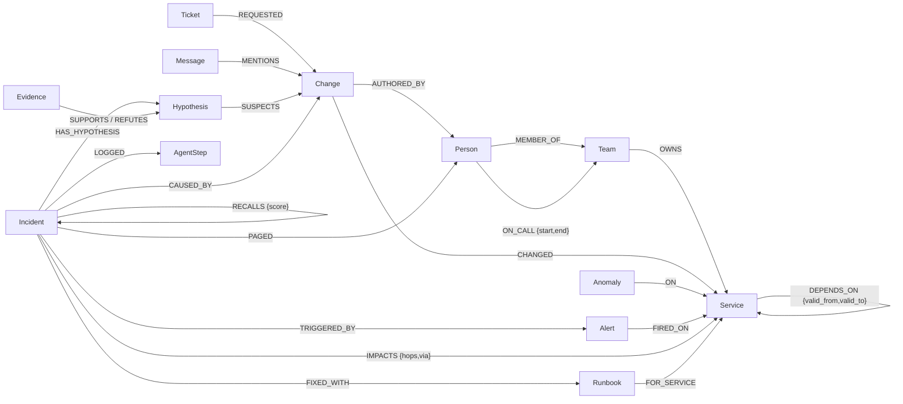

# On-call Brain

Incident agents that reason over a FalkorDB graph and remember what fixed things.

When an alert fires, three agents (triage, investigator, comms) work one incident together through a shared graph: who is hurt, which change broke it, who to page, what to tell people. When a human confirms the fix, the graph remembers it, and the next similar incident is solved in a fraction of the steps.

**Tracks entered:** 01 Agents That Act on Connected Data, 02 Agent Memory and Coordination, 03 Company Brain.
Built for Graph Hacks (WeMakeDevs x FalkorDB), October 2026. All data is synthetic (seeded generator, fake names).

<!-- DEMO VIDEO LINK: add after recording -->


## The story the demo tells

**Act 1, 09:30: "checkout p99 latency above 2s".**
- Triage walks `DEPENDS_ON` backwards: checkout, api-gateway, web-frontend and mobile-bff are hurt. It pages whoever is on call for checkout (rotation edges in the graph).
- The investigator recalls past incidents first. An old checkout incident was caused by inventory, but inventory has no change today, so it moves on.
- It lists every change from the last 2 hours on services checkout depends on at alert time, plus the newest changes anywhere (what a flat change log would blame). Each suspect becomes a `Hypothesis` on the incident and is tested against the graph:

| Suspect | Verdict | Graph fact that decided it |
|---|---|---|
| search deploy, 8 min before (the newest change anywhere) | refuted | no `DEPENDS_ON` path from checkout to search |
| legacy-billing deploy | refuted | checkout's dependency on it was retired 3 days ago (`valid_to`) |
| pricing deploy | refuted | rolled back before the alert |
| cart deploy | refuted | cart shows no anomaly after the change |
| **payments-gw config change** (pool 200 -> 20) | **supported** | anomaly propagates payments-gw -> payments -> checkout, two hops |

- Comms pages the payments team, warns refunds and subscriptions (they depend on the same gateway), and posts a status update citing the change ticket and the chat message that announced it.
- A human confirms. The incident gets `CAUSED_BY` the change, and a `Runbook` is learned for (payments-gw, config).

**Act 2, three days later: "refunds p99 latency above 2s".**
Recall finds act 1 by structure, because payments-gw is on refunds' live dependency path and the symptom is the same. Text similarity plays no part. The investigator tests the remembered cause first and confirms it in one check: **8 investigator calls on act 1, 3 on act 2.** Replayed on a graph without act 1's memory, act 2 takes 5 calls and checks 3 hypotheses.

## Why the graph is not decoration

| What the agents do | FalkorDB feature doing the work | Without it |
|---|---|---|
| Blast radius, suspects, recall | variable-length `DEPENDS_ON*` traversals filtered per relationship by `valid_from`/`valid_to` at alert time | no multi-hop suspects; retired dependencies blamed |
| Refute "no path" suspects | `shortestPath` in `WITH` | the flat baseline's wrong answer stands |
| Shared state and handoffs | the `Incident` board: `Hypothesis`, `Evidence` (`SUPPORTS`/`REFUTES`), `AgentStep` nodes, re-read before every decision | agents can't coordinate; the planner has nothing to decide from |
| Memory | `CAUSED_BY`, `FIXED_WITH`, `RECALLS`, `Runbook` success counts, persisted per tenant | act 2 is as slow as act 1 |
| Company brain | `who_knows` (ownership + authored changes + incidents), `change_story` (ticket, chat, author, incidents) | no sourced answers |
| Safety, multi-tenancy, repeatable demo | `GRAPH.RO_QUERY` for every read, one graph per tenant, `GRAPH.COPY` for resets | |

The full query catalogue is in [docs/QUERIES.md](docs/QUERIES.md); the data model in [docs/DATA_MODEL.md](docs/DATA_MODEL.md).

### Measured, not just claimed

On 200 generated incidents (random alert service, random cause 0-3 hops upstream, planted decoys of every kind above), from [docs/EVAL.md](docs/EVAL.md):

| method | uses the graph | correct |
|---|---|---|
| **On-call Brain** (deterministic planner) | yes | **200/200** |
| keyword match: change summary vs alert name | no | 59/200 |
| flat change log: newest change in the window | no | 0/200 (its pick is always a planted decoy) |

A whole incident (three agents, all reads and writes) takes about 70 ms on the deterministic planner; a single tool's queries take 1-7 ms.

## Graph data model



- **Episodic memory:** `Incident` + `CAUSED_BY` + its `AgentStep` history. **Semantic:** the org, ownership and dependency facts, with `valid_from`/`valid_to` so the agents use what was true at alert time. **Procedural:** `Runbook` + `FIXED_WITH`, with `uses`/`successes` counts.
- One graph per tenant (`tenant_<name>`), plus `pristine_<name>` for resets. Every label is indexed on `id`; `Change.at` and `Anomaly.at` have range indexes for the alert-window filters.
- Every label, property and relationship, with who writes it: [docs/DATA_MODEL.md](docs/DATA_MODEL.md).

## Quick start (local, no Docker)

Needs Python 3.12+, `make`, and either glibc >= 2.39 (uses the `falkordblite` wheel) or gcc (builds redis and fetches the official FalkorDB module).

```bash
make setup     # venv + deps; FalkorDB binaries via falkordblite or scripts/falkordb_bin.sh
make db        # FalkorDB on :6379 (make db-stop saves and stops it)
make seed      # synthetic company into graph tenant_acme (+ a pristine copy for resets)
make demo      # both acts end to end in the terminal, with the trace; exits non-zero if the story breaks
make dev       # API + web UI on http://localhost:8000
make test      # unit + integration tests (integration tests skip if FalkorDB is not running)
```

No LLM key is needed: by default a deterministic planner chooses each step from what the graph says. To let an LLM choose the tools instead, set `LLM_PROVIDER` (gemini, openai, groq, openrouter, ollama, anthropic) and a key in `.env` (see `.env.example`). If the model picks an unknown tool, invalid arguments or a repeated step, or the API fails, that step falls back to the deterministic planner and the trace says so.

## Using it

- **Web UI** (`make dev`, then http://localhost:8000): click 0 Reset, 1 Act 1, 2 Confirm root cause, 3 Act 2. The trace plays step by step; every card shows why the planner chose that tool and the exact Cypher it ran; clicking a card lights up its evidence in the graph. `?offline=1` replays recorded fixtures without a database.
- **HTTP API:** `GET /api/tools` lists every tool with its JSON schema; `POST /api/tenants/{tenant}/tools/{name}` runs one. Use-case endpoints: `POST /api/tenants/{t}/reset`, `POST /api/tenants/{t}/alerts/{alert_id}/respond`, `POST /api/tenants/{t}/incidents/{id}/resolve`.
- **MCP:** the same 14 tools, plus `respond_to_alert` and `reset_tenant`, for any MCP client. Run `make mcp` for stdio, or `python -m oncall_brain.mcp_server --http --port 8001`. For Claude Code: `claude mcp add --transport stdio oncall-brain -- <venv>/bin/python -m oncall_brain.mcp_server`. Details in [docs/MCP.md](docs/MCP.md).
- **Company brain** questions, as tools: `who_knows` (who knows a service, ranked by ownership, changes they authored and incidents they were paged for) and `change_story` (trace a change to its ticket, its chat announcement, its author and the incidents it caused).

## Docker

```bash
docker compose up --build    # falkordb/falkordb:v4.22.0 + the app on :8000 (+ FalkorDB Browser on :3000)
```

## How each track is covered

| Track | What to look at |
|---|---|
| 01 Agents That Act on Connected Data | multi-hop `DEPENDS_ON*` suspects with temporal edge filters; `shortestPath` refutations; the planner branches on what each query returns; actions written back (incident, impacts, pages, hypotheses, evidence, status update); tools exposed via MCP; every step's Cypher in the trace |
| 02 Agent Memory and Coordination | three roles hand off through the shared `Incident` board (no in-process state); `AgentStep` history persisted per incident; episodic + semantic + procedural memory; act 2 recalls act 1; one graph per tenant (`test_tenants_are_isolated`) |
| 03 Company Brain | changes, tickets, chat, incidents, runbooks and people in one graph; `who_knows` / `change_story`; every status update cites its sources (`CITES` edges); temporal dependencies keep answers current |

## Repo layout

```
src/oncall_brain/
  domain/        pure logic: planner, hypothesis verdicts, update templates, models
  ports/         Protocols: GraphRepository, GraphStore, LLMProvider
  adapters/      falkordb/ (repository + queries/*.cypher), llm/ (mock, openai_compat, anthropic)
  services/      use cases: respond, resolve, seeding, the tool implementations, board loader
  agents/        tool registry and the agent loop
  api/           FastAPI app (also serves web/)
  mcp_server/    MCP server generated from the same registry
  datagen.py     the seeded synthetic company and the planted two-act story
  scenarios.py   randomised incidents for the eval
web/             no-build UI (Cytoscape.js from a CDN)
scripts/         seed, demo, eval, gen_queries_doc, gen_fixtures, FalkorDB runners
tests/           unit/ (no DB), integration/ (real FalkorDB), cloud/ (reviewer's tests)
docs/            architecture, data model, queries, eval, MCP, walkthrough, ADRs, AI usage
```

## More

- [docs/ARCHITECTURE.md](docs/ARCHITECTURE.md): design (HLD/LLD), diagrams, trade-offs
- [docs/DATA_MODEL.md](docs/DATA_MODEL.md): every label and relationship
- [docs/QUERIES.md](docs/QUERIES.md): every Cypher query the product runs (generated)
- [docs/EVAL.md](docs/EVAL.md): graph agent vs baselines on generated incidents
- [docs/MCP.md](docs/MCP.md): use the same tools from any MCP client
- [docs/WALKTHROUGH.md](docs/WALKTHROUGH.md): a 30-minute tour of the code
- [docs/decisions/](docs/decisions/): ADRs, including the idea council
- [docs/AI_USAGE.md](docs/AI_USAGE.md): how AI assistants were used
