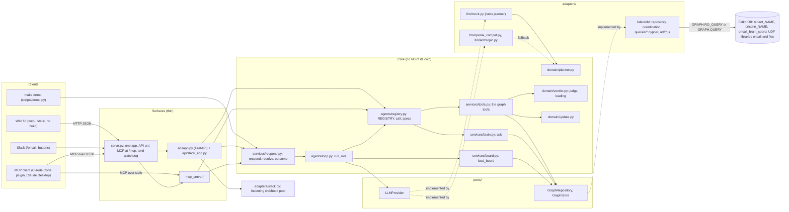
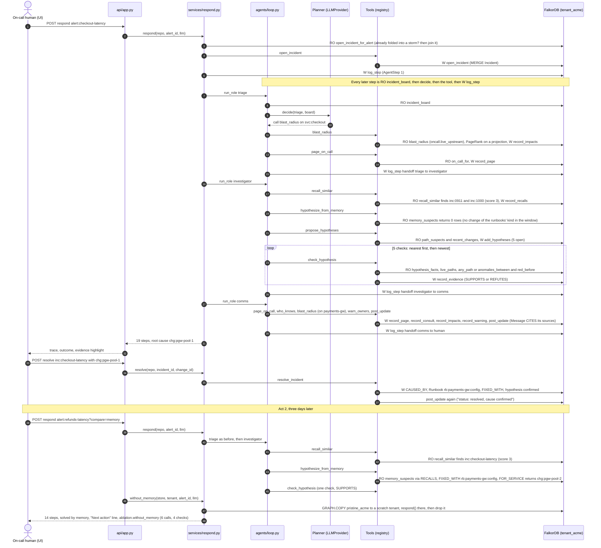
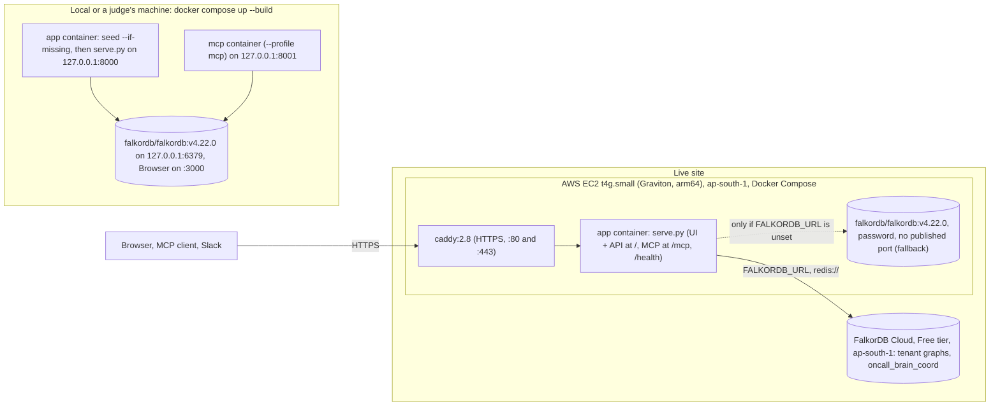

# Architecture

On-call Brain is a small team of incident agents (triage, investigator, comms) and a company brain, working on one
FalkorDB graph per company: its services, dependencies, owners, on-call shifts, changes, docs, tickets, chat and past
incidents. The agents share one incident board that lives in the graph. When a human confirms a fix, it becomes
memory that the next incident recalls. By default one deterministic planner (rules that pick each step from what the
graph returns) plays the three roles. With an LLM key, a model picks each step behind the same port, and the rules
take any step it gets wrong.

This document follows the system-design order: requirements, high-level design, deep dive, scale and reliability,
trade-offs. It names the real modules and functions, so you can open each file next to its section.

Related documents:
- [DATA_MODEL.md](DATA_MODEL.md): every label, relationship, property, index and constraint.
- [QUERIES.md](QUERIES.md): every named Cypher query and its purpose (generated by `make docs`).
- [EVAL.md](EVAL.md): the graph planner against three baselines without the graph, over 200 seeded scenarios.
- [PERF.md](PERF.md): query timings up to 2,500 services, and the concurrency benchmark.
- [DEPLOY.md](DEPLOY.md): the live site (an AWS box, graphs on FalkorDB Cloud), Render, any Docker VM.
- [MCP.md](MCP.md), [SECURITY.md](SECURITY.md).

---

## 1. Requirements

### 1.1 Functional

| # | The system must... | Where it happens |
|---|---|---|
| F1 | Open an incident for an alert and make it the shared board for all agents. | `open_incident` tool and query |
| F2 | Find who is hurt: every service that depends on the alerting service, directly or through others, using only dependencies live at alert time. | `blast_radius` (the `oncall.live_upstream` UDF) |
| F3 | Find and page whoever is on call, at alert time, for the team that owned the service at alert time. | `page_on_call`, `on_call_for` |
| F4 | List suspects: changes in the 2 hours before the alert on any service an alerting service depends on, plus the newest changes anywhere, so the graph can refute what a flat change log would blame. | `propose_hypotheses`, `path_suspects`, `recent_changes` |
| F5 | Test each suspect against graph facts and record a verdict (supports or refutes) with a reason and a short tag. When several survive, keep one leading cause, say why each other one lost, keep co-causes, and never blame a cascade victim. | `check_hypothesis`, `conclude`, `domain/verdict.py` |
| F6 | Hand off between roles through the graph, not through Python variables. | `incident_board`, `log_step`, `agents/loop.py` |
| F7 | Write a status update for #incidents: impact, cause, the project behind it, ruled-out suspects, who was paged and warned, who to ask, the next action, sources. It is stored on the incident; the headless webhook also posts it to Slack when `SLACK_WEBHOOK_URL` is set. | `post_update`, `domain/update.py` |
| F8 | Turn a human-confirmed fix into memory and recall it on the next similar incident. The runbook that fixed it decides what to suspect first. A human's call overrides the agents' pick. Show what memory saved by replaying the same incident without it. | `resolve_incident`, `recall_similar`, `hypothesize_from_memory`, `respond?compare=memory` |
| F9 | Answer company questions with sources: who owns or knows a service, why a decision was made, how to fix something, what happened, what a project is changing. | `ask`, `who_knows`, `change_story` |
| F10 | Explain every answer: the reason for each step, the Cypher it ran, rows, timing (FalkorDB's own execution time and plan cache), the plan on demand, and the graph ids to highlight. | `TraceStep`, `QueryRun`, `query_plan`, `Highlight` |
| F11 | Expose the same tools to the agent loop, MCP clients and the HTTP API. | `agents/registry.py` |
| F12 | Keep each company's data in its own graph, and reset the demo to a pristine state. | `FalkorGraphStore`, `GRAPH.COPY` |
| F13 | Keep knowledge current: record changes, anomalies, alerts, dependencies, docs, chat, tickets and ownership as they happen, with the time the graph learned each fact. | the event tools, `recorded_at`, `learned_late` |
| F14 | Treat an alert storm as one incident: fold in the alerts within 15 minutes that are connected to this one through upstream services that went red, rank what they all depend on, and prefer the suspect that explains the most alerting services. | `correlate_alerts` (`algo.WCC`), `conclude` |
| F15 | Never answer about a service that does not exist: every service argument is resolved against the graph, and an unknown name is refused with the closest ones. | `registry.call`, `resolve_service` |

### 1.2 Non-functional

Measured on a laptop with FalkorDB v4.22.0 on redis 8.10.2 and the seeded demo graph (EVAL.md, PERF.md).

| NFR | Target | Measured | How to check |
|---|---|---|---|
| Latency per graph tool | < 50 ms | slowest tool on average is `post_update`, 8.9 ms of queries per call (p95 12.8); `check_hypothesis` 2.8 ms; the board read before each decision 1.3 ms | `make demo` prints queries, rows and ms per step; the UI shows FalkorDB's execution time per query |
| Latency per incident | < 1 s on the rules planner | `respond()` p50 105 ms, p95 152 ms over 200 eval incidents. On a model, a run takes 60-150 s, almost all of it model time | `make eval` |
| Bounded reads | no read can hold a database thread | every read runs with a 3 s server-side timeout (`READ_TIMEOUT_MS`); FalkorDB aborts it past that, the API answers 503 | `config.py`, `FalkorRepository._send` |
| No LLM key needed | demo, tests, UI and MCP all work without one | `MockProvider` (the rules planner) is the default | `GET /api/health` shows `planner` |
| Read safety | read tools cannot write | every read is `GRAPH.RO_QUERY`; FalkorDB rejects writes | `test_read_tools_cannot_write` |
| Tenant isolation | no tool reaches another tenant's graph | one graph per tenant. This is data isolation, not access control: any caller who can reach the API can name any tenant | `test_tenants_are_isolated` |
| Exposure | safe on a laptop | compose publishes on 127.0.0.1 only; the API checks `Host` (400), refuses cross-origin POSTs (403) and can require `API_TOKEN` (401); MCP over HTTP checks `Host`/`Origin` and takes a bearer `MCP_TOKEN`, which a deployment (`serve.py`) requires | `test_cross_origin_writes_and_unknown_hosts_are_refused`, `test_api_token_guards_api_but_not_health_or_ui`, `test_mcp_over_http_refuses_foreign_host_and_origin` |
| Idempotency | re-loading and re-running are safe | `MERGE` on stable ids everywhere; a seed rebuilds from scratch | `test_ingest_is_idempotent_and_seed_rebuilds_from_scratch`, `test_agent_steps_persist_in_the_graph_and_respond_is_idempotent` |
| Concurrency | no duplicate ids, edges or work; reads never wait | UNIQUE `id` on every label, UNIQUE `DEPENDS_ON.key`, a per-tenant lease around agent runs and write tools (3.7), lock-free reads, atomic graph swaps on reset. 8 tenants at once in 456 ms against 914 ms one after another; 1,548 reads during 6 locked runs with 0 errors; 400 contended writes with 0 duplicates (PERF.md) | `tests/integration/test_concurrency.py` (7 tests), `test_concurrent_responders_do_not_duplicate_work_or_edges` |
| Failure behaviour | a clear error, not a hang; a bad model reply never breaks a run | FalkorDB down: 503, and `/api/health` still answers with `falkordb: false`. Model errors, and tool errors from a model's choice, fall back to the rules planner | `api/app.py` exception handlers, `test_a_bad_tool_choice_falls_back_instead_of_aborting` |
| Repeatability | the demo gives the same result every run | fixed seed, pinned demo clock (`datagen.T1`), epoch-int times, reset from a pristine copy | `make demo` exits non-zero if the story breaks |

### 1.3 Constraints

- Hackathon rules: FalkorDB is the primary database and does real work. Data is synthetic. AI assistance is
  disclosed ([AI_USAGE.md](AI_USAGE.md)).
- Every feature works without an LLM key (judges, CI, tests), so the rules planner is the floor. The LLM adapters
  are tested against canned HTTP replies.
- FalkorDB Cloud's Free tier gives its users the graph commands but no `SET`, `INCR` or `EVAL`, no TLS and no
  persistence. So locks and counters are graph nodes (3.7), and a watchdog restores what a restart loses (4.5).
- I built it alone, with AI coding help ([AI_USAGE.md](AI_USAGE.md)), so the rule was the least code that works.

---

## 2. High-level design

### 2.1 Components

`serve.py` is what the Dockerfile runs. Locally, `make dev` runs `api/app.py` alone and `make mcp` runs the MCP
server over stdio.

How data flows: a client asks to respond to an alert. `respond()` takes the tenant's lease, opens the incident and
runs the roles in turn. Before every decision the loop reads the incident board from FalkorDB. The planner (or a
model) sees only that board and picks the next tool. `registry.call` resolves any service argument against the graph,
validates the arguments and runs the tool. The tool runs named Cypher through the `GraphRepository` port, writes its
findings back to the graph and returns a `ToolOutput` (summary, data, the queries it ran, the ids to highlight). The
loop records the step in the trace and as an `AgentStep` node. The next decision sees it because it reads the board
again.

### 2.2 Main flow: act 1, human resolve, act 2

What the default seed gives (`make demo` prints all of it):

- **Act 1** (`alert:checkout-latency`): 19 steps, 8 investigator calls, 5 checks, culprit on check 3. It finds
  `chg:pgw-pool-1` on payments-gw via checkout -> payments -> payments-gw and refutes four decoys for four different
  reasons. Both baselines without the graph are wrong: the flat change log blames `chg:search-420` (newest), the
  anomaly-aware change log blames `chg:legacy-193` (legacy-billing went red first, but checkout stopped depending on
  it 3 days ago).
- **Act 2** (`alert:refunds-latency`, three days later, after the human confirmed act 1): 14 steps, 3 investigator
  calls, 1 check, solved by memory. The same incident without memory takes 6 calls and 4 checks, culprit on check 2:
  nearest-first checking tries `chg:pay-77` first, a newer, healthy payments deploy one hop away. The anomaly-aware
  baseline gets act 2 right too, so act 2 shows memory and speed, not accuracy over that baseline.
- **Act 3** (alert storm, two days later): checkout, refunds and subscriptions alert within 4 minutes. Triage calls
  `correlate_alerts` first: "3 related alerts on 3 services (checkout, refunds, subscriptions); 6 upstream services
  are shared by all of them, nearest to all first: payments, postgres-orders, fraud-check". The investigator checks
  `chg:pg-conn-3` (postgres-orders) first, the only suspect on the shared upstream: supported, explains 3 of 3.
  `chg:subs-88` is supported too but explains 1 of 3, so `conclude` marks it outranked. On a fresh graph: 18 steps,
  6 investigator calls, 3 checks, culprit on check 1 (after acts 1 and 2, a `hypothesize_from_memory` step that
  finds nothing makes it 19 steps and 7 calls). Both baselines are wrong (`chg:search-430`, `chg:subs-88`), and so
  is the same planner with correlation switched off (`chg:subs-88`).
- **Beyond the planted story**, `make eval` runs 200 randomised incidents with their own decoys and perturbations:
  the graph agent finds the planted cause in 186, an anomaly-aware change log in 134, a keyword match in 57 and the
  flat change log in 0 (3.10).

### 2.3 Deployment

| Where | What runs | Notes |
|---|---|---|
| Dev machine (native) | `make db` starts redis-server 8.10.2 with the FalkorDB v4.22.0 module from `$FALKORDB_BIN`; `make dev` runs the API and UI on :8000; `make mcp` runs the MCP server over stdio (`--http` for Streamable HTTP on :8001/mcp). | Both binaries come from `scripts/falkordb_bin.sh` (sha256-pinned). |
| Any Linux with glibc >= 2.39 | The same `make` targets. `make setup` installs `falkordblite`, which bundles redis-server and `falkordb.so`. | No compile step. |
| docker-compose | `docker compose up --build`: `falkordb/falkordb:v4.22.0` (FalkorDB Browser on :3000) and the app container, which runs `python -m scripts.seed --if-missing` and then `serve.py` (UI and API at `/`, MCP at `/mcp` once `MCP_TOKEN` is set, `/health`) on :8000. `--profile mcp` adds a standalone MCP server on :8001. | Every port is published on 127.0.0.1 only. |
| The live site ([DEPLOY.md](DEPLOY.md) E and F) | One AWS EC2 t4g.small (Graviton, arm64) in ap-south-1, set up by `deploy/aws/provision.sh` and updated by `deploy/aws/deploy.sh`: the same compose file plus `deploy/aws/docker-compose.aws.yml`, with Caddy in front for HTTPS. Only Caddy publishes ports. The graphs live on FalkorDB Cloud (Free tier, ap-south-1) through `FALKORDB_URL`; the box's own FalkorDB container is the fallback. | `redis://` (the Free tier has no TLS). The public limits of 2.5 are set in the AWS compose file. |
| Elsewhere | Render (`render.yaml`) or any Docker VM behind a TLS proxy; a static recorded replay on GitHub Pages (`?offline=1`, no backend). | [DEPLOY.md](DEPLOY.md) A-C. |

All shared state lives in FalkorDB: the tenant graphs and the coordination graph (locks, throttles, the LLM budget).
More app replicas can run behind a load balancer; only `MAX_CONCURRENT_RUNS` counts per process.

### 2.4 Product surfaces

The brain is the product; each surface is a window onto the same registry and the same `respond()` use case.
Nothing is defined twice.

| Surface | Entry point | What it adds |
|---|---|---|
| **MCP** (primary) | `python -m oncall_brain.mcp_server` (stdio) or `--http` (Streamable HTTP; a bearer token when `MCP_TOKEN` or `API_TOKEN` is set, required by `serve.py`'s `/mcp`) | Server `instructions` (the three workflows, id formats), 33 tools with every argument described, `readOnlyHint` on read tools (not on `ask`, which can record the question), two prompts (`work_alert`, `company_question`). Results carry every Cypher run and `by` per step. `scripts/mcp_pick.py` checks that a model picks the right tool from the list alone (17/17, [MCP_PICK.md](MCP_PICK.md)); `tests/unit/test_mcp_surface.py` fails the build if an argument lacks a description. |
| **Claude Code plugin** | `plugin/`: skills `incident`, `ask`, `who-owns`; `.mcp.json` with a stdio launcher and `oncall-brain-remote` (`ONCALL_BRAIN_URL`, `ONCALL_BRAIN_TOKEN`) | The same MCP server inside Claude Code. |
| **Headless webhook** | `POST /api/tenants/{t}/alerts?respond=true` | `raise_alert`, then `respond()`; the incident, evidence and update land in the graph, and `adapters/slack.py` posts the update to an incoming webhook when `SLACK_WEBHOOK_URL` is set (a failed post is reported, never raised). `make headless` runs it. |
| **Slack app** | `POST /slack/commands`, `POST /slack/actions` (`api/slack_app.py`) | `/oncall <question>`, `/oncall incident <service> <symptom>`, and "Confirm cause" / "Wrong cause" buttons on the incident message ([SLACK.md](SLACK.md)). Off (404) without `SLACK_SIGNING_SECRET`; every request must carry Slack's signature. |
| **Streaming** | `POST .../alerts/{id}/respond/stream` (NDJSON) | `respond(..., on_step=)` calls back as each step is recorded; the API yields one line per step, then the result, then the memory ablation if asked. The run holds the tenant lock and finishes even if the client disconnects. |
| **Web UI** | `web/` (no build) | An inbox (`GET .../alerts`) and stored incidents (`GET .../incidents/{id}`), so it survives reloads. "Show me why" lists each step's queries; a stored step fetches its Cypher once by name from `GET /api/queries/{name}` and compares the sha it stored. Each query row shows FalkorDB's execution time and whether the plan was cached; the Plan button runs `query_plan` (GRAPH.PROFILE for a read, GRAPH.EXPLAIN for a write). "Confirm cause" and "Wrong cause" call `resolve`. The Ask tab keeps one conversation per browser tab. The page asks for `app.js`, `graph.js` and `style.css` with `?v=<hash of their content>`, so a redeploy never mixes cached old files with a new page. |
| **HTTP tools** | `POST .../tools/{name}` | Any registry tool. Write tools take the tenant lock; on a deployment (a token is set) they also need the bearer token. |

Every stored `AgentStep` records `by`: the model id or `rules`. The outcome adds `confidence`
(`domain/verdict.py::confidence`: Confirmed, Very likely, Likely with its doubts, No cause found), `sources` (the
update's `CITES` targets with titles) and `learned_late` (3.4), all read from the graph.

### 2.5 Security limits (a public deployment)

A public URL with a paid model behind it lets anyone run three agents on the owner's key (a run on Claude is 60-150 s
and 60-100k tokens), make tenants and alerts, or keep the server busy. These limits bound that. Each is off at 0
(the default, so local dev and tests are unchanged). `.env.example` has the public preset below; `render.yaml` and
the AWS compose file set their own values (the live box allows 8 tenants, which fit FalkorDB Cloud Free).

| Setting (env) | Public preset | What it bounds | Where | Over the limit |
|---|---|---|---|---|
| `RATE_LIMIT_PER_MIN` | 120 | every `/api/*` and `/mcp` request, per client | `api/guards.py` `Throttle` | 429 + `Retry-After`, with the limit in words |
| `WRITES_PER_MIN` | 20 | non-GET `/api/*` (Ask included: it records the question) and every MCP tool that is not read-only, per client | same; `mcp_server.build_server` | 429, "Too many writes ..." |
| `RUNS_PER_HOUR` | 12 | agent runs and resets per client, over HTTP and MCP; `?compare=memory` counts two | same | 429, or an MCP tool error with the same words |
| `MAX_CONCURRENT_RUNS` | 2 | agent runs in progress at once in one process | `services/limits.py` `run_slot` | 429 `RunsBusy` (a tool error over MCP, `{"error": ...}` in the stream) |
| `LLM_DAILY_TOKEN_CAP` | 2,000,000 | model tokens per UTC day, every process together | `services/limits.py` `DailyBudget`, used by `RunBudget` | the rules planner decides until 00:00 UTC, and the trace says why |
| `LLM_HOURLY_TOKEN_CAP` | 500,000 | the same per UTC hour, so a few clients cannot spend the day in one hour | same | the rules planner until the next hour (never a 429: the demo keeps working) |
| `LOCK_WAIT_SECONDS` | 5 (default 120) | how long a write, reset or run waits for its tenant's lock | `FalkorRepository.lock` | 409 "another agent run holds this tenant's lock ...: retry shortly". Each waiter holds a server thread, so a long wait behind a run could take every thread |
| `MAX_TENANTS` | 5 (default 20) | tenant graphs a reset may create | `services/seeding.py` `reset` | 429 for a new tenant |
| `MAX_BODY_BYTES` | 65,536 (default) | request body on every API path and on `/mcp` | `api/guards.py` `BodyLimit` | 413 before the body is read (by `Content-Length`, and by counting a chunked body) |

- **Counted in FalkorDB.** Throttles are fixed windows: a `Counter` node per
  `oncall_brain:rl:<bucket>:<client>:<window>` in the coordination graph, updated by one atomic
  `MERGE ... SET c.n = c.n + $by` (`coordination.cypher: coord_incr`). The token budget is
  `oncall_brain:llm_tokens:<yyyy-mm-dd>` (and `...T<hh>` per hour). So the app and a standalone MCP process share
  them, and a restart does not reset them. If FalkorDB is down, the throttles let requests through (logged): every
  throttled route needs FalkorDB and answers 503 by itself.
- **The client** is the ASGI client address, an IPv6 address counted by its /64 (`limits.client_key`). The app never
  reads `X-Forwarded-For` itself: uvicorn applies proxy headers only from `FORWARDED_ALLOW_IPS`. On the AWS box that
  is the private ranges, and Caddy replaces any client-sent `X-Forwarded-For`. `MAX_CONCURRENT_RUNS` and the token
  caps count every client together. Never throttled: `/api/health`, `/health`, `/`, `/web/*`.
- **Cross-origin writes** are refused (403) by `api/guards.py` `SameOrigin`, before the throttles, so a page
  elsewhere cannot spend a visitor's quota through their browser.
- **Writes over HTTP need the token on a deployment.** With `MCP_TOKEN` (or `API_TOKEN`) set, `POST .../tools/{name}`
  for a write tool needs `Authorization: Bearer <token>`, and only `web-*` conversation ids are open to the UI.
  Anyone with the URL can still run the demo through the UI's routes; `API_TOKEN` closes the whole API.
- **The token budget** counts each decision's billed tokens (`Decision.usage`, on the decision so concurrent runs
  never mix counts). A request that reached the model but gave no usage back (a timeout at 15 s, a reply that would
  not parse) is charged an estimate; one never sent costs nothing. `RunBudget` checks before each decision, so runs
  in flight at a cap overshoot by one decision each. `/api/health` reports `llm_budget`.
- **Server threads**: sync routes run on anyio's worker threads; the API raises them from 40 to 100, since a
  `/respond` holds one for its whole run.
- **What visitors write stays** until a reset: `python -m scripts.seed --reset` restores the pristine copy (what the
  UI's reset does).
- **Security headers** on every response (`api/guards.py` `SecurityHeaders`): a strict Content-Security-Policy
  (`script-src 'self'`; the UI has no inline script and vendors its libraries), `nosniff`, `Referrer-Policy:
  no-referrer`, a `Permissions-Policy`, and HSTS over https.
- **A startup warning** (`wiring.exposure_warning`): the app answers on a public name with a real model while
  `LLM_DAILY_TOKEN_CAP` or `RUNS_PER_HOUR` is 0.
- Tests: `tests/unit/test_limits_unit.py`, `tests/unit/test_llm_adapters.py`, `tests/integration/test_limits.py`
  (each limit trips at N+1 through the API and MCP).

---

## 3. Deep dive (low-level design)

### 3.1 Package map

Everything is under `src/oncall_brain/`. Dependencies point inwards: adapters and surfaces depend on the core, and
the core depends only on ports and the domain.

| Package / module | Responsibility | Does I/O? |
|---|---|---|
| `domain/models.py` | Value objects: `QueryRun`, `Highlight`, `ToolOutput`, `Decision`, `TraceStep`. | no |
| `domain/planner.py` | The rules planner: one pure function per role (`triage`, `investigator`, `comms`) from board to `Decision`; `check_order`; `WINDOW` (2 h), `RECALL_MIN_SCORE` (3), `STORM_WINDOW` (15 min). | no |
| `domain/verdict.py` | `judge(CheckFacts) -> Verdict` (the verdict rules), `leading()` (which supported suspect leads, which are outranked and why, which are co-causes), `confidence()`. | no |
| `domain/update.py` | The status update and the learned runbook, as templates. | no |
| `ports/__init__.py` | Protocols: `GraphRepository`, `GraphStore`, `LLMProvider`. | no |
| `adapters/falkordb/repository.py` | `FalkorRepository` (one tenant's graph: named reads and writes, plans, schema, lock, scratch graphs), `FalkorGraphStore` (many graphs: seed staging, publish, restore, clone, drop). | FalkorDB |
| `adapters/falkordb/coordination.py` | Leases and counters as nodes in the `oncall_brain_coord` graph (3.7). | FalkorDB |
| `adapters/falkordb/queries.py`, `queries/*.cypher` | Named Cypher, loaded by `// name:` blocks. | no |
| `adapters/falkordb/udf/` | `oncall.js` (`live_upstream`, `live_reach`) and FalkorDB's FLEX library (`flex.js`, vendored, MIT), loaded with `GRAPH.UDF LOAD`. | FalkorDB |
| `adapters/llm/` | `MockProvider` (wraps the planner), `openai_compat.py` (any OpenAI-compatible endpoint; presets in `wiring.PRESETS`) and `anthropic.py`, sharing the fallback guard `guarded()`. | LLM HTTP |
| `adapters/slack.py`, `slack_blocks.py` | The incoming-webhook post, and Slack message formatting. | Slack HTTP |
| `agents/registry.py` | `@tool`, `REGISTRY`, `call()` (service resolution, validation), `specs()`, `ToolContext`. | via ports |
| `agents/loop.py` | `run_role()`, `record()`. | via ports |
| `services/tools.py` | The graph tools. Each runs named queries through the port and returns a `ToolOutput`. | via ports |
| `services/brain.py` | `ask` and `my_questions`, the company brain (3.5). | via ports |
| `services/sessions.py` | Conversation memory for `ask`: session ids, pronoun resolution, recording (3.13). | via ports |
| `services/board.py` | `load_board()`: reads the incident board out of the graph. | via ports |
| `services/respond.py` | Use cases: `respond()`, `resolve()`, `outcome()`, `without_memory()`, `run_tool()`, `RunBudget`. | via ports |
| `services/limits.py` | Abuse limits (2.5): `throttle()`, `run_slot()`, `DailyBudget`. | via ports |
| `services/seeding.py` | `load()` (idempotent `MERGE` ingest), `seed()` and `reset()` (3.8). | via ports |
| `datagen.py` | The seeded synthetic company: the planted three-act story, noise, and the docs, tickets, chat and initiatives the company brain answers from. | no |
| `scenarios.py` | Randomised incidents for the eval. | no |
| `api/app.py`, `api/guards.py`, `api/slack_app.py` | FastAPI surface: routes, error mapping, Host / same-origin / token checks, ASGI guards, the Slack app. | HTTP |
| `mcp_server/` | MCP surface over the same registry, plus `respond_to_alert` and `reset_tenant`. | MCP |
| `serve.py` | The deployment app the Dockerfile runs: API and UI at `/`, MCP at `/mcp` (bearer token required), `/health`, and the `tend` watchdog. | HTTP |
| `wiring.py` | Composition root: the only place that picks adapters (`make_store`, `make_llm`). | no |
| `config.py` | `Settings` from env vars or `.env` (pydantic-settings). | env |

### 3.2 Ports and adapters

| Port (Protocol) | Methods | Adapter | Test double |
|---|---|---|---|
| `GraphRepository` | `read(name, /, **params)` (RO), `write(name, /, **params)`, `plan()`, `ensure_schema()`, `lock(scope="")`, `scratch()`, `drop_graph()`, `tenant` | `FalkorRepository` | integration tests use a real FalkorDB with throwaway tenants |
| `GraphStore` | `tenant()`, `exists()`, `staging()`, `publish()`, `snapshot()`, `restore()`, `clone_pristine()`, `drop()`, `tenants()`, `lock()`, `incr()`, `counter()`, `claim()`, `unclaim()` | `FalkorGraphStore` | unit tests count in a dict (`test_limits_unit.py`) |
| `LLMProvider` | `decide(role, board, tools) -> Decision`, `name` | `MockProvider` (default), OpenAI-compatible, Anthropic | planner unit tests call `next_decision` on plain dicts |

Three details matter:
- Queries are addressed by name, not by text. `read("live_paths", origin=..., target=..., at=...)` runs the
  statement `// name: live_paths` from `queries/investigate.cypher`. Cypher exists only in `.cypher` files, and
  parameters are always passed separately, so user input is never formatted into Cypher.
- `read()` is `GRAPH.RO_QUERY` with the read timeout. FalkorDB itself rejects any write inside it, so a read tool
  cannot write even if its Cypher is wrong.
- `QueryRun` keeps FalkorDB's own account of each run from its reply: `db_ms` (execution time inside the database),
  `cached` (plan from its cache) and, for a write, `wrote` (nodes and edges created, properties set).

### 3.3 Key types

- `QueryRun` (name, cypher, params, rows, ms, readonly, db_ms, cached, wrote): one Cypher execution. Every tool
  returns its `QueryRun`s, so every answer carries its evidence.
- `Highlight` (nodes, edges as `(source_id, target_id, REL_TYPE)`): what the UI lights up for a step.
- `ToolOutput` (summary, data, queries, highlight): the single return type of every tool.
- `Decision` (action `call` or `done`, tool, args, reason, handoff_to, by, usage): what a role does next. `reason`
  is the "why" in the trace; `by` is `rules` or the model id; `usage` is the tokens it cost.
- `TraceStep` (seq, role, tool, reason, by, summary, writes, queries, highlight, data): one step, returned to
  clients and stored as an `AgentStep` node.
- `CheckFacts` / `Verdict` (`domain/verdict.py`): the input and output of `judge()`.
- `Tool` / `ToolContext` (`agents/registry.py`): a registered tool and the tenant-bound repository it runs against.

### 3.4 The agent loop, step by step

Code: `services/respond.py::respond` and `agents/loop.py::run_role`.

1. `respond(repo, alert_id, llm)` takes a run slot and the tenant lease (3.7). If another responder already folded
   this alert into an open incident (`open_incident_for_alert`), it joins that incident. Otherwise `open_incident`
   `MERGE`s `(:Incident {id: "inc:<alert suffix>"})-[:TRIGGERED_BY]->(:Alert)`. That node is the board. It is
   recorded as step 1.
2. `run_role()` loops up to `MAX_STEPS_PER_ROLE = 40` times:
   1. Observe: `load_board()` runs `incident_board` (RO): the steps already logged (tool, target, role), the
      hypotheses (status, source, hops, change time, `explained`, `onset`, `gaps`, `red_before`), the recalled
      incidents with scores, the number of other alerts within 15 minutes either side (`storm`), the alerting
      services folded in (`correlated`) and the ranked `shared_upstream`.
   2. Decide: `llm.decide(role, board, specs)`, where `specs` are only the tools registered for agents. With
      `MockProvider` this is `planner.next_decision(role, board)`, a pure function of the board.
   3. If the decision is `done`: record a `handoff` step to the next role (or `human`) and return.
   4. Otherwise act: refuse a tool registered with `agent=False`, drop any `user` or `session` argument (an agent has
      no asker), force `incident_id` to the current incident, and call `registry.call()`. If the tool raises
      (`KeyError`, `ValueError`, `ValidationError`, for example on an id a model made up), the rules planner picks
      this step instead, and the reason starts with "fallback after tool error".
   5. Record: append a `TraceStep` whose first query is the `incident_board` read, then the tool's queries.
      `log_step` writes it as an `AgentStep` linked by `LOGGED`, with each query's name, row count, ms, FalkorDB
      time, plan cache, write counts, params (up to 2 KB per step) and the sha of its Cypher. The Cypher text stays in
      the catalogue. Every recorded step renews the lease.
   A role that uses up its 40 steps hands off ("step budget (40) used up") instead of failing the incident.
3. `respond()` follows the handoffs (triage -> investigator -> comms -> human), then builds `outcome()`.

What each role decides, from the board only (`domain/planner.py`):

| Role | Rule (first match wins) |
|---|---|
| triage | `correlate_alerts` if other alerts fired within 15 minutes and it has not run; then `blast_radius` on the alerting service; then `page_on_call` for it; then hand off. |
| investigator | `recall_similar` if not run. If the best recall score is >= 3 and memory is unused: `hypothesize_from_memory`. If any hypothesis is open: `check_hypothesis` on the first by `check_order` (memory first, then suspects on the shared upstream in convergence order, then fewest hops, then newest). In a storm, if no supported suspect explains every alerting service and `propose_hypotheses` has not run: run it. If two or more are supported: `conclude`. If one is supported: hand off. If `propose_hypotheses` has not run: run it. Otherwise hand off as a non-change cause. |
| comms | With a cause: `page_on_call` for its service, then for each co-cause's service, then `who_knows` (records the top person as `CONSULTED`), then `blast_radius` on the cause's service (who else is at risk), then `warn_owners`. Then `post_update`, then hand off to a human. |

The planner branches on query results. An empty `memory_suspects` sends the investigator to traversal (act 1). A
strong recall skips it (act 2). Each refutation changes which hypothesis is next. If everything is refuted, it
escalates as a non-change cause.

**How memory decides** (`memory_suspects`): it follows `RECALLS` -> past incident -> `FIXED_WITH` -> `Runbook` ->
`FOR_SERVICE` -> service, and returns the in-window changes of the runbook's `kind` on that service that are on the
alert's live path, most trusted runbook first (`successes / uses`). Each such hypothesis carries `h.runbook`. If a
check refutes it, `record_evidence` adds 1 to that runbook's `uses` (once), so its confidence drops.
`resolve_incident` adds 1 to `uses` and `successes`. The update's "Next action" comes only from the runbook memory
used for the cause, or the runbook the incident was `FIXED_WITH`: a runbook that only shares the service and change
kind may fix a different failure.

**How a storm is correlated** (`correlate_alerts`):
1. `storm_alerts`: the other alerts within 15 minutes before or after this one (from the `Alert.at` range index).
2. `storm_upstream`: for each alerting service, every service it reaches over edges live at alert time (0 to 6 hops,
   breadth-first, one `CALL {}` per hop), with the hop count and whether it went red in the 2-hour window.
3. Which alerts are one incident is `algo.WCC`'s call. The alerting services and the red upstreams are projected into
   `scratch_<tenant>_storm_<nonce>` (`project_storm`: a `VIA_RED` edge from each alerting service to each red
   upstream it depends on, the service itself included), `storm_components` runs `algo.WCC` there, and the
   projection is dropped. The origin's component is the incident, chains included; other components are reported as
   separate storms. An alert that only shares a quiet piece of infrastructure (a cache everyone uses) is not
   connected (`test_unrelated_alert_sharing_only_a_quiet_cache_is_not_folded`).
4. The shared upstream is the intersection of the folded alerting services' upstream closures, ranked by total hops
   (where the paths converge). In act 3: payments 3, postgres-orders 5, fraud-check 6, payments-gw 6, redis-cache 8,
   kafka 9. It can be empty when the alerts have separate causes.
5. `record_correlation` writes `CORRELATED_WITH`, `IMPACTS` (hops 0) on the folded services and
   `SHARED_UPSTREAM {rank, hops}`.

Why no algorithm ranks the shared upstream: `algo.betweenness` was tried and dropped. Its scores are sampled: a
different `samplingSeed` gives a different order on the demo graph, even with `samplingSize` above the node count. A
score that decides which change gets blamed has to be exact; summed hops over live edges are, and explain
themselves.

**How a suspect is checked** (`check_hypothesis`): `hypothesis_facts`, then up to 20 dependency paths live at alert
time (`live_paths`). If the alert that opened the incident has no live path to the suspect but a folded alert does,
the suspect is judged from that alert. With no live path, `any_path` (`shortestPath`, no time filter) tells a retired
or not-yet-live dependency from none. With a live path, `anomalies_between` reads the anomalies on the path's
services between the change and the alert, the check judges the path the anomaly lit up most, and `red_before` asks
whether the changed service was already red before its own change. In a storm, `storm_unexplained` finds which
alerting services the suspect cannot reach. Then the pure `judge()` runs these rules in order, each leaving a tag on
the `Evidence` node:
1. Rolled back before the alert: refutes (`rolled back`).
2. No live path from the alerting service to the changed service: refutes with `dependency not yet live`,
   `dependency retired` or `no dependency path`.
3. No anomaly on the changed service between the change and the alert: refutes (`no anomaly after it`).
4. A service in the middle of the live path shows no anomaly: supports, but weakly (`supported, with a monitoring
   gap`). A silent hop is more often missing telemetry than a different cause, so the gap is named in the reason, in
   `h.gaps` and in the update's "Note:" line, and `leading()` ranks it after complete chains.
5. Otherwise: supports (`supported`), with the propagation path as the reason.

`record_evidence` stores the verdict, `explained` (the alerting services the suspect reaches), `onset` (the first
anomaly on its own service after the change), `gaps` and `red_before`. In act 1 each decoy is refuted for a
different reason: `chg:pricing-2140` by rule 1, `chg:search-420` and `chg:legacy-193` by rule 2 (no path, retired),
`chg:cart-310` by rule 3.

**How several supported suspects are ranked** (`conclude`, `domain/verdict.py::leading()`): a suspect that cannot
reach the alert that opened the incident never leads it. Then: most alerting services explained, fewest monitoring
gaps, a memory suggestion, nearest the alert, earliest onset, newest, id. One causal rule overrides that order, the
cascade rule. `depends_among` (RO) says which suspects' services depend on which others at alert time. If a suspect's
service is upstream of the leader's, went red before the leader's change landed, and the leader's own anomaly looks
like propagation (its service was already red before its change, or turned red within 15 minutes of the upstream),
the upstream suspect leads, provided it explains at least as much with no more gaps. Nearest-first alone would blame
a cascade victim that happened to deploy mid-incident (`test_a_deploy_on_a_cascade_victim_is_not_blamed`; the unit
cases in `test_an_upstream_suspect_already_red_when_a_nearer_change_landed_takes_over`). Then, for each other
supported suspect:
- If the leader explains every alerting service it explains, `record_outranked` marks it `outranked` with a separate
  `REFUTES` Evidence node and the reason ("chg:pg-conn-3 explains every alerting service this change does (1) and 2
  more"). Its check's `SUPPORTS` evidence stays, so a human can still confirm it.
- Otherwise it explains an alerting service the leader cannot: `record_co_causes` keeps it as a `co-cause` with
  `h.note` ("also needed: it alone explains refunds"). Comms pages its team too, and the update gets an "Also
  contributing:" line.

`tests/integration/test_storms.py` builds storms from live events: a quiet shared cache is not folded, a second
independent cause is a co-cause, alerts on one service are one incident, a memory hit that explains part of a storm
does not end the search, of two changes on one service the one the service went red after wins, concurrent
responders to one storm make one incident, and a chained storm is one incident by WCC with the far cause as a
co-cause. `tests/integration/test_causality.py` adds a stale upstream blip that is not a cascade, and a dependency
that starts after the alert, which is not called retired.

**A human's call overrides all of this.** `resolve_incident` makes the confirmed change the incident's `confirmed`
hypothesis (creating it with source `human` if no agent suspected it), outranks every other supported or co-cause
suspect, and re-runs `post_update`, so on every surface the update reads "status: resolved, cause confirmed".

**The outcome** (`outcome()`) reads the cause, ruled-out suspects (refuted and outranked, with reason and tag),
co-causes, the update, pages, warnings, impact, at-risk services and the storm from the graph, so a finished incident
reads the same after a reload (`test_rerunning_a_finished_incident_still_reports_its_cause`). Counters come from
this run's trace: investigator calls, checks, `checks_to_culprit`, and what memory did. It adds two baselines that
use no traversal: `recent_changes` (the newest change in the window) and `anomaly_baseline` (the change whose own
service went red first after it, the eval's `anomaly_pick`). `learned_late` (`learned_late` query) lists the facts
the investigation used that the graph learned after the incident opened: suspect changes, and anomalies inside the
alert window on the suspects' services and the evidence paths, whose `recorded_at` is later than the incident's
(DATA_MODEL, "Two times on a fact"). With `?compare=memory` the HTTP response adds `ablation.without_memory`.

### 3.5 The tool registry

`agents/registry.py` holds `REGISTRY: dict[str, Tool]`. A tool is a plain function
`fn(ctx: ToolContext, args: SomeArgsModel) -> ToolOutput`, registered with `@tool(writes=..., agent=...)`. The
decorator reads the name, the docstring (the description agents and MCP clients see) and the pydantic args model
(its JSON schema is the input schema) from the function itself. There is no second definition.

`registry.call()` is the one way in, for every surface. Before a tool runs, every service argument (`service`,
`from_service`, `to_service`, `caller`, `callee`) is resolved against the graph by `resolve_service`: an id, a name
without `svc:` or a display name becomes the id. A name the graph does not hold is refused with up to three closest
services, by shared word or by spelling (FLEX's `flex.text.jaroWinkler`), so no tool answers "0 services depend on
payment-service" about a service that does not exist.

The same registry feeds three surfaces:
- the agent loop: `registry.specs(agents_only=True)` goes to the planner or model. Tools registered with
  `agent=False` (`resolve_incident`, `my_questions`, `query_plan`, `independent_routes`, `list_incidents` and the
  nine event tools) are never offered to an agent run: an agent must not confirm its own fix or invent graph facts.
  The LLM adapters reject them if a model names one, and the loop refuses them again;
- the MCP server (`mcp_server/__init__.py::catalogue`): every registry tool, with a required `tenant` argument and
  `readOnlyHint` on read tools, plus `respond_to_alert` and `reset_tenant` (33 MCP tools). See [MCP.md](MCP.md);
- the HTTP API: `GET /api/tools` returns `specs()` (all 31), and `POST /api/tenants/{tenant}/tools/{name}` calls
  `run_tool()`, which takes the tenant lock for a write.

The 31 tools (`GET /api/tools` lists the live set), 17 of them offered to agents (`ask` is offered, but the rules
planner never calls it; it is there for a model planner and outside clients). "W" means the tool may write.

| Tool | W | Used by | Named queries (RO = read-only) |
|---|---|---|---|
| `open_incident` | W | `respond()` step 1 | `open_incident` |
| `blast_radius` | W | triage, comms | `incident_head`, `blast_radius` (RO: the `oncall.live_upstream` UDF), `topology_at` (RO), `project_topology` and `criticality` (`algo.pageRank`, on the scratch projection), `record_impacts` and `record_criticality` (with an incident) |
| `warn_owners` | W | comms | `incident_head`, `warn_candidates` (RO: impacted services in criticality order with their team's on-call, paged teams left out), `record_warning` |
| `page_on_call` | W | triage, comms | `incident_head`, `on_call_for` (RO), `record_page` |
| `correlate_alerts` | W | triage (storms) | `incident_head`, `storm_alerts`, `storm_upstream` (RO), `project_storm` and `storm_components` (`algo.WCC`, on the scratch projection), `record_correlation` |
| `recall_similar` | W | investigator | `recall_similar` (RO: the `oncall.live_reach` UDF), `record_recalls` |
| `hypothesize_from_memory` | W | investigator | `incident_head`, `memory_suspects` (RO), `add_hypotheses` |
| `propose_hypotheses` | W | investigator | `incident_head`, `path_suspects` (RO: `oncall.live_reach`), `recent_changes` (RO), `add_hypotheses` |
| `check_hypothesis` | W | investigator | `hypothesis_facts`, `live_paths`, `any_path` (no live path), `anomalies_between`, `red_before`, `storm_unexplained` (storms) (RO), `record_evidence` |
| `conclude` | W | investigator (2+ supported) | `incident_head`, `incident_board`, `depends_among` (RO: the cascade rule), `record_outranked`, `record_co_causes` |
| `post_update` | W | comms; re-run by `resolve_incident` | `incident_head`, `update_facts`, `refuted_hypotheses`, `co_causes`, `cause_facts`, `cause_context` (decision records and postmortems behind the cause, "Context:"), `cause_initiative` (the ticket and project behind it, "Behind it:") (RO), `post_update` |
| `resolve_incident` | W | a human (UI, API, MCP, Slack, demo); never agents | `incident_head`, `change_info` (RO), `resolve_incident`, then `post_update`'s queries |
| `dependency_path` | | MCP / API | `live_paths` (keeps the shortest) |
| `incident_board` | | MCP / API (the loop calls `load_board()` directly) | `incident_board` |
| `who_knows` | (W) | comms; MCP / API, Ask | `who_knows` (RO: owning team 3, former owning team 2, each authored change 2, each incident paged for 1, docs / tickets / chat written about it 1 each, at most 3), `record_consult` (with an `incident_id`, so it is registered as a write tool) |
| `change_story` | | MCP / API, Ask | `change_story` (author, team, requesting ticket, docs and chat that mention it, incidents it caused) |
| `ask` | (W) | MCP / API, the UI's Ask tab | `link_entities`, `session_context` (with a `user`), the intent's queries (`ownership`, `who_knows`, `decisions_about`, `change_story`, `service_runbooks`, `service_incidents`, `initiative_story`, `user_questions`), `search_knowledge` (full-text), `knowledge_context` (all RO), `record_question` (with a `user`, under the session's own lock, so it stays registered as a read tool) |
| `my_questions` | | MCP / API: a user's earlier questions | `link_entities`, `user_questions` (RO) |
| `service_map` | | API `/graph`, MCP | `service_map` |
| `list_incidents` | | MCP / API: the inbox, every alert with the incident working it | `list_alerts` |
| `query_plan` | | the UI's Plan button, MCP / API | FalkorDB's plan for a named product query with a step's parameters: GRAPH.PROFILE (runs it, rows and time per operation) for a query with no write clause, GRAPH.EXPLAIN (runs nothing) for any other |
| `independent_routes` | | MCP / API | `topology_at` (RO), `project_topology` and `route_count` (`algo.maxFlow` on the scratch projection, 3.11) |
| `record_change` | W | MCP / API (live events); re-recording an id corrects it | `record_change` |
| `record_anomaly` | W | MCP / API | `record_anomaly` |
| `raise_alert` | W | MCP / API; returns the alert id and the incident id to respond to | `raise_alert` |
| `add_dependency` | W | MCP / API; never a second live edge for a pair | `add_dependency` |
| `retire_dependency` | W | MCP / API; idempotent | `retire_dependency` |
| `record_doc` | W | MCP / API; an unknown mentioned id is refused before anything is written | `known_ids` (RO), `record_doc` |
| `record_message` | W | MCP / API | `known_ids` (RO), `record_message` |
| `record_ticket` | W | MCP / API: a ticket, the change it `REQUESTED`, the initiative it is `PART_OF` | `known_ids` (RO), `record_ticket` |
| `transfer_ownership` | W | MCP / API; closes the old owner's `OWNS` edge and opens the new one | `transfer_ownership` |

The nine event tools keep knowledge current. Their queries are in `queries/events.cypher`. Inputs are validated
(plain ASCII id patterns, `kind` and `symptom` enums, length caps). `test_live_events_drive_a_new_investigation`
records changes, anomalies and a retired dependency, raises an alert, and checks that the agents find the new cause.
`tests/integration/test_ownership.py` hands payments-gw to another team and checks that "who owns" flips, "who owned
it at the time of inc:0911" does not, and act 1 pages the team that owned payments-gw at the alert's time.

**`ask`** (`services/brain.py`) answers a free-form question from the graph first, then from the docs, tickets and
chat in it. It has no LLM; every claim points at a node.
1. **Link.** `link_entities` finds the services, teams, people, changes, tickets, incidents and initiatives the
   question names, as whole words.
2. **Route.** Keyword rules pick an intent (history, owner, members, project, expert, why, how, happened), and the
   intent's query answers from edges: owner -> `OWNS` valid at the time asked plus who is on call; why -> `DECIDES` /
   `SUPERSEDES` decision records; how -> runbooks and fixed incidents; project -> the `Initiative`, its team, lead,
   tickets, their changes and the incidents those are blamed for.
3. **Search.** The question is cut to at most 12 content words (only `[a-z0-9]`, stopwords dropped, so nothing
   reaches the index's query syntax). `search_knowledge` queries the full-text indexes on `Doc`, `Ticket` and
   `Message` with them OR-ed.
4. **Re-rank** in Python: docs the graph fact cites first, then how many of the question's words a hit contains
   (prefix stemming), then hits tied to the linked entities, then current before superseded, then a title on the
   topic, then doc before ticket before chat. The top 5 are kept.
5. **Expand.** `knowledge_context` walks one hop from the hits (`MENTIONS`, `AUTHORED_BY`, `DECIDES`, `SUPERSEDES`,
   `REQUESTED`, `CITES`, `HAS_UPDATE`), then each neighbour's author, a change's service and a service's team.
6. **Answer.** The graph fact leads, then the supporting source is quoted, with "Superseded by ..." where it applies.
   `data` carries `answer`, `hits`, `related` (each with the edge it came through) and `sources`.

For "Why was the payments gateway pool lowered?" it leads with the Q4 cost review design note by Sana Brandt and
names `chg:pgw-pool-1`. For "who designed the checkout retries" it leads with Bram Mensah's v2 design and says it
replaces Dana Okafor's v1 (`tests/integration/test_brain.py`). "What is the Q4 cost review changing" walks the
`Initiative` (`tests/integration/test_initiatives.py`). The corpus is small (35 docs, 21 tickets, 41 chat messages,
3 initiatives), so this shows the mechanism, not search quality at scale.

### 3.6 Error handling

| Failure | Raised where | What the caller sees |
|---|---|---|
| Unknown alert, incident, hypothesis, change or service | `ValueError` in tools, `registry.call`, `load_board` | API 404 `{"detail": ...}`; an unknown service names the closest ones |
| Unknown tool | `registry.call` (`KeyError`) or the API route | 404 |
| Invalid tool args | pydantic `ValidationError` | 422 with field-level detail |
| Bad tenant name | `Path(pattern=[a-z0-9_]{1,40})` in the API, `_check_tenant` in the adapter | 422 / `ValueError` |
| Unknown tenant | `tenant_repo` dependency | 404 with a hint to `POST .../reset` |
| FalkorDB down | redis `ConnectionError` | 503; `GET /api/health` still answers with `"falkordb": false`. The store connects on first use, so the app starts without the database. |
| A read past `READ_TIMEOUT_MS`, a full FalkorDB queue, a query over its memory cap | `RedisError` | 503 with `Retry-After: 5` |
| Any other FalkorDB error | `RedisError` | 503 with the first line of the error; the query text is not echoed |
| Another run holds the tenant's lock | `LockError` after `LOCK_WAIT_SECONDS` | 409 "retry shortly"; an MCP tool error |
| A write sent through `read()` | FalkorDB rejects `GRAPH.RO_QUERY` | an exception; a test proves it |
| The database lost a UDF library (a restart) | "Unknown function" from FalkorDB | the adapter loads the library and runs the query again |
| A role never finishes | `run_role` after 40 steps | the role hands off ("step budget (40) used up"); the run still ends with an update |
| A model call fails, times out, or picks an unknown tool, bad args, a step already on the board, a hypothesis that is not open, or a malformed id | `openai_compat.guarded` | the rules planner's decision for the same board, reason "LLM fallback: ...". Two timeouts in a row hand the rest of the run to the rules (`RunBudget`) |
| A tool raises on the chosen args anyway | `run_role` | the rules planner picks that step ("fallback after tool error") |
| NUL character in the path or body | API middleware | 422 |
| `LLM_PROVIDER` misconfigured | `make_llm()` | `/api/health` answers `ok: false`; respond returns 503 |
| A malformed `FALKORDB_URL` | `wiring.make_store` (`BadDatabaseUrl`) | 503 with fixed text (the URL can hold the password) |
| Too many tenants | `reset(max_tenants=MAX_TENANTS)` | 429 for a new tenant; existing tenants can always reset |
| Wrong `Host`, cross-origin POST, missing token | API middleware | 400, 403, 401 |
| A client over a throttle, or `MAX_CONCURRENT_RUNS` in progress | `api/guards.py` `Throttle`, `run_slot` | 429 with the limit in words; the same words as an MCP tool error |
| A body over `MAX_BODY_BYTES` | `api/guards.py` `BodyLimit` | 413 |
| The day's or hour's token cap spent | `RunBudget` | not an error: the rules planner decides, the trace says why |
| Any error inside an MCP tool call | `mcp_server.build_server` | a tool error; the MCP session stays up |
| Duplicate or missing named query | `queries.all_queries()`, `tests/unit/test_catalogue.py` | fails in tests, never at runtime |

### 3.7 Concurrency and idempotency

- **One agent run per tenant at a time.** Each FalkorDB query commits atomically, but two concurrent `MERGE`s of
  the same edge can both miss it and both create it (measured, PERF.md). So every agent run, reset, seed and write
  tool holds a per-tenant lease from `FalkorRepository.lock()`: a `Lease` node with the key
  `oncall_brain:lock:<tenant>` in the coordination graph `oncall_brain_coord` (`adapters/falkordb/coordination.py`,
  `queries/coordination.cypher`). A UNIQUE constraint on `Lease.key` lets exactly one of any number of concurrent
  `CREATE`s succeed, so FalkorDB itself is the mutex (16 racing clients, one winner every round, on FalkorDB Cloud
  too), across processes: the API, the MCP server and the scripts. The lease lasts 120 s and every recorded step
  renews it, so a long model run keeps it and a crashed holder frees the tenant within 2 minutes. Expiry runs on the
  server's clock. A waiter polls every 10 ms and gives up after `LOCK_WAIT_SECONDS`. This serialises runs on one
  tenant: a correctness guard for a handful of responders, not a design for many concurrent writers.
- **Why graph nodes, not Redis keys.** FalkorDB Cloud gives its users no `SET`, `INCR` or `EVAL`, so the leases and
  the counters of 2.5 are nodes. `Coordination._setup` creates the constraints when missing and waits until they are
  `OPERATIONAL`; a constraint that comes up `FAILED` after a database restart is repaired. Expired nodes are swept
  every 500 writes.
- **Reads never take the lock**, and different tenants never share one, so they run in parallel.
- **The database guards ids and dependencies.** `ensure_schema` creates a UNIQUE constraint on `id` for every
  indexed label, so even a raw `CREATE` cannot make a second `Service` with an existing id. `DEPENDS_ON` carries a
  `key` (`<caller>><callee>@<valid_from>`), UNIQUE and MANDATORY, so 12 clients racing to record one dependency
  outside any lock leave one edge (`test_racing_writers_record_one_dependency_once_without_any_lock`). `DEPENDS_ON`
  and `OWNS` have a MANDATORY `valid_from`, so no point-in-time query meets an undated edge. The board edges the
  agents write carry no key, which is why the lock stays.
- **A reset never leaves the graph missing.** `restore()` copies the pristine graph to `restoring_<tenant>` and
  `RENAME`s it over `tenant_<tenant>`; Redis renames atomically and FalkorDB moves the graph with its indexes and
  constraints. Deleting first and copying after failed 189 of 1,344 reads in the benchmark.
- **Conversation memory has its own lock.** `ask` with a `user` appends the `Question` under
  `lock(scope=<session id>)` (`oncall_brain:lock:<tenant>:<session id>`, 30 s lease), so a question never waits for
  an investigation (`test_concurrent_questions_in_one_session_get_consecutive_numbers_and_one_chain`).
- Single write-tool calls through HTTP or MCP take the same tenant lock (`run_tool`); inside a run the lock is
  already held, so the loop calls the registry directly (the lease is not re-entrant).
- **Every write `MERGE`s on a stable id**, so repeating it is harmless: ingest on `team:`, `svc:`, `chg:` ids;
  `open_incident` on `inc:<alert suffix>`; `add_hypotheses` on `hyp:<incident>:<change>`; `record_evidence` on
  `ev:...`; `post_update` on `msg:update:<incident>`. Edge writers use `MERGE ... ON CREATE SET`, so the first
  writer's properties stick. `resolve_incident` matches only an incident that is not resolved, so a second resolve
  does not count a runbook success twice. `log_step` and `record_question` `CREATE` with `seq = count + 1` under
  their lock; the unique constraints on `AgentStep.id` and `Question.id` are the backstop.
- **Re-running `respond()` on the same alert is safe.** The board already shows every tool as done, so each role
  hands off: the second run adds `open_incident` and three handoff steps, and no duplicate hypotheses or evidence
  (tested). Four responders at once give 5 checks in total and no duplicate edge
  (`test_concurrent_responders_do_not_duplicate_work_or_edges`).

### 3.8 Multi-tenancy, seeding and resets

- One FalkorDB instance holds many graphs. Tenant `acme` lives in `tenant_acme`; its pristine copy is
  `pristine_acme`. Tenant names match `[a-z0-9_]{1,40}`, checked in the API path and again in the adapter.
- **Seeding** (`seed()`, under the tenant lock) builds the company on an empty staging graph `seeding_<tenant>`
  (`load()`, then a `Meta` node with a fingerprint of the generated data and the seed), then publishes it:
  `GRAPH.COPY` to `pristine_<tenant>`, then `RENAME` over `tenant_<tenant>`. Nothing reads or writes a half-built
  tenant, and the pristine copy holds only seed data.
- **A reset** (`reset()`, under the tenant lock) restores the pristine copy if its fingerprint matches the current
  generator with the tenant's own seed, and seeds again otherwise. It brings the schema up to date on the pristine
  graph first, where nothing writes. `GRAPH.COPY` forks like `BGSAVE`, so a copy that overlaps a background save
  fails with "could not fork"; `_copy()` retries with backoff.
- A reset that would create a new tenant past `MAX_TENANTS` is refused with 429.
- A `ToolContext` holds one tenant's repository, and a repository holds one graph handle, so a tool cannot reach
  another tenant. Graph algorithms run on per-call scratch graphs (`scratch_<tenant>_...`) that expire after 5
  minutes even if the process dies; `drop(tenant)` removes them with the tenant.
- This is data isolation, not access control: tenants have no owners. Memory is per tenant; conversation memory is
  per tenant and per `user`, a parameter the caller supplies.

### 3.9 Explainability

- Every `TraceStep` has a `reason` (why), a `summary` (what it found) and every `QueryRun` it ran: the Cypher,
  params, rows, round-trip ms, FalkorDB's own execution time, whether the plan was cached, and what a write changed.
- The first query of every step after the first is `incident_board`: the exact state the planner decided from.
- `query_plan` shows FalkorDB's plan for any step's query with that step's parameters: GRAPH.PROFILE (rows and time
  per operation) for a read, GRAPH.EXPLAIN for a write, which it never runs.
- `Highlight` gives the node ids and typed edges to light up. The UI merges the steps' highlights with the root
  cause into one lit path, for example `chg:pgw-pool-1 -CHANGED-> payments-gw <-DEPENDS_ON- payments
  <-DEPENDS_ON- checkout`.
- The graph keeps the explanation too: each check leaves an `Evidence` node (verdict, reason, tag, path); the update
  is a `Message` that `CITES` the change, ticket, chat, docs, runbook, person and initiative behind it; the agent
  history is queryable as `AgentStep` nodes (`GET /api/tenants/{t}/incidents/{id}/steps`).
- Every incident comes with what a change log alone would have blamed (the two baselines).
- The UI says who decided: the model's name on each step, or "Rules choose each step (no model key is set)". The
  recorded replay says it has no database behind it.

### 3.10 Evaluation

`scripts/eval.py` (`make eval`) builds a fresh graph per seed from `scenarios.py`: datagen's 25-service org, one
alert, one planted cause 0 to 3 hops upstream, and decoys that each fool a method without the graph (*a* the newest
change off the closure, *b* rolled back, *c* a change off the propagation path, *d* a change behind a retired
dependency, *e* a misleading past incident). Perturbations add noise anomalies off the truth path (*noise*; when one
lands on decoy *c*'s service after its change, *noise-on-c*), a silent middle hop (*gap*), and a cascade victim that
deploys after the cause went red (*innocent*). It runs `respond()` with the rules planner and three baselines that
read the same rows without traversal. Results at N=200 ([EVAL.md](EVAL.md)):

| method | correct |
|---|---|
| graph agent | 186/200 (93%) |
| anomaly-aware change log | 134/200 (fooled by *d* 55 times, by a red *c* 11 times) |
| keyword match | 57/200 |
| flat change log | 0/200 (by construction) |

By perturbation the graph agent gets 66/66 on seeds with only the planted story, 47/51 with a cascade victim, 9/13
with a gap and 26/38 with noise on *c*. Its 14 misses are two patterns. In 12, a blip on decoy *c*'s service makes
*c* a supported suspect that then leads by being nearer, by an earlier onset, by the cascade rule (its service is
upstream of the truth's and went red first), or because the truth has a gap. In 2, the truth has a monitoring gap
and a cascade victim with a complete chain wins. EVAL.md lists each miss in the agent's own words. I added the
perturbations because the first version was too easy to pass, and I changed the ranking rules in the same round,
knowing the perturbations. So it is not a blind test: read it as "the checks hold on random topologies with this
much noise", not as accuracy on real incidents.

### 3.11 Graph algorithms as tools

FalkorDB's algorithm procedures walk every edge of a graph, and the tenant graph keeps retired and not-yet-live
dependencies as history. So an algorithm never runs on the tenant graph: the edges live at the time in question are
projected into a per-call scratch graph, the procedure runs there, and the projection is dropped. Every step is in
the trace.

- **`algo.pageRank` as criticality.** `blast_radius` reads `topology_at`, writes it into
  `scratch_<tenant>_topology_<nonce>` (`project_topology`), runs `algo.pageRank('Service', 'DEPENDS_ON')`
  (`criticality`) and orders the impacted services tier 1 first, then by PageRank. The order goes on the board
  (`IMPACTS.rank`, `IMPACTS.score`), and comms' `warn_owners` sends a heads-up to the on-call of the top-ranked
  impacted teams nobody paged (the update's "Heads-up" line).
  `test_criticality_comes_from_the_dependencies_live_at_alert_time_not_from_history` plants retired and future
  dependencies and shows they add no rank. Cost: about 5 ms per `blast_radius` call on the demo graph (PERF.md).
  PageRank is exact and deterministic; tier comes first because business criticality is not a graph property.
- **`algo.WCC` as the storm split.** `correlate_alerts` projects the alerting services and their red upstreams
  (`project_storm`) and runs `algo.WCC` (`storm_components`): the origin's component is the incident, chains
  included, the rest are separate storms (3.4). `test_a_chained_storm_is_one_incident_by_wcc_and_the_far_cause_is_a_co_cause`
  runs a chain end to end.
- **`algo.maxFlow` as independent routes.** `independent_routes` projects the live edges, every edge with capacity
  1, and runs `algo.maxFlow` (`route_count`): the flow is the number of live routes from one service to another that
  share no dependency edge (they may still meet at a service). 1 means every call crosses one edge, so there is no
  way around its two services; 0 means no live route. It answers questions; no agent decision depends on it.

Cause-finding stays Cypher traversal and two UDFs: temporal variable-length paths, `shortestPath`, and intersecting
upstream closures ranked by hops. `algo.betweenness` stays out because its scores are sampled (3.4).

### 3.12 Who decides each step: a model with a key, rules as the floor

`wiring.make_llm()` returns the rules planner unless `LLM_PROVIDER` names a real provider with a key. With a key,
the model gets the system prompt in `adapters/llm/openai_compat.py` (the roles' playbook, "start every reply with
one plain sentence ... what you are doing and why"), the incident board as the user message, and the agent tools.
`guarded()` accepts its choice only if it is a known agent tool with valid arguments that has not already run on the
same target, and stamps the decision `by=<model id>`. Anything else (unknown tool, bad arguments, a repeat, an HTTP
error, a timeout at 15 s) becomes the rules' decision with `by="rules"` and a reason that starts "LLM fallback:".
`services/respond.py::RunBudget` wraps the provider per run: past `LLM_RUN_TOKEN_CAP` (default 300k; a full run on
Claude is 60-100k), past the day's or hour's budget, or after two timeouts in a row, the rules finish the incident
and the trace says so. Tests, CI and no-key runs use the rules planner (`tests/conftest.py` pins it). Measured: Opus
5.5 and Sonnet 5.5 each drive all three acts with 0 fallbacks and the right cause.

### 3.13 Conversation memory

`ask` is stateless unless it is given a `user`. With one, every question it answers becomes a `Question` node in
that user's `Session` (`services/sessions.py`, `queries/sessions.cypher`): `ASKED` by the session, `FOLLOWS` the
previous question, `ABOUT` the entities it linked, `ANSWERED_WITH` the sources it cited. Before answering,
`session_context` reads the previous question's `ABOUT` edges, and a pronoun ("it", "they", "she", ...) is replaced
by an entity it can stand for: "and who knows it?" after "who owns payments-gw" becomes "and who knows
payments-gw?", and the answer says so. "What did I ask about payments-gw" is the `history` intent:
`user_questions` walks `Session -> Question -> ABOUT` for that user, newest first; `my_questions` is the same as a
tool. Sessions are per tenant and per user (`test_memory_is_per_user_and_per_session`), and a reset clears them.
The UI's Ask tab uses one `web-*` user per browser tab; the Claude Code `ask` skill passes `--as person:...` with the
session key `claude-code`. `tests/integration/test_sessions.py` (3 tests) and `tests/unit/test_sessions.py` (2)
cover it.

---

## 4. Scale and reliability

The demo graph is small (25 services). Here is what already holds as each dimension grows, and what would change.

### 4.1 Bigger graphs

- **The hot traversals do not enumerate paths** ([PERF.md](PERF.md)). Written the plain way,
  `MATCH p=(o)-[:DEPENDS_ON*0..6]->(s) WHERE all(r IN relationships(p) ...)` lists every path before it filters.
  What the product runs instead:
  - `blast_radius`: the `oncall.live_upstream` UDF, a breadth-first walk against the edge direction inside FalkorDB
    that follows only edges live at alert time;
  - `path_suspects`, `recall_similar`: the `oncall.live_reach` UDF, one breadth-first walk per alerting service,
    which stops once it has found the services it was asked about; `path_suspects` starts from the in-window
    changes (`Change.at` range index);
  - `memory_suspects`, `storm_unexplained`, `depends_among`: a `shortestPath` check per candidate pair, then a
    traversal with a per-hop validity filter only when the shortest path crosses an edge that is not live;
  - `storm_upstream`: breadth-first Cypher, one `CALL {}` per hop;
  - `live_paths` (the check's 20 paths): the plain traversal, behind a `shortestPath` early exit when no path exists.
  At 1,000 services, p50, plain form -> faster Cypher form: `blast_radius` on the hub 2,599 -> 45 ms (breadth-first
  Cypher, which the UDF then replaced; PERF.md has no timing for the UDF itself), `storm_upstream` 254 -> 38 ms,
  `recall_similar` 171 -> 34 ms and `path_suspects` 73 -> 13 ms (the `shortestPath` check). The `live_reach` UDF
  matches the `shortestPath` check at 1,000 services and is 2 to 4 times faster at 2,500. The plain statements are kept as
  `*_reference` queries in `queries/reference.cypher`, and `tests/integration/test_query_equivalence.py` checks the
  product's forms return the same rows on the demo graph, 20 eval scenarios and a 100-service graph with cycles.
- Indexes: `id` on every label except `Meta`; range indexes on `Change.at`, `Anomaly.at` and `Alert.at`; indexes
  on `Person.handle`, `Session.user`, `Doc.kind`, `Incident.status`; full-text indexes for `ask`
  (`tests/integration/test_plans.py` checks the plans). `who_knows` still starts with a label scan over people; at
  scale it should start from the service.
- Variable-length traversals are bounded (6 hops; `live_paths` returns at most 20 paths, `recent_changes` 5 rows;
  every read has a 3 s timeout). `any_path` uses an unbounded `shortestPath`. `path_suspects` has no `LIMIT`: every
  in-window change on the path is a suspect, so the 2-hour window sets its size.
- `ask` re-ranks its full-text hits in Python with a prefix stemmer. With thousands of docs: tune the index instead.
- `AgentStep` nodes grow by one per step. Archive or summarise those of resolved incidents.

### 4.2 Many concurrent incidents

- Runs on different tenants never wait on each other. Within a tenant, each write is well under a millisecond of
  database time.
- Two incidents on one tenant run one after the other. `correlate_alerts` already folds a storm's alerts into one
  incident, and a second responder to a folded alert joins that incident. Next: lock per incident instead of per
  tenant.
- Every read already goes through `GRAPH.RO_QUERY`, so reads can be routed to FalkorDB replicas.

### 4.3 Many tenants

- Add per-user auth that maps users to tenants (today any caller can name any tenant). `MAX_TENANTS` only caps how
  many graphs resets create.
- Restrict each tenant's credentials to its own graph keys with Redis ACLs.
- Shard tenants across FalkorDB instances by name. `GraphStore` is where that routing would live.

### 4.4 LLM cost and latency

- Each step is one model call. A run is 60k to 100k tokens and 60-150 s on Claude (about
  1.9 to 2.7 s per decision on average).
- Options: keep the rules for triage and comms, where they are obvious, and use the model for investigator
  branching; cache decisions by a hash of the board.
- The rules fallback caps the damage of a slow or wrong model: the run always finishes.

### 4.5 Reliability and operations

- **FalkorDB Cloud Free keeps nothing across a restart and stops an idle instance.** `serve.py`'s `tend` watchdog
  runs once a minute: it re-checks the coordination graph's constraints (`Coordination.recheck`) and, if the demo
  tenant is missing, reseeds it (`reset`). The UDF libraries reload on the first query that misses them
  (`FalkorRepository._run`). `ensure_udfs` loads a library only when it is missing and replaces it only when the
  server holds other code, one thread at a time, since two close `REPLACE`s under load can crash FalkorDB 4.22.
- Persistence elsewhere: FalkorDB is Redis, so use RDB/AOF and back up the tenant graphs. Locally, `make db-stop`
  saves to disk.
- Monitoring: every `QueryRun` carries `ms` and FalkorDB's `db_ms`, and every `AgentStep` stores `rows` and `ms`, so
  slow tools can be found with a Cypher query over `AgentStep` nodes.
- Real ingest: deploy webhooks, monitoring and the dependency map would call the event tools. They `MERGE` on ids,
  so a replayed event changes nothing.

---

## 5. Trade-offs

| Decision | Gain | Cost |
|---|---|---|
| FalkorDB as the only store, one graph per tenant, plus a coordination graph | the graph does the work: traversal, temporal filters, shared state, memory, locks. Tenancy and resets come almost free | no relational store for reporting; everything is Cypher |
| Named `.cypher` files, no OGM | every query is reviewable, documented and parameterised | no compile-time check of query names (a unit test covers it) |
| Two UDFs (`oncall.live_upstream`, `oncall.live_reach`) for the temporal walks | a breadth-first walk that drops dead edges as it meets them, inside the database | JavaScript to maintain beside the Cypher; a library to reload after a restart; rows checked against plain Cypher by tests |
| Hand-written loop, planner reads the board before every step | the plan lives in the graph, the trace is complete, runs are deterministic | about 1.3 ms per decision for the board read (EVAL.md); the rules are hand-written heuristics |
| LLM optional, with a rules fallback | works with no key, tests are stable, judges can run it | without a key there is no free-text reasoning; with one, the model decides every step |
| A silent middle hop is weak support; a cascade rule over live `DEPENDS_ON` and onsets | missing telemetry does not hide the cause; a deploy on a service already red from upstream is not blamed | more rules in `leading()`, and the cascade rule can follow a red upstream decoy (5 of the 14 eval misses) |
| `ask` assembles its answer from graph facts and quoted sentences, no LLM | every claim points at a node, runs offline, testable | no paraphrase or synthesis; a prefix stemmer and a stopword list, tried only on a small corpus |
| Structural recall instead of vectors | model-free, offline, explained by a path, respects time | needs a known cause service; text-only similarity is not captured |
| Memory written only on a human-confirmed resolve | the agents cannot reinforce their own mistakes | memory grows only as fast as humans confirm |
| One lease per tenant (a `Lease` node) around agent runs and write tools | concurrent responders cannot duplicate edges; works across the API, MCP and scripts, and on FalkorDB Cloud | runs on one tenant are serialised |
| Algorithms only where an exact, time-correct answer is possible: `algo.pageRank`, `algo.WCC` and `algo.maxFlow` on point-in-time projections; none in the cause ranking | a score that blames a change has to be exact and respect `valid_from`/`valid_to`: hops are both | `algo.betweenness` stays out (sampled); a projection write per algorithm call |

## 6. What I would revisit as the system grows

1. A `who_knows` that starts from the service (4.1).
2. Per-incident locks instead of one lock per tenant (3.7, 4.2).
3. Runbook confidence: a refuted memory suggestion lowers it, but it does not decay with age.
4. Tools register by import side effect (`services/respond.py` imports `services/tools.py`). An explicit
   `register_all()` would be clearer with more tool modules.
5. A "no change, it's capacity" path: the investigator escalates when every change is refuted, but does not look
   for non-change causes.
6. Vector similarity as a tie-breaker among structurally equal recalls, in FalkorDB's vector index.
7. Real event sources (deploy webhooks, monitoring, paging, a wiki, chat and a tracker) calling the event tools;
   there is no bulk importer.
8. Per-user auth mapped to tenants (4.3).
9. The eval's main blind spot: a blip on a decoy's service still beats the truth (12 of the 14 misses). Telling "red
   because of my change" from "red at the same time for another reason" needs more than onset order, for example the
   anomaly's kind matching the change, or several anomalies in a row.
