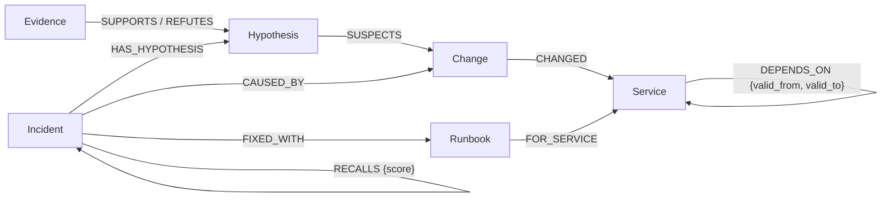

# The 3 am questions: incident agents that reason over a FalkorDB graph

*Three agents, one shared graph, and an investigation that gets shorter the second time. My entry to Graph Hacks (WeMakeDevs x FalkorDB, October 2026).*

> TODO(Harsh): add the repo URL and demo video link. Before publishing, swap relative links for GitHub URLs (and export the Mermaid diagram as an image for dev.to).

It's 3 am and the pager says "checkout p99 latency above 2s". Half awake, you ask the three questions every on-call engineer asks: who is hurt, what changed, and what fixed this last time?

On-call Brain answers them with three agents (triage, investigator, comms) that read and write one FalkorDB graph. When a human confirms the fix, the graph keeps it, and the next similar incident takes fewer steps.

> TODO(Harsh): one or two lines on why this problem matters to you.

## Why a graph, and not a change log or a vector store

The obvious first tool is a change log: list what shipped in the last two hours and blame the newest thing. In my demo that is a search deploy 8 minutes before the alert. Checkout doesn't call search at all.

The real cause is a payments-gw config change 40 minutes earlier (HTTP pool 200 -> 20). Checkout calls payments, which calls payments-gw. The evidence is in how things connect: which dependencies were live at alert time, whether a change was rolled back, and whether anomalies line up along a path.

| Suspect | Verdict | Graph fact that decided it |
|---|---|---|
| search deploy (newest change anywhere) | refuted | no `DEPENDS_ON` path from checkout to search |
| legacy-billing deploy | refuted | checkout's dependency on it was retired 3 days ago (`valid_to`) |
| pricing deploy | refuted | rolled back before the alert |
| cart deploy | refuted | cart shows no anomaly after the change |
| **payments-gw config change** | **supported** | anomaly propagates payments-gw -> payments -> checkout |

One hand-made story proves little, so I also ran an eval: 200 generated incidents, each with a random alerting service, a planted cause 0 to 3 hops upstream, and decoys of every kind above.

| method | correct |
|---|---|
| On-call Brain (uses the graph) | 200/200 |
| anomaly-aware change log: change behind the first service to go red | 141/200 |
| keyword match: change summary vs alert name | 59/200 |
| flat change log: newest change in the window | 0/200 |

Read those with the caveats. The scenarios are synthetic (one 25-service company), and the same team wrote the generator and the checks, so 200/200 shows the checks hold on random topologies, not that they are the right checks for real incidents. The flat log scores 0 by construction: one decoy is always the newest change. The anomaly-aware log is the strongest rule I found without the graph, and it fails only on the retired dependency: a change plus an anomaly there looks like a real upstream cause unless you know the edge ended days ago. The planner is deterministic, with no LLM in the loop. Details in [EVAL.md's limitations](EVAL.md#limitations-read-before-quoting-the-numbers).

A vector store over incident text shares the keyword blind spot. Incident titles all look alike ("X p99 latency above 2s"); what makes two incidents similar is where the cause sat in the system.

## The data model

The slice this post needs (full model in [DATA_MODEL.md](DATA_MODEL.md)):



A `DEPENDS_ON` edge is never deleted. When checkout stopped calling legacy-billing, the edge got a `valid_to`. History stays, and every traversal asks what was true at alert time.

## Two Cypher ideas worth stealing

### 1. Temporal multi-hop suspects

```cypher
// name: path_suspects
MATCH (i:Incident {id: $incident_id})-[:TRIGGERED_BY]->(a:Alert)-[:FIRED_ON]->(o:Service)
MATCH p = (o)-[:DEPENDS_ON*0..6]->(s:Service)
WHERE all(r IN relationships(p) WHERE r.valid_from <= a.at AND (r.valid_to IS NULL OR r.valid_to > a.at))
WITH a, s, min(length(p)) AS hops
MATCH (c:Change)-[:CHANGED]->(s)
WHERE c.at >= a.at - $window AND c.at <= a.at
RETURN c.id AS change, s.id AS service, c.kind AS kind, c.at AS at, c.summary AS summary, hops
ORDER BY hops, at DESC
LIMIT 10
```

Walk up to 6 `DEPENDS_ON` hops from the alerting service, keeping a path only if *every* edge on it was live at alert time: `all(r IN relationships(p) ...)` filters per relationship, not per path. `*0..6` lets a change on the alerting service itself count. Then take the changes from the 2-hour window on those services, nearest first. The legacy-billing deploy never appears, because its only path uses a retired edge.

### 2. Structural recall

```cypher
// name: recall_similar (RETURN columns trimmed)
MATCH (i:Incident {id: $incident_id})-[:TRIGGERED_BY]->(a:Alert)-[:FIRED_ON]->(o:Service)
MATCH (past:Incident {status: 'resolved'})-[:CAUSED_BY]->(c:Change)-[:CHANGED]->(cs:Service)
WHERE past.opened_at < a.at AND past.id <> i.id
MATCH p = (o)-[:DEPENDS_ON*0..6]->(cs)
WHERE all(r IN relationships(p) WHERE r.valid_from <= a.at AND (r.valid_to IS NULL OR r.valid_to > a.at))
WITH past, c, cs, a, min(length(p)) AS hops
OPTIONAL MATCH (past)-[:FIXED_WITH]->(rb:Runbook)
RETURN past.id AS incident, cs.id AS cause_service, hops, rb.title AS runbook,
       2 + CASE WHEN past.symptom = a.symptom THEN 1 ELSE 0 END AS score
ORDER BY score DESC, past.opened_at DESC
LIMIT 5
```

"Have we seen this before?" becomes: resolved incidents whose root-cause service sits on the new alert's *live* dependency path. That scores 2, plus 1 for the same symptom, and the planner only acts on 3. No embeddings, no model, and every recall is explainable as a path. If the old cause is no longer upstream, it isn't recalled.

### Two gotchas and a free guard

Both confirmed on FalkorDB v4.22.0 (see `any_path` and `live_paths` in [investigate.cypher](../src/oncall_brain/adapters/falkordb/queries/investigate.cypher)):

- `shortestPath` only works in `WITH` or `RETURN`. `MATCH p = shortestPath(...)` fails with "FalkorDB currently only supports shortestPaths in WITH or RETURN clauses", so write `WITH shortestPath((o)-[:DEPENDS_ON*]->(t)) AS p`.
- `RETURN [n IN nodes(p) | n.id] AS path ORDER BY length(p)` fails ("Unable to locate a value with alias p") because `p` is gone after the projection. Project it first: `WITH p ORDER BY length(p) LIMIT 20 RETURN ...`.

The guard: every read goes through `GRAPH.RO_QUERY`. Send it a `CREATE` and FalkorDB replies "graph.RO_QUERY is to be executed only on read-only queries". A read tool can't write even if its Cypher is wrong, and the database enforces that, not my code.

## The plan lives in the graph

The agents never pass Python objects to each other. They share an incident board in the graph: the `Incident`, its `Hypothesis` nodes with a status, `Evidence` linked by `SUPPORTS` or `REFUTES`, and one `AgentStep` node per step. A handoff from triage to the investigator is just another `AgentStep`.

Before every decision the loop re-reads the board (`incident_board`, about 1 ms), and the planner sees nothing else. Each role is a pure function of it:

```python
def investigator(board):  # domain/planner.py, shortened
    if not _ran(board, "recall_similar"):
        return _call("recall_similar", "Have we seen this before? ...")
    best = max((r["score"] for r in board["recalls"]), default=0)
    if best >= RECALL_MIN_SCORE and not _ran(board, "hypothesize_from_memory"):
        return _call("hypothesize_from_memory", "A past incident matches structurally; ...")
    ...  # then check open hypotheses (memory first, then a storm's shared upstream, nearest, newest), then hand off
```

Because the board is the only input, an LLM can take the planner's seat behind the same `decide(role, board, tools)` port without changing the tools or the trace. If the model picks an unknown tool, bad arguments or a repeated step, that step falls back to the deterministic planner and the trace says so. Every number in this post comes from the deterministic planner.

## Memory that pays off

After act 1, a human confirms the cause. `resolve_incident` writes `CAUSED_BY` and learns a runbook, `rb:payments-gw:config`. Three days later, act 2: "refunds p99 latency above 2s". Refunds also depends on payments-gw, and a new config rollout has cut the pool again (200 -> 25).

Recall finds act 1 with score 3. The runbook that fixed act 1 is for config changes on payments-gw, so memory suspects the new payments-gw config change, and one check confirms it. From `make demo`:

```text
investigator tool calls: 8, hypotheses checked: 5 (culprit on check 3), solved by memory: False   # act 1
investigator tool calls: 3, hypotheses checked: 1 (culprit on check 1), solved by memory: True    # act 2
=== memory ablation: act 2 with vs without act 1 in the graph ===
  without memory: 6 investigator calls, 4 hypotheses checked, culprit on check 2
```

Without memory, nearest-first checking tries a newer, healthy payments deploy one hop away before the real cause. With memory, act 2's status update ends with "Next action: Revert the config change on payments-gw (...) (runbook 'Revert the config change on payments-gw', worked 1 of 1 times)", and names who knows payments-gw best, found by `who_knows` in the same graph.


The three kinds of memory are ordinary nodes:

- **Episodic** (what happened): `Incident`, `CAUSED_BY`, `RECALLS`, the `AgentStep` history.
- **Semantic** (how the company works): `DEPENDS_ON {valid_from, valid_to}`, `OWNS`, `ON_CALL {start, end}`.
- **Procedural** (what fixes it): `Runbook {uses, successes}` with `FIXED_WITH`. The runbook decides what memory suspects (its service and change kind), and a refuted suggestion adds a use without a success, so its confidence drops.

Memory only proposes; the same checks still decide. In act 1 the agent recalls an old checkout incident caused by inventory, finds no change on inventory, and moves on. And only a human writes `CAUSED_BY`, so the agents can't reinforce their own wrong guesses.

## Three alerts at once

Act 3 is an alert storm: checkout, refunds and subscriptions alert within 4 minutes. Investigated alone, the subscriptions alert points at a subscriptions deploy 10 minutes earlier, and that is what my planner blames when I switch correlation off. With correlation, triage first folds the other alerts into the incident and asks which services all three depend on at alert time. That is six services. It ranks them with FalkorDB's `algo.betweenness` over the dependency graph (paths converge on payments). The investigator checks suspects there first: a postgres-orders config change is confirmed on check 1, and the subscriptions deploy is refuted because checkout and refunds don't depend on subscriptions.

Two honest caveats. In this story only one suspect sits on the shared upstream, so the shared-upstream set and the refutation rule decide the answer; the betweenness order matters only when several suspects sit there (a unit test covers that). And `algo.betweenness` counts every `DEPENDS_ON` edge, retired ones too, because FalkorDB's algorithms filter by label and relationship type, not by property. The shared-upstream set itself uses live edges only.

## How it was built

With a lot of AI help, and I want to be upfront about it. I wrote the brief: the five-idea shortlist, the scoring rubric, the engineering rules (Cypher in named files, one tool registry for the agent loop, HTTP and MCP, a planner that works without keys) and the machine constraints. Claude Code (Opus 5.5) picked the idea through an LLM council of five advisor personas (On-call Brain 8.22, runner-up 6.36), then wrote most of the code, tests and docs. A second Claude session on another machine acted as a cloud reviewer, running snapshots independently and sending patches. Full disclosure in [AI_USAGE.md](AI_USAGE.md).

> TODO(Harsh): what you personally reviewed, verified and changed (for example: ran `make setup db seed demo test` on a clean checkout, read every query, clicked through the UI).

A practical tip from setup: my laptop has glibc 2.35, and the `falkordblite` wheel needs 2.39, so it won't install. FalkorDB also ships a rhel8 build of its module that needs only glibc 2.28, which loads into a redis built from source:

```bash
redis-server --port 6379 --loadmodule ./falkordb-rhel8-x64.so
```

[`scripts/falkordb_bin.sh`](../scripts/falkordb_bin.sh) does this with pinned versions and sha256 checksums (FalkorDB v4.22.0, redis 8.10.2). No Docker needed.

## What I'd do next

- A "no change, it's capacity" path. Today the investigator escalates when every change is refuted, but doesn't look for other causes.
- Runbook confidence that also decays with age. Today a refuted suggestion lowers it, but time doesn't.
- Real ingest: deploy webhooks, monitoring and paging calling the event tools (`record_change`, `record_anomaly`, `raise_alert`, `add_dependency`, `retire_dependency`) that already keep the graph current.

## Try it

```bash
make setup db seed demo   # deps, FalkorDB on :6379, synthetic company, all three acts in the terminal
make dev                  # API + web UI on http://localhost:8000
make mcp                  # the same tools for any MCP client (stdio)
```

No LLM key is needed, and `make demo` exits non-zero if the story breaks.

> TODO(Harsh): a closing line in your own voice, the repo URL, the demo video, and thanks to WeMakeDevs and FalkorDB.
