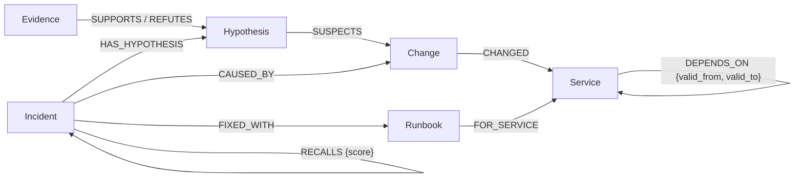
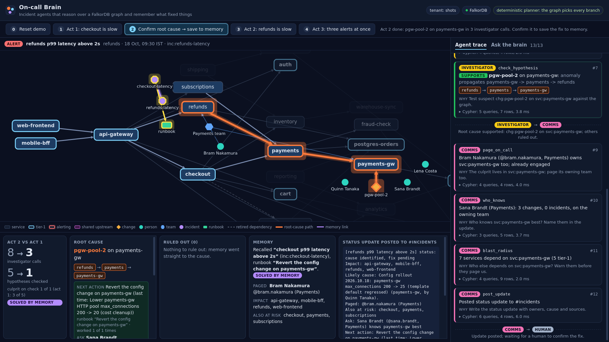

# The 3 am questions: incident agents that reason over a FalkorDB graph

*Three agents, one shared graph, and an investigation that gets shorter the second time. My entry to Graph Hacks (WeMakeDevs x FalkorDB, October 2026).*

> TODO(Harsh): add the repo URL and demo video link. Before publishing, swap relative links for GitHub URLs (and export the Mermaid diagram as an image for dev.to).

It's 3 am and the pager says "checkout p99 latency above 2s". Half awake, you ask the three questions every on-call engineer asks: who is hurt, what changed, and what fixed this last time?

On-call Brain answers them with three agents (triage, investigator, comms) that read and write one FalkorDB graph. When a human confirms the fix, the graph keeps it, and the next similar incident takes fewer steps.

> TODO(Harsh): one or two lines on why this problem matters to you.

## Why a graph, and not a change log or a vector store

The obvious first tool is a change log: list what shipped in the last two hours and blame the newest thing. In my demo that is a search deploy 8 minutes before the alert. Checkout doesn't call search at all.

The real cause is a payments-gw config change 40 minutes earlier (HTTP pool 200 -> 20). Checkout calls payments, which calls payments-gw. The evidence is in how things connect: which dependencies were live at alert time, whether a change was rolled back, and whether anomalies line up along a path.

| Suspect | Verdict | Graph fact that decided it |
|---|---|---|
| search deploy (newest change anywhere) | refuted | no `DEPENDS_ON` path from checkout to search |
| legacy-billing deploy | refuted | checkout's dependency on it was retired 3 days ago (`valid_to`) |
| pricing deploy | refuted | rolled back before the alert |
| cart deploy | refuted | cart shows no anomaly after the change |
| **payments-gw config change** | **supported** | anomaly propagates payments-gw -> payments -> checkout |

A smarter change log that also watches anomalies (blame the change whose own service went red first) does no better: legacy-billing deployed 50 minutes before the alert and threw errors 5 minutes later, before payments-gw went red. Only the retired dependency edge rules it out.

One hand-made story proves little, so I also ran an eval: 200 generated incidents, each with a random alerting service, a planted cause 0 to 3 hops upstream, and decoys of every kind above.

The first version scored 200/200, and a round of mock judges said, fairly, that it was built to be passed: one decoy per verdict rule and nothing else in the window. So the generator now adds what real telemetry adds: unrelated anomalies in the window, a middle hop whose anomaly never arrived, and a cascade victim, a service between the cause and the alert that happens to deploy after the cause already went red. The numbers dropped, which is the point:

| method | correct |
|---|---|
| On-call Brain (uses the graph) | 186/200 (93%) |
| anomaly-aware change log: change behind the first service to go red | 134/200 |
| keyword match: change summary vs alert name | 57/200 |
| flat change log: newest change in the window | 0/200 |

On seeds with only the planted story the agent still gets 66 of 66. All 16 misses are one pattern: a random blip lands on an innocent changed service right after its change, so that change looks like a real, supported cause and wins on a ranking rule (nearer, earlier, or upstream and red first). The eval lists every miss in the agent's own words from its trace.

Read those with the caveats. The scenarios are synthetic (one 25-service company), and the same team wrote the generator, the checks and the agent. Worse for a clean comparison: the perturbations and the agent's ranking rules changed in the same round, by people who knew what the perturbations were, so this is not a blind test. The flat log scores 0 by construction: one decoy is always the newest change. The anomaly-aware log is the strongest rule I found without the graph; the retired dependency fools it 55 times (a change plus an anomaly there looks like a real upstream cause unless you know the edge ended days ago), and the noisy innocent change 11 times. The planner is deterministic, with no LLM in the loop. Details in [EVAL.md's limitations](EVAL.md#limitations-read-before-quoting-the-numbers).

Two of the judges' probes became rules and regression tests. A deploy on a cascade victim: payments-gw breaks, payments deploys half a minute later and goes red, checkout alerts. Nearest-first would blame payments; the graph knows payments depends on payments-gw, which was already red when the payments change landed, so the payments-gw change leads and the update says why. And a monitoring gap: if payments never reports an anomaly although the failure passed through it, the suspect is no longer "inconclusive". It is supported with the gap named ("monitoring gap?"), ranked after any suspect with a complete chain, and the status update says to check payments' monitoring.

A vector store over incident text shares the keyword blind spot. Incident titles all look alike ("X p99 latency above 2s"); what makes two incidents similar is where the cause sat in the system.

## The data model

The slice this post needs (full model in [DATA_MODEL.md](DATA_MODEL.md)):



A `DEPENDS_ON` edge is never deleted. When checkout stopped calling legacy-billing, the edge got a `valid_to`. History stays, and every traversal asks what was true at alert time.

## Two Cypher ideas worth stealing

### 1. Temporal multi-hop suspects

```cypher
// name: path_suspects
MATCH (i:Incident {id: $incident_id})-[:TRIGGERED_BY]->(a:Alert)-[:FIRED_ON]->(o:Service)
MATCH p = (o)-[:DEPENDS_ON*0..6]->(s:Service)
WHERE all(r IN relationships(p) WHERE r.valid_from <= a.at AND (r.valid_to IS NULL OR r.valid_to > a.at))
WITH a, s, min(length(p)) AS hops
MATCH (c:Change)-[:CHANGED]->(s)
WHERE c.at >= a.at - $window AND c.at <= a.at
RETURN c.id AS change, s.id AS service, c.kind AS kind, c.at AS at, c.summary AS summary, hops
ORDER BY hops, at DESC, change
```

Walk up to 6 `DEPENDS_ON` hops from the alerting service, keeping a path only if *every* edge on it was live at alert time: `all(r IN relationships(p) ...)` filters per relationship, not per path. `*0..6` lets a change on the alerting service itself count. Then take the changes from the 2-hour window on those services, nearest first. The legacy-billing deploy never appears, because its only path uses a retired edge.

### 2. Structural recall

```cypher
// name: recall_similar (RETURN columns trimmed)
MATCH (i:Incident {id: $incident_id})-[:TRIGGERED_BY]->(a:Alert)-[:FIRED_ON]->(o:Service)
MATCH (past:Incident {status: 'resolved'})-[:CAUSED_BY]->(c:Change)-[:CHANGED]->(cs:Service)
WHERE past.opened_at < a.at AND past.id <> i.id
MATCH p = (o)-[:DEPENDS_ON*0..6]->(cs)
WHERE all(r IN relationships(p) WHERE r.valid_from <= a.at AND (r.valid_to IS NULL OR r.valid_to > a.at))
WITH past, c, cs, a, min(length(p)) AS hops
OPTIONAL MATCH (past)-[:FIXED_WITH]->(rb:Runbook)
RETURN past.id AS incident, cs.id AS cause_service, hops, rb.title AS runbook,
       2 + CASE WHEN past.symptom = a.symptom THEN 1 ELSE 0 END AS score
ORDER BY score DESC, past.opened_at DESC
LIMIT 5
```

"Have we seen this before?" becomes: resolved incidents whose root-cause service sits on the new alert's *live* dependency path. That scores 2, plus 1 for the same symptom, and the planner only acts on 3. No embeddings, no model, and every recall is explainable as a path. If the old cause is no longer upstream, it isn't recalled.

### Two gotchas and a free guard

Both confirmed on FalkorDB v4.22.0 (see `any_path` and `live_paths` in [investigate.cypher](../src/oncall_brain/adapters/falkordb/queries/investigate.cypher)):

- `shortestPath` only works in `WITH` or `RETURN`. `MATCH p = shortestPath(...)` fails with "FalkorDB currently only supports shortestPaths in WITH or RETURN clauses", so write `WITH shortestPath((o)-[:DEPENDS_ON*]->(t)) AS p`.
- `RETURN [n IN nodes(p) | n.id] AS path ORDER BY length(p)` fails ("Unable to locate a value with alias p") because `p` is gone after the projection. Project it first: `WITH p ORDER BY length(p) LIMIT 20 RETURN ...`.

The guard: every read goes through `GRAPH.RO_QUERY`. Send it a `CREATE` and FalkorDB replies "graph.RO_QUERY is to be executed only on read-only queries". A read tool can't write even if its Cypher is wrong, and the database enforces that, not my code.

## The plan lives in the graph

The agents never pass Python objects to each other. They share an incident board in the graph: the `Incident`, its `Hypothesis` nodes with a status, `Evidence` linked by `SUPPORTS` or `REFUTES`, and one `AgentStep` node per step. A handoff from triage to the investigator is just another `AgentStep`.

Before every decision the loop re-reads the board (`incident_board`, 1 to 2 ms), and the planner sees nothing else. Each role is a pure function of it:

```python
def investigator(board):  # domain/planner.py, shortened
    if not _ran(board, "recall_similar"):
        return _call("recall_similar", "Have we seen this before? ...")
    best = max((r["score"] for r in board["recalls"]), default=0)
    if best >= RECALL_MIN_SCORE and not _ran(board, "hypothesize_from_memory"):
        return _call("hypothesize_from_memory", "A past incident matches structurally; ...")
    ...  # then check open hypotheses (memory first, then a storm's shared upstream, nearest, newest);
         # if several are supported, conclude (one leading cause, plus any co-causes); then hand off
```

Because the board is the only input, an LLM can take the planner's seat behind the same `decide(role, board, tools)` port without changing the tools or the trace. If the model picks an unknown tool, bad arguments or a repeated step, that step falls back to the deterministic planner and the trace says so. Every number in this post comes from the deterministic planner.

## Memory that pays off

After act 1, a human confirms the cause. `resolve_incident` writes `CAUSED_BY` and learns a runbook, `rb:payments-gw:config`. Three days later, act 2: "refunds p99 latency above 2s". Refunds also depends on payments-gw, and a new config rollout has cut the pool again (200 -> 25).

Recall finds act 1 with score 3. The runbook that fixed act 1 is for config changes on payments-gw, so memory suspects the new payments-gw config change, and one check confirms it. From `make demo`:

```text
=== memory ablation: act 2 with vs without act 1 in the graph ===
  with memory:    3 investigator calls, 1 hypotheses checked, culprit on check 1
  without memory: 6 investigator calls, 4 hypotheses checked, culprit on check 2
```

That is the same incident twice: the "without" run replays the refunds alert on a copy of the pristine graph, which has never seen act 1. (An earlier version of the UI compared act 2 with act 1: two different incidents, which flattered memory.) The API does the same with `?compare=memory`, and the UI's act 2 card shows both. Without memory, nearest-first checking tries a newer, healthy payments deploy one hop away before the real cause. With memory, act 2's status update says "Next action: Revert the config change on payments-gw (this runbook worked 1 of 1 times)", and names who knows payments-gw best, found by `who_knows` in the same graph.



The three kinds of memory are ordinary nodes:

- **Episodic** (what happened): `Incident`, `CAUSED_BY`, `RECALLS`, the `AgentStep` history.
- **Semantic** (how the company works): `DEPENDS_ON {valid_from, valid_to}`, `OWNS`, `ON_CALL {start, end}`.
- **Procedural** (what fixes it): `Runbook {uses, successes}` with `FIXED_WITH`. The runbook decides what memory suspects (its service and change kind), and a refuted suggestion adds a use without a success, so its confidence drops.

Memory only proposes; the same checks still decide. In act 1 the agent recalls an old checkout incident caused by inventory, finds no change on inventory, and moves on. And only a human writes `CAUSED_BY`, so the agents can't reinforce their own wrong guesses.

## Three alerts at once

Act 3 is an alert storm: checkout, refunds and subscriptions alert within 4 minutes. Investigated alone, the subscriptions alert points at a subscriptions deploy half an hour earlier, which blipped right after it. That is what my planner blames when I switch correlation off, and what the anomaly-aware change log blames too.

With correlation, triage first asks, for each alerting service, which services it reaches over live dependencies and which of those went red. It folds in only the alerts that share a red upstream service with this one, so an unrelated alert that just shares a quiet cache stays its own incident. The services all three reach are ranked by convergence, the fewest total hops from the alerting services: payments 3, postgres-orders 5, and so on. The investigator checks suspects there first. A postgres-orders config change is supported and explains all three alerting services. The subscriptions deploy is supported too, but explains only subscriptions, which the postgres-orders change explains as well. A `conclude` step keeps one leading cause and writes down why the other lost: "outranked: chg:pg-conn-3 explains every alerting service this change does (1) and 2 more".

A third review round broke an earlier version of this with one question: what if two things broke at once? Folded alerts don't have to share one cause, so a suspect is now ruled out only when the leader explains every alerting service it explains. A change that explains an alert the leader can't is kept as a co-cause: its team is paged too, and the update says "Also contributing". The outcome, the status update and the paging agree on the leading cause and the co-causes, and a human's confirmation overrides them all.

An honest note on graph algorithms. My first version ranked that shared upstream with FalkorDB's `algo.betweenness`. A review caught two problems. The scores are sampled: on my 25-service graph, changing `samplingSeed` reorders the services even with `samplingSize` above the node count. And the procedure filters by label and relationship type, not by property, so it counts dependencies that were retired before the alert. Neither is fine for a number that decides which change gets blamed, so I replaced it with summed hops over live edges, which is exact, respects time and explains itself. Everything the product does on the graph is now plain Cypher: temporal variable-length paths, `shortestPath`, and intersecting upstream closures.

## Asking the graph why

The same graph holds the company's paperwork: a small synthetic corpus of 34 docs (postmortems, design notes, decision records, runbook pages), 21 tickets and 41 chat messages, each linked to the services, changes, people and incidents it talks about (`MENTIONS`, `AUTHORED_BY`, `DECIDES`, `SUPERSEDES`). An `ask` tool takes a question, runs FalkorDB's full-text index over docs, tickets and chat, re-ranks the hits, then walks the graph around them.

Ask "Why was the payments gateway pool lowered?" and it leads with the Q4 cost review design note by Sana Brandt, quoting "Decision: lower the pool max_connections from 200 to 20, which cuts the gateway bill by about 40%", links the change `chg:pgw-pool-1`, and lists the peak load test postmortem that warned against going below 150 among its sources. Ask "who designed the checkout retries" and it names the v2 design and says it replaces an older v1 by someone else, because `SUPERSEDES` says which doc is current. Full-text search finds the words; the edges say whose change it was, who owns the service now and whether the doc still holds. There is no LLM in it: the answer is assembled from graph facts and quoted sentences, so it can't summarise, but every claim points at a node.

## How it was built

With a lot of AI help, and I want to be upfront about it. I wrote the brief: the five-idea shortlist, the scoring rubric, the engineering rules (Cypher in named files, one tool registry for the agent loop, HTTP and MCP, a planner that works without keys) and the machine constraints. Claude Code (Opus 5.5) picked the idea through an LLM council of five advisor personas (On-call Brain 8.22, runner-up 6.36), then wrote most of the code, tests and docs. A second Claude session on another machine acted as a cloud reviewer, running snapshots independently and sending patches. Late in the build, three simulated judges scored the tracks and listed overclaims; the realistic eval, the cascade rule, the same-incident memory comparison and the company-brain corpus came out of that round. Full disclosure in [AI_USAGE.md](AI_USAGE.md).

> TODO(Harsh): what you personally reviewed, verified and changed (for example: ran `make setup db seed demo test` on a clean checkout, read every query, clicked through the UI).

A practical tip from setup: my laptop has glibc 2.35, and the `falkordblite` wheel needs 2.39, so it won't install. FalkorDB also ships a rhel8 build of its module that needs only glibc 2.28, which loads into a redis built from source:

```bash
redis-server --port 6379 --loadmodule ./falkordb-rhel8-x64.so
```

[`scripts/falkordb_bin.sh`](../scripts/falkordb_bin.sh) does this with pinned versions and sha256 checksums (FalkorDB v4.22.0, redis 8.10.2). No Docker needed.

## What I'd do next

- Tell "red because of my change" from "red at the same moment for another reason". That is every one of the eval's 16 misses.
- A "no change, it's capacity" path. Today the investigator escalates when every change is refuted, but doesn't look for other causes.
- Runbook confidence that also decays with age. Today a refuted suggestion lowers it, but time doesn't.
- Real ingest: deploy webhooks, monitoring and paging calling the event tools (`record_change`, `record_anomaly`, `raise_alert`, `add_dependency`, `retire_dependency`) that already keep the graph current.

## Try it

```bash
make setup db seed demo   # deps, FalkorDB on :6379, synthetic company, all three acts in the terminal
make dev                  # API + web UI on http://localhost:8000
make mcp                  # the same tools for any MCP client (stdio)
```

No LLM key is needed, and `make demo` exits non-zero if the story breaks.

> TODO(Harsh): a closing line in your own voice, the repo URL, the demo video, and thanks to WeMakeDevs and FalkorDB.
