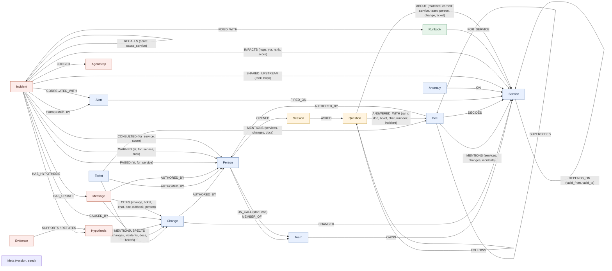

# Graph data model

On-call Brain keeps a company's operational knowledge and its incident memory in one FalkorDB property graph per
tenant. The agents never hold incident state in Python. They read the graph before every decision and write each
finding back as nodes and edges. This page describes every label, relationship, id and index the code uses. It is
derived from `src/oncall_brain/adapters/falkordb/queries/*.cypher` and `src/oncall_brain/datagen.py`. The queries
themselves are listed in [QUERIES.md](QUERIES.md).

Conventions:
- Every node has a string `id` with a type prefix (see [Ids](#ids)). Every write `MERGE`s on it.
- Times (`at`, `start`, `valid_from`, ...) are epoch seconds. The demo clock is pinned: act 1 fires at
  T1 = 2026-10-15 04:00 UTC (09:30 IST), act 2 at T2 = T1 + 3 days, and act 3's alert storm ends at
  T3 = T1 + 5 days.
- FalkorDB does not store null properties. A missing `valid_to` therefore means "still live", and a missing
  `rolled_back_at` means "never rolled back".

## Diagram



Blue nodes hold semantic facts about the company, red nodes hold episodic memory of incidents, and the green node
holds procedural memory, and the orange nodes hold conversational memory: what each engineer asked the company brain
(`Session`, `Question`). `Message` is drawn red because the status updates the agents write are episodic. Seeded chat
messages are semantic source material, like `Doc` and `Ticket`. `Meta` is not memory: it is one unconnected node that
fingerprints the seed data.

## Nodes

"Seed" means `services/seeding.py` writes it through the named `ingest_*` statement. `tool` → `statement` means
that tool (defined in `services/tools.py`, registered once in `agents/registry.py` and exposed to the agent
loop, the HTTP API and MCP) writes it by running that named write statement. The five event tools (`record_change`,
`record_anomaly`, `raise_alert`, `add_dependency`, `retire_dependency`, queries in `events.cypher`) keep the
semantic facts current after seeding.

| Label | Key properties | Meaning | Written by |
|---|---|---|---|
| `Team` | `id`, `name` | An engineering team that owns services and has an on-call rotation. | seed `ingest_teams` |
| `Person` | `id`, `name`, `handle` (`@first.last`, e.g. `@sana.brandt`) | An engineer. All names are fake, and no two people share a first name. | seed `ingest_people` |
| `Service` | `id`, `name`, `tier` (1 = customer-facing critical, 2 = other) | A deployable service. | seed `ingest_services` |
| `Change` | `id`, `kind` (`deploy` / `config`), `summary`, `at`, `version` (deploys only), `rolled_back_at` (if rolled back) | A deploy or a config change to one service. Changes are the suspects in an investigation. | seed `ingest_changes`; `record_change` → `record_change` (re-recording an id corrects it: the old `CHANGED` / `AUTHORED_BY` edges are dropped) |
| `Alert` | `id`, `name`, `symptom` (`latency` / `errors` / `saturation`), `at`, `act` (story act 1, 2 or 3; seeded alerts only) | A monitoring alert that fired on a service. It is what starts an investigation. | seed `ingest_alerts`; `raise_alert` → `raise_alert` |
| `Anomaly` | `id`, `kind` (`latency` / `errors` / `saturation`), `summary`, `at` | A monitoring signal on a service. Checks use it to see whether a symptom travelled along a dependency path. | seed `ingest_anomalies`; `record_anomaly` → `record_anomaly` |
| `Incident` | `id`, `title`, `symptom`, `status` (`open` / `resolved`), `opened_at`, `resolved_at` | The shared board that every agent role reads and writes. Past incidents are already resolved. | seed `ingest_incidents` (history); `open_incident` → `open_incident`; `resolve_incident` → `resolve_incident` sets `status`, `resolved_at` |
| `Hypothesis` | `id`, `status` (see below), `source` (`dependency-path` / `recent-anywhere` / `memory`, or `human` when a human confirmed a change no agent suspected), `hops`, `created_at`, `runbook` (memory suspects only: the runbook that suggested it), `explained` (list of alerting service ids the change can reach: the alert's own service, plus in a storm each other folded alerting service with a live path to it; empty without a live path), `onset` (time of the first anomaly on the change's own service after the change; unset if none), `gaps` (services in the middle of the judged path with no anomaly on record: a possible monitoring gap; empty for a complete chain), `note` (co-causes only: why it is still needed, e.g. "also needed: it alone explains refunds") | "Change X caused this incident", together with where the suspicion came from. Status: `open` → `supported` / `refuted` after its check (a check never leaves it undecided: a silent middle hop gives a weaker `supported` with `gaps` set, ranked after complete chains). When several are supported, `conclude` keeps one leading `supported` cause; another becomes `outranked` if the leader explains every alerting service it explains, else `co-cause`. `confirmed` is set only by a human, and then every other `supported` or `co-cause` suspect becomes `outranked`. A later re-check never changes `confirmed`. | `propose_hypotheses`, `hypothesize_from_memory` → `add_hypotheses`; status, `explained`, `onset`, `gaps` from `check_hypothesis` → `record_evidence`; `conclude` → `record_outranked`, `record_co_causes` (`note`); `resolve_incident` (creates it if no agent suspected the change) |
| `Evidence` | `id`, `verdict` (`supports` / `refutes` / `outranked`), `reason` (the full explanation), `tag` (a few words for the status update's "Ruled out:" line: `rolled back`, `dependency retired`, `no dependency path`, `no anomaly after it`, `supported` / `supported, with a monitoring gap`, `outranked`, `a human confirmed another cause`), `path` (service ids the check walked), `at`, `explained` (as on the hypothesis, at check time) | The result of one check on a hypothesis, together with the path that justifies it. An outranked hypothesis gets a separate `outranked` Evidence node that `REFUTES` it, with the reason; the check's own `SUPPORTS` evidence stays, so a human can still confirm it. A human confirmation adds a `supports` node with reason "confirmed by a human". | `check_hypothesis` → `record_evidence`; `conclude` → `record_outranked`; `resolve_incident` |
| `Runbook` | `id`, `title`, `steps` (list), `kind` (change kind it fixes), `uses`, `successes`, `learned_from` (learned runbooks only) | A fix procedure for one service and one kind of change. Its confidence is `successes / uses`. | seed `ingest_runbooks`; `resolve_incident` → `resolve_incident` (learns, or adds 1 to `uses` and `successes`); `check_hypothesis` → `record_evidence` adds 1 to `uses` when the runbook's suggestion is refuted (once, on open → refuted) |
| `Message` | `id`, `kind` (`chat` / `status_update`), `channel`, `text`, `at` | Seeded chat (change announcements, design debates, `#incidents` wrap-ups), or the status update the comms agent wrote for #incidents. The update is stored on the incident; nothing is sent to a chat tool. `text` is full-text indexed, so `ask` finds both. | seed `ingest_messages` (chat); `post_update` → `post_update` (status updates) |
| `Ticket` | `id`, `title`, `text`, `at` | A change request or other work item (`CR-881`, `PAY-412`, `PLAT-233`, ...), which a status update can cite and `ask` can find (`title` and `text` are full-text indexed). | seed `ingest_tickets` |
| `Doc` | `id`, `kind` (`postmortem` / `design` / `decision` / `runbook`), `title`, `text`, `at` | A written page: a postmortem, a design note, a decision record (ADR) or a runbook page. Company-brain source material; `title` and `text` are full-text indexed for `ask`. Not the same as `Runbook`, which is procedural memory the agents act on. | seed `ingest_docs`, `ingest_doc_links` |
| `AgentStep` | `id`, `seq`, `role` (`triage` / `investigator` / `comms`), `tool` (tool name or `handoff`), `target`, `reason`, `summary`, `rows`, `ms`, `writes` | One step of one agent: what it did, why, and what it cost. Handoffs between roles are steps too. | agent loop (`agents/loop.record`) → `log_step` |
| `Session` | `id`, `user` (the asker as given to `ask`: a Person id, a handle or any stable name, lowercased), `key` (the conversation key, default `default`), `started_at`, `last_at` | One engineer's conversation with the company brain. A user can have several (a chat, a terminal); a pronoun is read within one. Created on first use; the Person `OPENED` it when the user is one. | `ask` (with a `user`) → `record_question` |
| `Question` | `id`, `seq` (position in the session), `text` (as asked), `resolved` (the question with its pronoun replaced, when one was; absent otherwise), `intent` (the `ask` route that answered: `owner`, `expert`, `why`, `how`, `happened` or `search`), `at`, `summary`, `answer` | One question `ask` answered for a named user, with the answer it gave. A recall ("what did I ask about X") is not recorded. | `ask` (with a `user`) → `record_question` |
| `Meta` | `id` (always `meta`), `version` (fingerprint of the generated data), `seed` | Which generator built this graph. `reset()` restores the pristine copy only if its `version` matches the current generator run with this `seed`, else it re-seeds with the same seed. | seed `ingest_meta` |

## Relationships

| Relationship | Properties | Meaning | Written by |
|---|---|---|---|
| `(Person)-[:MEMBER_OF]->(Team)` | | Team membership. | seed `ingest_people` |
| `(Person)-[:ON_CALL]->(Team)` | `start`, `end` (end exclusive) | One on-call shift. The rotation is weekly and covers all three acts. | seed `ingest_on_call` |
| `(Team)-[:OWNS]->(Service)` | | Ownership. | seed `ingest_services` |
| `(Service)-[:DEPENDS_ON]->(Service)` | `valid_from`, `valid_to` (absent = still live) | The caller calls the callee during that window. A pair has at most one live edge: `add_dependency` creates a new edge only if none is live, so a dependency that is retired and later re-added gets a new edge with its own window. Adding a live one again only moves its `valid_from` earlier, if the new time is earlier. | seed `ingest_depends_on` (`MERGE` on `valid_from`); `add_dependency` → `add_dependency`; `retire_dependency` → `retire_dependency` (sets `valid_to` on the live edge) |
| `(Change)-[:CHANGED]->(Service)` | | The service the change touched. | seed `ingest_changes`; `record_change` → `record_change` |
| `(Change\|Ticket\|Message\|Doc)-[:AUTHORED_BY]->(Person)` | | Who made the change, filed the ticket, wrote the chat message or the doc. `who_knows` counts the docs, tickets and chat someone wrote that mention or decide a service (at most 3 points, so writing about a service never outweighs hands-on evidence). | seed `ingest_changes`, `ingest_tickets`, `ingest_messages`, `ingest_docs`; `record_change` (if an author is given) |
| `(Ticket)-[:REQUESTED]->(Change)` | | The change request behind a change. | seed `ingest_tickets` |
| `(Doc)-[:MENTIONS]->(Service\|Change\|Incident)`, `(Ticket)-[:MENTIONS]->(Service\|Change\|Doc)`, `(Message)-[:MENTIONS]->(Service\|Change\|Incident\|Doc\|Ticket)` | | What a doc, ticket or chat message talks about (a chat message that announced a change `MENTIONS` it). `ask` expands search hits along these edges; `change_story` lists every doc and chat that mentions a change. | seed `ingest_docs`, `ingest_tickets`, `ingest_messages` (each mention is looked up per label, so the id indexes are used) |
| `(Doc)-[:DECIDES]->(Service)` | | The doc is the decision of record for that service (a design note or decision record). `ask` says so in its answer, and `who_knows` counts it. | seed `ingest_docs` |
| `(Doc)-[:SUPERSEDES]->(Doc)` | | The newer doc replaces the older one (e.g. ADR-011 Kafka retention of 7 days supersedes ADR-006). `ask` ranks a superseded doc below its replacement and flags it. | seed `ingest_doc_links` (after every doc exists) |
| `(Alert)-[:FIRED_ON]->(Service)` | | Where the alert fired. | seed `ingest_alerts`; `raise_alert` → `raise_alert` |
| `(Anomaly)-[:ON]->(Service)` | | Where the anomaly was seen. | seed `ingest_anomalies`; `record_anomaly` → `record_anomaly` |
| `(Runbook)-[:FOR_SERVICE]->(Service)` | | The service the runbook fixes. Together with `Runbook.kind`, it says which changes the runbook is for. | seed `ingest_runbooks`; `resolve_incident` → `resolve_incident` |
| `(Incident)-[:TRIGGERED_BY]->(Alert)` | | The alert that opened the incident. | `open_incident` → `open_incident` |
| `(Incident)-[:IMPACTS]->(Service)` | `hops`, `via`, `rank`, `score` | An impacted service. `hops` 0 is an alerting service. `via` is the service the blast radius was walked from: the alerting service when triage writes the edge (direct impact), and the culprit service when comms writes it (also at risk). `rank` is the criticality order (1 = warn first: tier 1 before tier 2, then by `score`, the service's PageRank over the dependencies live at alert time), rewritten by every `blast_radius` call with an incident. | `open_incident` → `open_incident` (hops 0); `blast_radius` → `record_impacts`, `record_criticality`; `correlate_alerts` → `record_correlation` (hops 0 for each correlated alert's service); seed `ingest_incidents` (hops 0) |
| `(Incident)-[:CORRELATED_WITH]->(Alert)` | | A related alert, folded into this incident (alert storm): it fired in the 15 minutes before this incident's alert, and its service shares with the alerting service an upstream service (0 to 6 hops, so possibly the service itself) that went red in the 2-hour window. Alerts on the alerting service itself fold too. Related alerts need not share one cause. `check_hypothesis` records which of their services each suspect can reach (`explained`). | `correlate_alerts` → `record_correlation` |
| `(Incident)-[:SHARED_UPSTREAM]->(Service)` | `rank`, `hops` | A service every correlated alerting service depends on (live edges at alert time, 0 to 6 hops). There may be none, when the alerts have separate causes. `hops` is the total of their hop counts to it; `rank` orders by it (fewest first: where the paths converge). The board reads these in rank order, and the investigator checks suspects on them first. | `correlate_alerts` → `record_correlation` |
| `(Incident)-[:PAGED]->(Person)` | `at`, `for_service` | Who was paged, when, and for which service. `who_knows` counts the incidents where someone was paged for the service it is asked about. | `page_on_call` → `record_page`; seed `ingest_incidents` (each past incident pages someone for its culprit service) |
| `(Incident)-[:WARNED]->(Person)` | `at`, `for_service`, `rank` | Who got a heads-up: the on-call of an impacted team that was not paged, in criticality order (`rank` is the `IMPACTS.rank` of the service it was sent for). The status update's "Heads-up" line. | `warn_owners` → `record_warning` |
| `(Incident)-[:CONSULTED]->(Person)` | `for_service`, `score` | The person comms will ask about the culprit service: the top `who_knows` answer. The status update names them in its "Ask:" line. | `who_knows` (with an `incident_id`) → `record_consult` |
| `(Incident)-[:HAS_HYPOTHESIS]->(Hypothesis)` | | A suspect on the board. | `add_hypotheses` |
| `(Hypothesis)-[:SUSPECTS]->(Change)` | | The change the hypothesis blames. | `add_hypotheses` |
| `(Evidence)-[:SUPPORTS]->(Hypothesis)` / `(Evidence)-[:REFUTES]->(Hypothesis)` | | The verdict of a check: every check writes exactly one of the two edges (verdicts are supports or refutes). An outranked hypothesis also gets a `REFUTES` edge from its separate `outranked` Evidence node; its check's `SUPPORTS` edge is kept. A co-cause gets no new edge (its `note` says why it stays). | `check_hypothesis` → `record_evidence` (`FOREACH` picks the edge); `conclude` → `record_outranked`; `resolve_incident` |
| `(Incident)-[:RECALLS]->(Incident)` | `score`, `cause_service` | Episodic recall. The score is 2 when the past incident's root-cause service is on this alert's live dependency path, plus 1 for the same symptom. The planner acts on a score of 3 or more. | `recall_similar` → `record_recalls` |
| `(Incident)-[:CAUSED_BY]->(Change)` | | The human-confirmed root cause (also the incident's `confirmed` hypothesis). | seed `ingest_incidents`; `resolve_incident` → `resolve_incident` |
| `(Incident)-[:FIXED_WITH]->(Runbook)` | | The runbook that fixed the incident. | seed `ingest_incidents`; `resolve_incident` → `resolve_incident` |
| `(Incident)-[:LOGGED]->(AgentStep)` | | The incident's agent history, in `seq` order. | agent loop → `log_step` |
| `(Incident)-[:HAS_UPDATE]->(Message)` | | The status update written for the incident (stored here; not sent anywhere). | `post_update` → `post_update` |
| `(Message)-[:CITES]->(Change\|Ticket\|Message\|Doc\|Runbook\|Person)` | | Every claim in a status update links to its source node, including the person it says to ask (act 1 cites `chg:pgw-pool-1`, `ticket:CR-881`, `msg:pay-deploys-1`, `doc:cost-review-pgw` and `person:sana-brandt`). A rewrite drops stale citations. | `post_update` → `post_update` |
| `(Person)-[:OPENED]->(Session)` | | The engineer behind a session, when the `user` given to `ask` is a Person id or handle in the graph; a session under any other name has no edge and still works. | `ask` → `record_question` |
| `(Session)-[:ASKED]->(Question)` | | The session's questions; `Question.seq` orders them. | `ask` → `record_question` |
| `(Question)-[:FOLLOWS]->(Question)` | | The question asked just before this one in the session: the conversation is a chain the graph can walk. | `ask` → `record_question` |
| `(Question)-[:ABOUT]->(Service\|Team\|Person\|Change\|Ticket)` | `matched`, `carried` | What the question was about: the entities `ask` linked in its text (`carried` false), or read a pronoun as (`carried` true: "it" in "and who knows it?" after "who owns payments-gw"). `session_context` reads the latest question's `ABOUT` edges to resolve the next pronoun; `user_questions` filters on them for "what did I ask about payments-gw". | `ask` → `record_question` |
| `(Question)-[:ANSWERED_WITH]->(Doc\|Ticket\|Message\|Runbook\|Incident)` | `rank` | The sources the answer cited, in the order it listed them. | `ask` → `record_question` |

## Ids

Ids are stable and human-readable, so writes can `MERGE` on them and a trace can be read without lookups.

| Label | Pattern | Example |
|---|---|---|
| Team | `team:<slug>` | `team:payments` |
| Person | `person:<first>-<last>` | `person:asha-okafor` (fake) |
| Service | `svc:<name>` | `svc:payments-gw` |
| Change | `chg:<slug>`; `record_change` uses the given id, else `chg:<service>-<at>` | `chg:pgw-pool-1` (story), `chg:n042` (noise), `chg:hist-3` (history) |
| Alert | `alert:<slug>`; `raise_alert` makes `alert:<service>-<symptom>-<at>` | `alert:checkout-latency` |
| Anomaly | `anom:<slug>`; `record_anomaly` makes `anom:<service>-<kind>-<at>` | `anom:pgw-1` |
| Incident | `inc:<alert slug>` for live incidents (derived from the alert id), `inc:<number>` for history | `inc:checkout-latency`, `inc:0911` |
| Hypothesis | `hyp:<incident slug>:<change slug>` (one per incident and change, also when `resolve_incident` creates it) | `hyp:checkout-latency:pgw-pool-1` |
| Evidence | `ev:<incident slug>:<change slug>` for the check (a re-check overwrites it); `...:outranked` for `conclude`'s outranked verdict; `...:human` both for the "confirmed by a human" support and for the refutation of a suspect a human's confirmation outranked | `ev:checkout-latency:pgw-pool-1`, `ev:subscriptions-latency:subs-88:outranked`, `ev:checkout-latency:cart-310:human`, `ev:checkout-latency:pgw-pool-1:human` |
| Runbook | `rb:<slug>` seeded, `rb:<service>:<change kind>` learned | `rb:pg-disk`, `rb:payments-gw:config` |
| Message | `msg:<slug>` story chat, `msg:chat-<nnn>` corpus chat, `msg:update:<incident id>` status update | `msg:pay-deploys-1`, `msg:chat-008`, `msg:update:inc:checkout-latency` |
| Ticket | `ticket:<key>` | `ticket:CR-881`, `ticket:PAY-412` |
| Doc | `doc:<slug>`; a past incident's postmortem is `doc:pm-<incident number>` | `doc:cost-review-pgw`, `doc:adr-012`, `doc:pm-0911` |
| AgentStep | `<incident id>#<seq>` | `inc:refunds-latency#7` |
| Session | `session:<user without the person: or @ prefix>:<key>` | `session:hana-costa:default`, `session:hana.costa:claude-code` |
| Question | `<session id>#<seq>` | `session:hana-costa:default#2` |
| Meta | `meta` (one per graph) | `meta` |

## Indexes and constraints

`FalkorRepository.ensure_schema` (run by every seed) creates one range index per label on `id`:
`CREATE INDEX FOR (n:<Label>) ON (n.id)` for Team, Person, Service, Change, Alert, Anomaly, Incident, Hypothesis,
Evidence, Runbook, Message, Ticket, Doc, AgentStep, Session and Question (`repository.INDEXED_LABELS`). The single `Meta` node is not
indexed. The agent's queries anchor on an id first, for example `(:Incident {id: $incident_id})` or
`(:Service {id: $service})`. The index finds the start node, and the traversal then runs over adjacency.

It also creates range indexes on `Change.at` and `Anomaly.at` (`repository.TIME_INDEXED`) for the alert-window
filters. `recent_changes` and `anomalies_between` pass literal `$since` / `$until` bounds, so they use them.

And it creates three FalkorDB full-text indexes (`repository.FULLTEXT`): `CREATE FULLTEXT INDEX FOR (n:Doc) ON
(n.title, n.text)`, the same for `Ticket`, and `Message` on `text`. `search_knowledge` queries each with
`db.idx.fulltext.queryNodes(<label>, $query)`. The caller's question is reduced to content words (stopwords dropped,
only `[a-z0-9]` kept, at most 12, joined with `|`), so nothing the user types reaches the index's query syntax.
`GRAPH.COPY` carries these indexes, so a reset keeps them (`test_fulltext_index_is_idempotent_survives_reset_and_scenarios_still_load`).

Every indexed label also has a unique node constraint on `id` (`GRAPH.CONSTRAINT CREATE <graph> UNIQUE NODE <Label>
PROPERTIES 1 id`, created by `ensure_schema` after the index it needs; `FalkorRepository.unique_constraints()` lists
them with their status, and `ensure_schema` waits for every one to be `OPERATIONAL`). Idempotency still comes from
`MERGE` on a stable id in every write statement, so re-loading, re-running a tool or replaying an act updates nodes
instead of duplicating them, and a `MERGE` never trips a constraint. What the constraint adds is that no writer, a
future tool or a raw `GRAPH.QUERY` included, can create a second `Service` with an existing id: 12 clients racing
`CREATE` on ten ids made ten duplicates without constraints and none with them (PERF.md, Concurrency). `GRAPH.COPY`
carries constraints, so the pristine copy and every reset keep them, and `reset()` runs `ensure_schema()` after a
restore so a copy made before the constraints existed gets them
(`test_every_label_has_a_unique_id_constraint_that_reset_keeps_and_the_database_enforces`). FalkorDB has no
constraint on relationships, and `MERGE` on an edge is not safe under concurrency (two writers can both miss it and
both create it; measured in the same benchmark), so every agent run and write tool holds a per-tenant lock (see
ARCHITECTURE 3.7). The `CREATE`s are `log_step` and `record_question`: append-only logs whose `seq` is the
current count + 1, each with one writer at a time (the tenant lock for agent steps, the session's own lock for
questions, see ARCHITECTURE 3.7), and the unique constraints on `AgentStep.id` and `Question.id` are the backstop
should a writer ever skip the lock.

## Memory, mapped to the model

| Memory kind | In the graph | Written | Read |
|---|---|---|---|
| **Episodic**: what happened | `Incident` with `TRIGGERED_BY`, `CORRELATED_WITH`, `SHARED_UPSTREAM`, `IMPACTS`, `PAGED`, `CONSULTED`, `HAS_HYPOTHESIS` → `Hypothesis` ← `SUPPORTS`/`REFUTES` `Evidence`, `CAUSED_BY` → `Change`, `HAS_UPDATE`, and the `LOGGED` → `AgentStep` history; `RECALLS` links incidents to each other | by the agents during the incident, and by `resolve_incident` when a human confirms the cause | `recall_similar` finds past incidents by structure: their cause service is on today's live dependency path. Text similarity is not used. `incident_board` replays the board for the planner. |
| **Semantic**: how the company works | `Team`, `Person`, `Service`, `MEMBER_OF`, `OWNS`, `DEPENDS_ON {valid_from, valid_to}`, `ON_CALL {start, end}`, `Change` + `CHANGED` / `AUTHORED_BY`, sources (`Doc`, `Ticket`, chat `Message`, linked by `REQUESTED`, `MENTIONS`, `DECIDES`, `SUPERSEDES`, `AUTHORED_BY`) | by seed / ingest, then kept current by the event tools (docs, tickets and chat are seeded only; there is no event tool for them yet) | Every traversal filters time-bounded edges to the alert time, so the graph answers "who depended on what, and who was on call, at that moment". `ask`, `who_knows` and `change_story` answer company-brain questions with sources; `SUPERSEDES` says which doc is current. |
| **Procedural**: what fixes it | `Runbook {kind, steps, uses, successes}` + `FOR_SERVICE` + `FIXED_WITH` | `resolve_incident` learns `rb:<service>:<kind>` from a confirmed fix, or adds 1 to `uses` and `successes` if it already exists. `record_evidence` adds 1 to `uses` when a check refutes the runbook's suggestion, so its confidence drops. | `memory_suspects` follows `RECALLS` → `FIXED_WITH` → `Runbook` → `FOR_SERVICE` and suspects in-window changes of the runbook's kind on that service, most trusted runbook first. `update_facts` adds the runbook memory used for the cause (`h.runbook`), or the one the incident was `FIXED_WITH`, to the status update as its "Next action". A runbook that only shares the service and change kind is not suggested: it may fix a different failure. |
| **Conversational**: what each engineer asked | `Session` + `Question` per user and conversation, `OPENED`, `ASKED`, `FOLLOWS`, `ABOUT {carried}`, `ANSWERED_WITH {rank}` | `ask`, when given a `user`, appends every question it answers (`record_question`) with the entities it linked, the sources it cited and the answer. Per tenant and per user: another user's questions are never read, and a tenant reset clears them with the rest of the memory. | `session_context` gives the previous question's entities, so "and who is on call for it?" is read as "... for payments-gw" and the answer says so. `user_questions` answers "what did I ask about payments-gw" (the `ask` history route and the `my_questions` tool), newest first, with each question's sources. |

Act 2 shows the three kinds working together. The refunds alert recalls the checkout incident because its cause
service (`payments-gw`) is still on refunds' live dependency path (semantic). The runbook that fixed it is for config
changes on `payments-gw`, so the investigator suspects the new `payments-gw` config change first (procedural), and
confirms it in one check instead of testing every change on the path. That shortcut is recorded on the incident as
`RECALLS` and `AgentStep` nodes (episodic).

## Tenants

Each tenant has its own graph in the same FalkorDB: `tenant_<name>`, where the name matches `[a-z0-9_]{1,40}`.
A graph algorithm never runs on the tenant graph, because FalkorDB's procedures walk every edge and the tenant graph keeps retired and not-yet-live dependencies as history. `blast_radius` projects the `DEPENDS_ON` edges live at the alert time into `scratch_<tenant>_topology_<nonce>` (`topology_at`, `project_topology`), runs `algo.pageRank` there (`criticality`) and drops it; `GraphStore.drop(tenant)` removes any projection left behind. Seeding rebuilds the tenant from scratch and also keeps `pristine_<name>`. A demo reset is a server-side
`GRAPH.COPY` from that copy, so it does not re-run ingest, as long as the copy's `Meta` fingerprint matches the
current generator. Tenants share no nodes, so one tenant's incidents and learned runbooks can never be recalled for
another. The seeded company (seed 7) has 6 teams, 24 people, 25 services, 39 `DEPENDS_ON` edges (one retired), 24
on-call shifts, 109 changes, 5 alerts (1 for act 1, 1 for act 2, 3 for act 3), 44 anomalies, 7 runbooks, 7 past
incidents (each with a `PAGED` edge), 34 docs (13 design notes, 9 postmortems, 6 decision records, 6 runbook pages;
4 `SUPERSEDES` and 18 `DECIDES` edges), 21 tickets, 41 chat messages and the `Meta` node: 324 nodes and 777
relationships (234 of them `MENTIONS`). The corpus is small and synthetic: a few planted facts to ask about (why the
payments-gw pool was lowered, who designed the checkout retries, why legacy-billing left the checkout path, the
postgres-orders connection limit debate) plus routine paperwork, all dated outside the act windows.

## Three traversals in plain English

These are run against the seeded demo tenant, with the results shown. `$at` is the act-1 alert time T1.

**1. "If payments-gw is slow, who is hurt?"** Walk `DEPENDS_ON` edges backwards from `payments-gw`, up to 6 hops.
Keep a path only if every edge on it was live at alert time, and report each caller's shortest distance. This is
`blast_radius`.

```cypher
MATCH p = (caller:Service)-[:DEPENDS_ON*1..6]->(:Service {id: 'svc:payments-gw'})
WHERE all(r IN relationships(p) WHERE r.valid_from <= $at AND (r.valid_to IS NULL OR r.valid_to > $at))
RETURN caller.id AS service, min(length(p)) AS hops
ORDER BY hops, service
```

Result: `payments` (1 hop), then `checkout`, `refunds`, `subscriptions` (2), then `api-gateway` (3), then
`mobile-bff` and `web-frontend` (4). Checkout, where act 1's alert fires, is two hops from the cause.

**2. "Could the legacy-billing deploy have slowed checkout?"** First ask for a path that is live at alert time,
which is what `live_paths` does. There is none. Then ask for any path, ignoring validity, which is what `any_path`
does with `shortestPath`:

```cypher
MATCH (o:Service {id: 'svc:checkout'}), (t:Service {id: 'svc:legacy-billing'})
WITH shortestPath((o)-[:DEPENDS_ON*]->(t)) AS p
RETURN [n IN nodes(p) | n.id] AS path, [r IN relationships(p) | r.valid_to] AS retired_at
```

Result: `[svc:checkout, svc:legacy-billing]`, retired at T1 − 3 days. Checkout used to call legacy-billing but
stopped before the alert, so the hypothesis is refuted with that reason. A flat change log cannot tell this suspect
apart from a real one, and a dependency map without validity windows would wrongly keep it.

**3. "Have we seen this before, and what fixed it?"** After act 2, follow the incident's memory chain: what it
recalled, what caused that earlier incident, and which runbook for that service fixed it.

```cypher
MATCH (now:Incident {id: 'inc:refunds-latency'})-[x:RECALLS]->(past:Incident)
      -[:CAUSED_BY]->(c:Change)-[:CHANGED]->(s:Service)
MATCH (past)-[:FIXED_WITH]->(rb:Runbook)-[:FOR_SERVICE]->(s)
RETURN past.id AS recalled, x.score AS score, c.summary AS cause, s.id AS service, rb.title AS runbook,
       rb.successes AS successes
ORDER BY score DESC
```

Result: `inc:checkout-latency` with score 3, caused by "Lower payments-gw HTTP pool max_connections 200 -> 20" on
`svc:payments-gw`, fixed with "Revert the config change on payments-gw" (1 success). Two older incidents score 2:
their cause service is on refunds' path, but they had a different symptom, so the planner ignores them. This chain
(INC-2 → INC-1 → change → runbook) is the path act 2 lights up.
