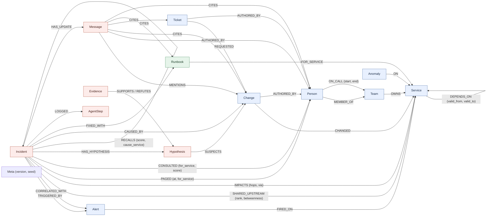

# Graph data model

On-call Brain keeps a company's operational knowledge and its incident memory in one FalkorDB property graph per
tenant. The agents never hold incident state in Python. They read the graph before every decision and write each
finding back as nodes and edges. This page describes every label, relationship, id and index the code uses. It is
derived from `src/oncall_brain/adapters/falkordb/queries/*.cypher` and `src/oncall_brain/datagen.py`. The queries
themselves are listed in [QUERIES.md](QUERIES.md).

Conventions:
- Every node has a string `id` with a type prefix (see [Ids](#ids)). Every write `MERGE`s on it.
- Times (`at`, `start`, `valid_from`, ...) are epoch seconds. The demo clock is pinned: act 1 fires at
  T1 = 2026-10-15 04:00 UTC (09:30 IST), act 2 at T2 = T1 + 3 days, and act 3's alert storm ends at
  T3 = T1 + 5 days.
- FalkorDB does not store null properties. A missing `valid_to` therefore means "still live", and a missing
  `rolled_back_at` means "never rolled back".

## Diagram



Blue nodes hold semantic facts about the company, red nodes hold episodic memory of incidents, and the green node
holds procedural memory. `Message` is drawn red because the status updates the agents post are episodic. Seeded chat
messages are semantic source material. `Meta` is not memory: it is one unconnected node that fingerprints the seed
data.

## Nodes

"Seed" means `services/seeding.py` writes it through the named `ingest_*` statement. `tool` → `statement` means
that tool (defined in `services/tools.py`, registered once in `agents/registry.py` and exposed to the agent
loop, the HTTP API and MCP) writes it by running that named write statement. The five event tools (`record_change`,
`record_anomaly`, `raise_alert`, `add_dependency`, `retire_dependency`, queries in `events.cypher`) keep the
semantic facts current after seeding.

| Label | Key properties | Meaning | Written by |
|---|---|---|---|
| `Team` | `id`, `name` | An engineering team that owns services and has an on-call rotation. | seed `ingest_teams` |
| `Person` | `id`, `name`, `handle` (`@first.last`, e.g. `@sana.brandt`) | An engineer. All names are fake. | seed `ingest_people` |
| `Service` | `id`, `name`, `tier` (1 = customer-facing critical, 2 = other) | A deployable service. | seed `ingest_services` |
| `Change` | `id`, `kind` (`deploy` / `config`), `summary`, `at`, `version` (deploys only), `rolled_back_at` (if rolled back) | A deploy or a config change to one service. Changes are the suspects in an investigation. | seed `ingest_changes`; `record_change` → `record_change` |
| `Alert` | `id`, `name`, `symptom` (`latency` / `errors` / `saturation`), `at`, `act` (story act 1, 2 or 3; seeded alerts only) | A monitoring alert that fired on a service. It is what starts an investigation. | seed `ingest_alerts`; `raise_alert` → `raise_alert` |
| `Anomaly` | `id`, `kind` (`latency` / `errors` / `saturation`), `summary`, `at` | A monitoring signal on a service. Checks use it to see whether a symptom travelled along a dependency path. | seed `ingest_anomalies`; `record_anomaly` → `record_anomaly` |
| `Incident` | `id`, `title`, `symptom`, `status` (`open` / `resolved`), `opened_at`, `resolved_at` | The shared board that every agent role reads and writes. Past incidents are already resolved. | seed `ingest_incidents` (history); `open_incident` → `open_incident`; `resolve_incident` → `resolve_incident` sets `status`, `resolved_at` |
| `Hypothesis` | `id`, `status` (`open` → `supported` / `refuted` / `inconclusive`, then `confirmed` by a human), `source` (`dependency-path` / `recent-anywhere` / `memory`), `hops`, `created_at`, `runbook` (memory suspects only: the runbook that suggested it) | "Change X caused this incident", together with where the suspicion came from. | `propose_hypotheses`, `hypothesize_from_memory` → `add_hypotheses`; status from `check_hypothesis` → `record_evidence` and `resolve_incident` |
| `Evidence` | `id`, `verdict` (`supports` / `refutes` / `inconclusive`), `reason`, `path` (service ids the check walked), `at` | The result of one check on a hypothesis, together with the path that justifies it. | `check_hypothesis` → `record_evidence` |
| `Runbook` | `id`, `title`, `steps` (list), `kind` (change kind it fixes), `uses`, `successes`, `learned_from` (learned runbooks only) | A fix procedure for one service and one kind of change. Its confidence is `successes / uses`. | seed `ingest_runbooks`; `resolve_incident` → `resolve_incident` (learns, or adds 1 to `uses` and `successes`); `check_hypothesis` → `record_evidence` adds 1 to `uses` when the runbook's suggestion is refuted |
| `Message` | `id`, `kind` (`chat` / `status_update`), `channel`, `text`, `at` | Seeded chat that announced a change, or a status update the comms agent posted. | seed `ingest_messages` (chat); `post_update` → `post_update` (status updates) |
| `Ticket` | `id`, `title`, `text`, `at` | A change-request ticket, which a status update can cite as a source. | seed `ingest_tickets` |
| `AgentStep` | `id`, `seq`, `role` (`triage` / `investigator` / `comms`), `tool` (tool name or `handoff`), `target`, `reason`, `summary`, `rows`, `ms`, `writes` | One step of one agent: what it did, why, and what it cost. Handoffs between roles are steps too. | agent loop (`agents/loop.record`) → `log_step` |
| `Meta` | `id` (always `meta`), `version` (fingerprint of the generated data), `seed` | Which generator built this graph. `reset()` restores the pristine copy only if its `version` matches the current generator, else it re-seeds. | seed `ingest_meta` |

## Relationships

| Relationship | Properties | Meaning | Written by |
|---|---|---|---|
| `(Person)-[:MEMBER_OF]->(Team)` | | Team membership. | seed `ingest_people` |
| `(Person)-[:ON_CALL]->(Team)` | `start`, `end` (end exclusive) | One on-call shift. The rotation is weekly and covers all three acts. | seed `ingest_on_call` |
| `(Team)-[:OWNS]->(Service)` | | Ownership. | seed `ingest_services` |
| `(Service)-[:DEPENDS_ON]->(Service)` | `valid_from`, `valid_to` (absent = still live) | The caller calls the callee during that window. `valid_from` is part of the `MERGE` key, so a dependency that is retired and later re-added gets a new edge with its own window. | seed `ingest_depends_on`; `add_dependency` → `add_dependency`; `retire_dependency` → `retire_dependency` (sets `valid_to` on the live edge) |
| `(Change)-[:CHANGED]->(Service)` | | The service the change touched. | seed `ingest_changes`; `record_change` → `record_change` |
| `(Change\|Ticket\|Message)-[:AUTHORED_BY]->(Person)` | | Who made the change, filed the ticket or wrote the chat message. | seed `ingest_changes`, `ingest_tickets`, `ingest_messages`; `record_change` (if an author is given) |
| `(Ticket)-[:REQUESTED]->(Change)` | | The change request behind a change. | seed `ingest_tickets` |
| `(Message)-[:MENTIONS]->(Change)` | | A chat message that announced a change. | seed `ingest_messages` |
| `(Alert)-[:FIRED_ON]->(Service)` | | Where the alert fired. | seed `ingest_alerts`; `raise_alert` → `raise_alert` |
| `(Anomaly)-[:ON]->(Service)` | | Where the anomaly was seen. | seed `ingest_anomalies`; `record_anomaly` → `record_anomaly` |
| `(Runbook)-[:FOR_SERVICE]->(Service)` | | The service the runbook fixes. Together with `Runbook.kind`, it says which changes the runbook is for. | seed `ingest_runbooks`; `resolve_incident` → `resolve_incident` |
| `(Incident)-[:TRIGGERED_BY]->(Alert)` | | The alert that opened the incident. | `open_incident` → `open_incident` |
| `(Incident)-[:IMPACTS]->(Service)` | `hops`, `via` | An impacted service. `hops` 0 is an alerting service. `via` is the service the blast radius was walked from: the alerting service when triage writes the edge (direct impact), and the culprit service when comms writes it (also at risk). | `open_incident` → `open_incident` (hops 0); `blast_radius` → `record_impacts`; `correlate_alerts` → `record_correlation` (hops 0 for each correlated alert's service); seed `ingest_incidents` (hops 0) |
| `(Incident)-[:CORRELATED_WITH]->(Alert)` | | Another alert that fired in the 15 minutes before this incident's alert, folded into this incident (alert storm). `check_hypothesis` refutes a suspect that cannot reach every correlated alert's service. | `correlate_alerts` → `record_correlation` |
| `(Incident)-[:SHARED_UPSTREAM]->(Service)` | `rank`, `betweenness` | A service every alerting service in the storm depends on (live edges at alert time), ranked by `algo.betweenness` over `Service` / `DEPENDS_ON`. The board reads these in rank order, and the investigator checks suspects on them first. Betweenness counts all `DEPENDS_ON` edges, retired ones included. | `correlate_alerts` → `record_correlation` |
| `(Incident)-[:PAGED]->(Person)` | `at`, `for_service` | Who was paged, when, and for which service. `who_knows` counts the incidents where someone was paged for the service it is asked about. | `page_on_call` → `record_page`; seed `ingest_incidents` (each past incident pages someone for its culprit service) |
| `(Incident)-[:CONSULTED]->(Person)` | `for_service`, `score` | The person comms will ask about the culprit service: the top `who_knows` answer. The status update names them in its "Ask:" line. | `who_knows` (with an `incident_id`) → `record_consult` |
| `(Incident)-[:HAS_HYPOTHESIS]->(Hypothesis)` | | A suspect on the board. | `add_hypotheses` |
| `(Hypothesis)-[:SUSPECTS]->(Change)` | | The change the hypothesis blames. | `add_hypotheses` |
| `(Evidence)-[:SUPPORTS]->(Hypothesis)` / `(Evidence)-[:REFUTES]->(Hypothesis)` | | The verdict of a check. An `inconclusive` verdict only sets the hypothesis status and writes no edge. | `check_hypothesis` → `record_evidence` (`FOREACH` picks the edge) |
| `(Incident)-[:RECALLS]->(Incident)` | `score`, `cause_service` | Episodic recall. The score is 2 when the past incident's root-cause service is on this alert's live dependency path, plus 1 for the same symptom. The planner acts on a score of 3 or more. | `recall_similar` → `record_recalls` |
| `(Incident)-[:CAUSED_BY]->(Change)` | | The human-confirmed root cause. | seed `ingest_incidents`; `resolve_incident` → `resolve_incident` |
| `(Incident)-[:FIXED_WITH]->(Runbook)` | | The runbook that fixed the incident. | seed `ingest_incidents`; `resolve_incident` → `resolve_incident` |
| `(Incident)-[:LOGGED]->(AgentStep)` | | The incident's agent history, in `seq` order. | agent loop → `log_step` |
| `(Incident)-[:HAS_UPDATE]->(Message)` | | The status update posted for the incident. | `post_update` → `post_update` |
| `(Message)-[:CITES]->(Change\|Ticket\|Message\|Runbook\|Person)` | | Every claim in a status update links to its source node, including the person it says to ask. A rewrite drops stale citations. | `post_update` → `post_update` |

## Ids

Ids are stable and human-readable, so writes can `MERGE` on them and a trace can be read without lookups.

| Label | Pattern | Example |
|---|---|---|
| Team | `team:<slug>` | `team:payments` |
| Person | `person:<first>-<last>` | `person:asha-okafor` (fake) |
| Service | `svc:<name>` | `svc:payments-gw` |
| Change | `chg:<slug>`; `record_change` uses the given id, else `chg:<service>-<at>` | `chg:pgw-pool-1` (story), `chg:n042` (noise), `chg:hist-3` (history) |
| Alert | `alert:<slug>`; `raise_alert` makes `alert:<service>-<symptom>-<at>` | `alert:checkout-latency` |
| Anomaly | `anom:<slug>`; `record_anomaly` makes `anom:<service>-<kind>-<at>` | `anom:pgw-1` |
| Incident | `inc:<alert slug>` for live incidents (derived from the alert id), `inc:<number>` for history | `inc:checkout-latency`, `inc:0911` |
| Hypothesis | `hyp:<incident slug>:<change slug>` (one per incident and change) | `hyp:checkout-latency:pgw-pool-1` |
| Evidence | `ev:<incident slug>:<change slug>` (one per hypothesis; a re-check overwrites it) | `ev:checkout-latency:pgw-pool-1` |
| Runbook | `rb:<slug>` seeded, `rb:<service>:<change kind>` learned | `rb:pg-disk`, `rb:payments-gw:config` |
| Message | `msg:<slug>` chat, `msg:update:<incident id>` status update | `msg:pay-deploys-1`, `msg:update:inc:checkout-latency` |
| Ticket | `ticket:<key>` | `ticket:CR-881` |
| AgentStep | `<incident id>#<seq>` | `inc:refunds-latency#7` |
| Meta | `meta` (one per graph) | `meta` |

## Indexes, and why there are no uniqueness constraints

`FalkorRepository.ensure_schema` (run by every seed) creates one range index per label on `id`:
`CREATE INDEX FOR (n:<Label>) ON (n.id)` for Team, Person, Service, Change, Alert, Anomaly, Incident, Hypothesis,
Evidence, Runbook, Message, Ticket and AgentStep (`repository.INDEXED_LABELS`). The single `Meta` node is not indexed.
The agent's queries anchor on an id first, for example `(:Incident {id: $incident_id})` or
`(:Service {id: $service})`. The index finds the start node, and the traversal then runs over adjacency.

It also creates range indexes on `Change.at` and `Anomaly.at` (`repository.TIME_INDEXED`) for the alert-window
filters. `recent_changes` and `anomalies_between` pass literal `$since` / `$until` bounds, so they use them.

There are no uniqueness constraints, by design. Idempotency comes from `MERGE` on a stable id in every write
statement, so re-loading, re-running a tool or replaying an act updates nodes instead of duplicating them. All writes
go through a small set of named, reviewed statements, so a constraint would only guard against writers that do not
exist. `MERGE` alone is not safe under concurrency (two writers can both miss an edge and both create it), so every
agent run holds a per-tenant lock (see ARCHITECTURE 3.7). The one `CREATE` is `log_step`: agent steps are an
append-only log whose `seq` is the incident's current step count + 1, and the lock makes the running agent its only
writer.

## Memory, mapped to the model

| Memory kind | In the graph | Written | Read |
|---|---|---|---|
| **Episodic**: what happened | `Incident` with `TRIGGERED_BY`, `CORRELATED_WITH`, `SHARED_UPSTREAM`, `IMPACTS`, `PAGED`, `CONSULTED`, `HAS_HYPOTHESIS` → `Hypothesis` ← `SUPPORTS`/`REFUTES` `Evidence`, `CAUSED_BY` → `Change`, `HAS_UPDATE`, and the `LOGGED` → `AgentStep` history; `RECALLS` links incidents to each other | by the agents during the incident, and by `resolve_incident` when a human confirms the cause | `recall_similar` finds past incidents by structure: their cause service is on today's live dependency path. Text similarity is not used. `incident_board` replays the board for the planner. |
| **Semantic**: how the company works | `Team`, `Person`, `Service`, `MEMBER_OF`, `OWNS`, `DEPENDS_ON {valid_from, valid_to}`, `ON_CALL {start, end}`, `Change` + `CHANGED` / `AUTHORED_BY`, sources (`Ticket` `REQUESTED`, chat `Message` `MENTIONS`) | by seed / ingest, then kept current by the event tools | Every traversal filters time-bounded edges to the alert time, so the graph answers "who depended on what, and who was on call, at that moment". `who_knows` and `change_story` answer company-brain questions with sources. |
| **Procedural**: what fixes it | `Runbook {kind, steps, uses, successes}` + `FOR_SERVICE` + `FIXED_WITH` | `resolve_incident` learns `rb:<service>:<kind>` from a confirmed fix, or adds 1 to `uses` and `successes` if it already exists. `record_evidence` adds 1 to `uses` when a check refutes the runbook's suggestion, so its confidence drops. | `memory_suspects` follows `RECALLS` → `FIXED_WITH` → `Runbook` → `FOR_SERVICE` and suspects in-window changes of the runbook's kind on that service, most trusted runbook first. `update_facts` adds the runbook memory used for the cause (`h.runbook`), or the one the incident was `FIXED_WITH`, to the status update as its "Next action". A runbook that only shares the service and change kind is not suggested: it may fix a different failure. |

Act 2 shows the three kinds working together. The refunds alert recalls the checkout incident because its cause
service (`payments-gw`) is still on refunds' live dependency path (semantic). The runbook that fixed it is for config
changes on `payments-gw`, so the investigator suspects the new `payments-gw` config change first (procedural), and
confirms it in one check instead of testing every change on the path. That shortcut is recorded on the incident as
`RECALLS` and `AgentStep` nodes (episodic).

## Tenants

Each tenant has its own graph in the same FalkorDB: `tenant_<name>`, where the name matches `[a-z0-9_]{1,40}`.
Seeding rebuilds the tenant from scratch and also keeps `pristine_<name>`. A demo reset is a server-side
`GRAPH.COPY` from that copy, so it does not re-run ingest, as long as the copy's `Meta` fingerprint matches the
current generator. Tenants share no nodes, so one tenant's incidents and learned runbooks can never be recalled for
another. The seeded company (seed 7) has 6 teams, 24 people, 25 services, 39 `DEPENDS_ON` edges (one retired), 24
on-call shifts, 109 changes, 5 alerts (1 for act 1, 1 for act 2, 3 for act 3), 43 anomalies, 7 runbooks, 7 past
incidents (each with a `PAGED` edge), 3 tickets, 1 chat message and the `Meta` node: 231 nodes and 421 relationships.

## Three traversals in plain English

These are run against the seeded demo tenant, with the results shown. `$at` is the act-1 alert time T1.

**1. "If payments-gw is slow, who is hurt?"** Walk `DEPENDS_ON` edges backwards from `payments-gw`, up to 6 hops.
Keep a path only if every edge on it was live at alert time, and report each caller's shortest distance. This is
`blast_radius`.

```cypher
MATCH p = (caller:Service)-[:DEPENDS_ON*1..6]->(:Service {id: 'svc:payments-gw'})
WHERE all(r IN relationships(p) WHERE r.valid_from <= $at AND (r.valid_to IS NULL OR r.valid_to > $at))
RETURN caller.id AS service, min(length(p)) AS hops
ORDER BY hops, service
```

Result: `payments` (1 hop), then `checkout`, `refunds`, `subscriptions` (2), then `api-gateway` (3), then
`mobile-bff` and `web-frontend` (4). Checkout, where act 1's alert fires, is two hops from the cause.

**2. "Could the legacy-billing deploy have slowed checkout?"** First ask for a path that is live at alert time,
which is what `live_paths` does. There is none. Then ask for any path, ignoring validity, which is what `any_path`
does with `shortestPath`:

```cypher
MATCH (o:Service {id: 'svc:checkout'}), (t:Service {id: 'svc:legacy-billing'})
WITH shortestPath((o)-[:DEPENDS_ON*]->(t)) AS p
RETURN [n IN nodes(p) | n.id] AS path, [r IN relationships(p) | r.valid_to] AS retired_at
```

Result: `[svc:checkout, svc:legacy-billing]`, retired at T1 − 3 days. Checkout used to call legacy-billing but
stopped before the alert, so the hypothesis is refuted with that reason. A flat change log cannot tell this suspect
apart from a real one, and a dependency map without validity windows would wrongly keep it.

**3. "Have we seen this before, and what fixed it?"** After act 2, follow the incident's memory chain: what it
recalled, what caused that earlier incident, and which runbook for that service fixed it.

```cypher
MATCH (now:Incident {id: 'inc:refunds-latency'})-[x:RECALLS]->(past:Incident)
      -[:CAUSED_BY]->(c:Change)-[:CHANGED]->(s:Service)
MATCH (past)-[:FIXED_WITH]->(rb:Runbook)-[:FOR_SERVICE]->(s)
RETURN past.id AS recalled, x.score AS score, c.summary AS cause, s.id AS service, rb.title AS runbook,
       rb.successes AS successes
ORDER BY score DESC
```

Result: `inc:checkout-latency` with score 3, caused by "Lower payments-gw HTTP pool max_connections 200 -> 20" on
`svc:payments-gw`, fixed with "Revert the config change on payments-gw" (1 success). Two older incidents score 2:
their cause service is on refunds' path, but they had a different symptom, so the planner ignores them. This chain
(INC-2 → INC-1 → change → runbook) is the path act 2 lights up.
