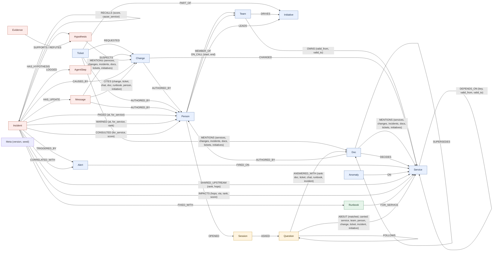

# Graph data model

On-call Brain keeps a company's operational knowledge and its incident memory in one FalkorDB property graph per
tenant. The agents hold no incident state in Python. They read the graph before every decision and write each
finding back as nodes and edges. This page describes every label, relationship, id, index and constraint the code
uses, from `src/oncall_brain/adapters/falkordb/queries/*.cypher`, `repository.py` and `src/oncall_brain/datagen.py`.
The queries themselves are listed in [QUERIES.md](QUERIES.md).

Conventions:
- Every node has a string `id` with a type prefix (see [Ids](#ids)). Every write `MERGE`s on it.
- Times (`at`, `start`, `valid_from`, ...) are epoch seconds. The demo clock is pinned: act 1 fires at
  T1 = 2026-10-15 04:00 UTC (09:30 IST), act 2 at T2 = T1 + 3 days, and act 3's alert storm ends at
  T3 = T1 + 5 days.
- FalkorDB does not store null properties. A missing `valid_to` means "still live", and a missing `rolled_back_at`
  means "never rolled back".

## Diagram



Blue nodes hold semantic facts about the company, red nodes episodic memory of incidents, the green node
procedural memory, and the orange nodes conversational memory: what each engineer asked the company brain.
`Message` is drawn red because the status updates the agents write are episodic; seeded chat messages are semantic
source material, like `Doc` and `Ticket`. `Meta` is not memory: one unconnected node that fingerprints the seed
data. Locks and counters live in a separate graph ([The coordination graph](#the-coordination-graph)).

## Nodes

"Seed" means `services/seeding.py` writes it through the named `ingest_*` statement. `tool` → `statement` means
that tool (defined in `services/tools.py`, registered in `agents/registry.py`, exposed to the agent loop, the HTTP
API and MCP) writes it with that named statement. The nine event tools (`record_change`, `record_anomaly`,
`raise_alert`, `add_dependency`, `retire_dependency`, `record_doc`, `record_message`, `record_ticket`,
`transfer_ownership`, queries in `events.cypher`) keep the semantic facts current after seeding.

| Label | Key properties | Meaning | Written by |
|---|---|---|---|
| `Team` | `id`, `name` | An engineering team that owns services and has an on-call rotation. | seed `ingest_teams` |
| `Person` | `id`, `name`, `handle` (`@first.last`, e.g. `@sana.brandt`) | An engineer. All names are fake, and no two people share a first name. | seed `ingest_people` |
| `Service` | `id`, `name`, `tier` (1 = customer-facing critical, 2 = other) | A deployable service. | seed `ingest_services` |
| `Change` | `id`, `kind` (`deploy` / `config`), `summary`, `at`, `version` (deploys only), `rolled_back_at` (if rolled back), `recorded_at` (when a tool recorded it) | A deploy or a config change to one service. Changes are the suspects in an investigation. | seed `ingest_changes`; `record_change` → `record_change` (re-recording an id corrects it: the old `CHANGED` / `AUTHORED_BY` edges are dropped) |
| `Alert` | `id`, `name`, `symptom` (`latency` / `errors` / `saturation`), `at`, `act` (story act 1, 2 or 3; seeded alerts only) | A monitoring alert that fired on a service. It starts an investigation. | seed `ingest_alerts`; `raise_alert` → `raise_alert` |
| `Anomaly` | `id`, `kind` (`latency` / `errors` / `saturation`), `summary`, `at`, `recorded_at` (when a tool recorded it) | A monitoring signal on a service. Checks use it to see whether a symptom travelled along a dependency path. | seed `ingest_anomalies`; `record_anomaly` → `record_anomaly` |
| `Incident` | `id`, `title`, `symptom`, `status` (`open` / `resolved`), `opened_at`, `resolved_at`, `recorded_at` (when the graph opened it) | The shared board every agent role reads and writes. Past incidents are already resolved. | seed `ingest_incidents` (history); `open_incident` → `open_incident`; `resolve_incident` → `resolve_incident` sets `status`, `resolved_at` |
| `Hypothesis` | `id`, `status` (see below), `source` (`dependency-path` / `recent-anywhere` / `memory`, or `human` when a human confirmed a change no agent suspected), `hops`, `created_at`, `runbook` (memory suspects only: the runbook that suggested it), `explained` (the alerting services the change can reach over live edges), `onset` (the first anomaly on the change's own service after the change; unset if none), `red_before` (the latest anomaly on that service before the change, in the alert window: was it already failing?), `gaps` (middle services of the judged path with no anomaly on record), `note` (co-causes only: why it is still needed) | "Change X caused this incident", with where the suspicion came from. Status: `open` → `supported` / `refuted` after its check (a silent middle hop gives a weaker `supported` with `gaps` set). When several are supported, `conclude` keeps one leading `supported` cause; another becomes `outranked` if the leader explains every alerting service it explains, else `co-cause`. `confirmed` is set only by a human, and then every other `supported` or `co-cause` suspect becomes `outranked`. A later re-check never changes `confirmed`. | `propose_hypotheses`, `hypothesize_from_memory` → `add_hypotheses`; status and facts from `check_hypothesis` → `record_evidence`; `conclude` → `record_outranked`, `record_co_causes`; `resolve_incident` (creates it if no agent suspected the change) |
| `Evidence` | `id`, `verdict` (`supports` / `refutes` / `outranked`), `reason` (the full explanation), `tag` (a few words for the update's "Ruled out:" line: `rolled back`, `dependency retired`, `dependency not yet live`, `no dependency path`, `no anomaly after it`, `supported`, `supported, with a monitoring gap`, `outranked`, `a human confirmed another cause`), `path` (service ids the check walked), `at`, `explained` | The result of one check, with the path that justifies it. An outranked hypothesis gets a separate `outranked` Evidence node that `REFUTES` it; the check's own `SUPPORTS` evidence stays, so a human can still confirm it. A human confirmation adds a `supports` node with reason "confirmed by a human". | `check_hypothesis` → `record_evidence`; `conclude` → `record_outranked`; `resolve_incident` |
| `Runbook` | `id`, `title`, `steps` (list), `kind` (the change kind it fixes), `uses`, `successes`, `learned_from` (learned runbooks only) | A fix procedure for one service and one kind of change. Its confidence is `successes / uses`. | seed `ingest_runbooks`; `resolve_incident` (learns it, or adds 1 to `uses` and `successes`); `record_evidence` adds 1 to `uses` when its suggestion is refuted (once, on open → refuted) |
| `Message` | `id`, `kind` (`chat` / `status_update`), `channel`, `text`, `at` | Seeded chat (change announcements, design debates, `#incidents` wrap-ups), or the status update the comms agent wrote for #incidents. `text` is full-text indexed, so `ask` finds both. | seed `ingest_messages`; `record_message` → `record_message`; `post_update` → `post_update` (status updates) |
| `Ticket` | `id`, `title`, `text`, `at`, `status` (`open` / `done`, set by `record_ticket`) | A change request or other work item (`CR-881`, `PAY-412`, ...), which an update can cite and `ask` can find (`title` and `text` are full-text indexed). | seed `ingest_tickets`; `record_ticket` → `record_ticket` |
| `Initiative` | `id`, `name`, `goal`, `status` (`active` / `done`), `since`, `due` | A project, programme or review: the work behind changes. A team `DRIVES` it, a person `LEADS` it, tickets are `PART_OF` it, docs and chat `MENTION` it. `ask` walks it for "what is the Q4 cost review changing" and "who is on it" (`initiative_story`), and the update names the initiative behind its cause (`cause_initiative`: the change's `REQUESTED` ticket, then `PART_OF`). | seed `ingest_initiatives` |
| `Doc` | `id`, `kind` (`postmortem` / `design` / `decision` / `runbook`), `title`, `text`, `at` | A written page: a postmortem, a design note, a decision record (ADR) or a runbook page. Company-brain source material; `title` and `text` are full-text indexed. Not the same as `Runbook`, which is procedural memory the agents act on. | seed `ingest_docs`, `ingest_doc_links`; `record_doc` → `record_doc` |
| `AgentStep` | `id`, `seq`, `role` (`triage` / `investigator` / `comms`), `tool` (a tool name or `handoff`), `target`, `reason`, `summary`, `rows`, `ms`, `writes`, `by` (model id or `rules`), `queries` (JSON, one entry per named query the step ran: `name`, `row_count`, `ms`, `readonly`, `db_ms` and `cached` from FalkorDB's reply, `wrote` for a write, `params` up to 2 KB per step, and `sha`, the first 12 hex of the SHA-256 of the query's Cypher) | One step of one agent: what it did, why, what it cost, and the queries behind it. Handoffs are steps too. The Cypher text is code, served by name from `GET /api/queries/{name}` with its current `sha`, so a query edited after the step ran shows as changed. | agent loop (`agents/loop.record`) → `log_step` |
| `Session` | `id`, `user` (the asker as given to `ask`, lowercased), `key` (the conversation key, default `default`), `started_at`, `last_at` | One engineer's conversation with the company brain. A user can have several (a chat, a terminal); a pronoun is read within one. The Person `OPENED` it when the user is one. | `ask` (with a `user`) → `record_question` |
| `Question` | `id`, `seq` (position in the session), `text` (as asked), `resolved` (the question with its pronoun replaced, when one was), `intent` (the `ask` route that answered: `owner`, `expert`, `why`, `how`, `happened`, `project`, `members` or `search`), `at`, `summary`, `answer` | One question `ask` answered for a named user, with the answer. A recall ("what did I ask about X") is not recorded. | `ask` (with a `user`) → `record_question` |
| `Meta` | `id` (always `meta`), `version` (fingerprint of the generated data), `seed` | Which generator built this graph. `reset()` restores the pristine copy only if its `version` matches the current generator run with this `seed`, else it re-seeds. | seed `ingest_meta` |

## Relationships

| Relationship | Properties | Meaning | Written by |
|---|---|---|---|
| `(Person)-[:MEMBER_OF]->(Team)` | | Team membership. | seed `ingest_people` |
| `(Person)-[:ON_CALL]->(Team)` | `start`, `end` (end exclusive) | One on-call shift. The rotation is weekly and covers all three acts. | seed `ingest_on_call` |
| `(Team)-[:OWNS]->(Service)` | `valid_from` (MANDATORY), `valid_to` (absent = still the owner) | Ownership during that window. A service has one live owner: `transfer_ownership` closes the live edge (`valid_to`) and creates the new team's edge (a time before the live edge's start writes nothing: history is append-only). Paging (`on_call_for`), `blast_radius`, `warn_candidates`, `service_map` and `ask` use the owner at the time asked; `who_knows` still credits the team that ran it; "who owned payments-gw at the time of inc:0911" reads the history. | seed `ingest_services`; `transfer_ownership` → `transfer_ownership` |
| `(Service)-[:DEPENDS_ON]->(Service)` | `key` (UNIQUE and MANDATORY: `<caller id>><callee id>@<valid_from>`), `valid_from` (MANDATORY), `valid_to` (absent = still live), `recorded_at` (from `add_dependency`) | The caller calls the callee during that window. A pair has at most one live edge. `add_dependency` creates a new edge only if none is live (a retired record that starts at the same time is reopened instead); adding a live one again only moves its `valid_from` earlier. A dependency retired and later re-added gets a new edge with its own window and key. | seed `ingest_depends_on` (`MERGE` on `key` and `valid_from`); `add_dependency` → `add_dependency`; `retire_dependency` → `retire_dependency` (sets `valid_to` on the live edge) |
| `(Change)-[:CHANGED]->(Service)` | | The service the change touched. | seed `ingest_changes`; `record_change` |
| `(Change\|Ticket\|Message\|Doc)-[:AUTHORED_BY]->(Person)` | | Who made the change, filed the ticket, wrote the message or the doc. `who_knows` counts the docs, tickets and chat someone wrote that mention or decide a service (at most 3 points, so writing about a service never outweighs hands-on evidence). | seed `ingest_changes`, `ingest_tickets`, `ingest_messages`, `ingest_docs`; `record_change`, `record_doc`, `record_message`, `record_ticket` (if an author is given) |
| `(Ticket)-[:REQUESTED]->(Change)` | | The change request behind a change. | seed `ingest_tickets`; `record_ticket` (`requests`) |
| `(Ticket)-[:PART_OF]->(Initiative)` | | The initiative the ticket belongs to, so a change traces to the project behind it (`REQUESTED`, then `PART_OF`): the update's "Behind it:" line and `ask`'s "what is the Q4 cost review changing". | seed `ingest_tickets`; `record_ticket` (`part_of`) |
| `(Team)-[:DRIVES]->(Initiative)`, `(Person)-[:LEADS]->(Initiative)` | | Who is behind an initiative: the sponsoring team and its lead. | seed `ingest_initiatives` |
| `(Doc\|Ticket\|Message)-[:MENTIONS]->(Service\|Change\|Incident\|Doc\|Ticket\|Initiative)` | | What a doc, ticket or chat message talks about (a chat message that announced a change `MENTIONS` it). `ask` expands search hits along these edges; `change_story` lists every doc and chat that mentions a change. | seed `ingest_docs`, `ingest_tickets`, `ingest_messages`; `record_doc`, `record_message`, `record_ticket`, which refuse an unknown id before writing anything (`known_ids`) |
| `(Doc)-[:DECIDES]->(Service)` | | The doc is the decision of record for that service. `ask` says so, and `who_knows` counts it. | seed `ingest_docs`; `record_doc` (`decides`) |
| `(Doc)-[:SUPERSEDES]->(Doc)` | | The newer doc replaces the older one (e.g. ADR-011 Kafka retention of 7 days supersedes ADR-006). `ask` ranks a superseded doc below its replacement and flags it. | seed `ingest_doc_links` (after every doc exists); `record_doc` (`supersedes`) |
| `(Alert)-[:FIRED_ON]->(Service)` | | Where the alert fired. | seed `ingest_alerts`; `raise_alert` |
| `(Anomaly)-[:ON]->(Service)` | | Where the anomaly was seen. | seed `ingest_anomalies`; `record_anomaly` |
| `(Runbook)-[:FOR_SERVICE]->(Service)` | | The service the runbook fixes. With `Runbook.kind`, it says which changes the runbook is for. | seed `ingest_runbooks`; `resolve_incident` |
| `(Incident)-[:TRIGGERED_BY]->(Alert)` | | The alert that opened the incident. | `open_incident` |
| `(Incident)-[:IMPACTS]->(Service)` | `hops`, `via`, `rank`, `score` | An impacted service. `hops` 0 is an alerting service. `via` is the service the blast radius was walked from: the alerting service when triage writes the edge (direct impact), the culprit service when comms writes it (also at risk). `rank` is the criticality order (1 = warn first: tier 1 before tier 2, then by `score`, the service's PageRank over the dependencies live at alert time). | `open_incident` (hops 0); `blast_radius` → `record_impacts`, `record_criticality`; `correlate_alerts` → `record_correlation` (hops 0 for each folded alert's service); seed `ingest_incidents` (hops 0) |
| `(Incident)-[:CORRELATED_WITH]->(Alert)` | | A related alert folded into this incident (an alert storm): it fired within 15 minutes of this incident's alert, and `algo.WCC` put its service in the same component, joined through upstream services that went red in the 2-hour window (chains included). Related alerts need not share one cause: `check_hypothesis` records which of their services each suspect can reach (`explained`). A second responder to a folded alert joins this incident (`open_incident_for_alert`). | `correlate_alerts` → `record_correlation` |
| `(Incident)-[:SHARED_UPSTREAM]->(Service)` | `rank`, `hops` | A service every folded alerting service depends on (live edges at alert time, 0 to 6 hops). There may be none, when the alerts have separate causes. `hops` is the total of their hop counts to it; `rank` orders by it (fewest first: where the paths converge). The investigator checks suspects on them first. | `correlate_alerts` → `record_correlation` |
| `(Incident)-[:PAGED]->(Person)` | `at`, `for_service` | Who was paged, when, and for which service. `who_knows` counts the incidents where someone was paged for the service asked about. | `page_on_call` → `record_page`; seed `ingest_incidents` |
| `(Incident)-[:WARNED]->(Person)` | `at`, `for_service`, `rank` | A heads-up to the on-call of an impacted team that was not paged, in criticality order (`rank` is the `IMPACTS.rank` of its service). The update's "Heads-up" line. | `warn_owners` → `record_warning` |
| `(Incident)-[:CONSULTED]->(Person)` | `for_service`, `score` | The person comms will ask about the culprit service: the top `who_knows` answer, named in the update's "Ask:" line. | `who_knows` (with an `incident_id`) → `record_consult` |
| `(Incident)-[:HAS_HYPOTHESIS]->(Hypothesis)` | | A suspect on the board. | `add_hypotheses` |
| `(Hypothesis)-[:SUSPECTS]->(Change)` | | The change the hypothesis blames. | `add_hypotheses` |
| `(Evidence)-[:SUPPORTS]->(Hypothesis)` / `(Evidence)-[:REFUTES]->(Hypothesis)` | | The verdict of a check: every check writes exactly one of the two edges (a re-check that changes the verdict drops the old edge). An outranked hypothesis also gets a `REFUTES` edge from its separate `outranked` Evidence node. A co-cause gets no new edge (its `note` says why it stays). | `check_hypothesis` → `record_evidence`; `conclude` → `record_outranked`; `resolve_incident` |
| `(Incident)-[:RECALLS]->(Incident)` | `score`, `cause_service` | Episodic recall. The score is 2 when the past incident's root-cause service is on this alert's live dependency path, plus 1 for the same symptom. The planner acts on 3 or more. | `recall_similar` → `record_recalls` |
| `(Incident)-[:CAUSED_BY]->(Change)` | | The human-confirmed root cause (also the incident's `confirmed` hypothesis). | seed `ingest_incidents`; `resolve_incident` |
| `(Incident)-[:FIXED_WITH]->(Runbook)` | | The runbook that fixed the incident. | seed `ingest_incidents`; `resolve_incident` |
| `(Incident)-[:LOGGED]->(AgentStep)` | | The incident's agent history, in `seq` order. | agent loop → `log_step` |
| `(Incident)-[:HAS_UPDATE]->(Message)` | | The status update written for the incident. | `post_update` |
| `(Message)-[:CITES]->(Change\|Ticket\|Message\|Doc\|Runbook\|Person\|Initiative)` | | Every claim in a status update links to its source node, including the person it says to ask and the initiative behind the cause. Act 1 cites `chg:pgw-pool-1`, `ticket:CR-881`, `msg:pay-deploys-1`, `doc:cost-review-pgw`, `doc:pm-load-test-pgw`, `person:sana-brandt` and `init:q4-cost-review`. A rewrite drops stale citations. | `post_update` |
| `(Person)-[:OPENED]->(Session)` | | The engineer behind a session, when the `user` given to `ask` is a Person id or handle in the graph; a session under any other name has no edge and still works. | `ask` → `record_question` |
| `(Session)-[:ASKED]->(Question)` | | The session's questions; `Question.seq` orders them. | `ask` → `record_question` |
| `(Question)-[:FOLLOWS]->(Question)` | | The question asked just before this one in the session. | `ask` → `record_question` |
| `(Question)-[:ABOUT]->(Service\|Team\|Person\|Change\|Ticket\|Incident\|Initiative)` | `matched`, `carried` | What the question was about: the entities `ask` linked in its text (`carried` false), or read a pronoun as (`carried` true: "it" in "and who knows it?" after "who owns payments-gw"). `session_context` reads the latest question's `ABOUT` edges to resolve the next pronoun; `user_questions` filters on them for "what did I ask about payments-gw". | `ask` → `record_question` |
| `(Question)-[:ANSWERED_WITH]->(Doc\|Ticket\|Message\|Runbook\|Incident)` | `rank` | The sources the answer cited, in the order it listed them. | `ask` → `record_question` |

## Ids

Ids are stable and human-readable, so writes can `MERGE` on them and a trace can be read without lookups.

| Label | Pattern | Example |
|---|---|---|
| Team | `team:<slug>` | `team:payments` |
| Person | `person:<first>-<last>` | `person:asha-okafor` (fake) |
| Service | `svc:<name>` | `svc:payments-gw` |
| Change | `chg:<slug>`; `record_change` uses the given id, else `chg:<service>-<at>` | `chg:pgw-pool-1` (story), `chg:n042` (noise), `chg:hist-3` (history) |
| Alert | `alert:<slug>`; `raise_alert` makes `alert:<service>-<symptom>-<at>` | `alert:checkout-latency` |
| Anomaly | `anom:<slug>`; `record_anomaly` makes `anom:<service>-<kind>-<at>` | `anom:pgw-1` |
| Incident | `inc:<alert slug>` for live incidents (derived from the alert id), `inc:<number>` for history | `inc:checkout-latency`, `inc:0911` |
| Hypothesis | `hyp:<incident slug>:<change slug>` (one per incident and change) | `hyp:checkout-latency:pgw-pool-1` |
| Evidence | `ev:<incident slug>:<change slug>` for the check (a re-check overwrites it); `...:outranked` for `conclude`'s verdict; `...:human` for the "confirmed by a human" support and for the refutation of a suspect a human's confirmation outranked | `ev:checkout-latency:pgw-pool-1`, `ev:subscriptions-latency:subs-88:outranked`, `ev:checkout-latency:pgw-pool-1:human` |
| Runbook | `rb:<slug>` seeded, `rb:<service>:<change kind>` learned | `rb:pg-disk`, `rb:payments-gw:config` |
| Message | `msg:<slug>` story chat, `msg:chat-<nnn>` corpus chat, `msg:update:<incident id>` status update; `record_message` uses the given id, else `msg:<channel>-<at>-<digest>` | `msg:pay-deploys-1`, `msg:chat-008`, `msg:update:inc:checkout-latency` |
| Ticket | `ticket:<key>`; `record_ticket` uses the given id or key, else `ticket:<at>-<digest>` | `ticket:CR-881`, `ticket:PAY-412` |
| Doc | `doc:<slug>`; a past incident's postmortem is `doc:pm-<incident number>`; `record_doc` uses the given id, else `doc:<kind>-<at>-<digest>` | `doc:cost-review-pgw`, `doc:adr-012`, `doc:pm-0911` |
| Initiative | `init:<slug>` | `init:q4-cost-review` |
| AgentStep | `<incident id>#<seq>` | `inc:refunds-latency#7` |
| Session | `session:<user without the person: or @ prefix>:<key>` | `session:hana-costa:default`, `session:hana.costa:claude-code` |
| Question | `<session id>#<seq>` | `session:hana-costa:default#2` |
| Meta | `meta` (one per graph) | `meta` |

## Indexes and constraints

`FalkorRepository.ensure_schema` (run by every seed and reset) creates, from the constants in `repository.py`:
- **A range index on `id`** for Team, Person, Service, Change, Alert, Anomaly, Incident, Hypothesis, Evidence,
  Runbook, Message, Ticket, Doc, AgentStep, Session, Question and Initiative (`INDEXED_LABELS`). The single `Meta`
  node is not indexed. The agents' queries anchor on an id first, for example `(:Incident {id: $incident_id})`; the
  index finds the start node, and the traversal runs over adjacency.
- **Range indexes on `Change.at`, `Anomaly.at` and `Alert.at`** (`TIME_INDEXED`) for the alert-window filters. The
  queries pass literal `$since` / `$until` bounds, since FalkorDB uses the range index only for literal or parameter
  bounds.
- **Range indexes on `Person.handle`, `Session.user`, `Doc.kind` and `Incident.status`** (`PROP_INDEXED`), the other
  properties a query starts from. `tests/integration/test_plans.py` checks every named query's plan: it must start
  from an index unless it is on a short list that says why it reads a whole label.
- **Three full-text indexes** (`FULLTEXT`): `Doc` and `Ticket` on `title` and `text`, `Message` on `text`.
  `search_knowledge` queries each with `db.idx.fulltext.queryNodes(<label>, $query)`. The question is reduced to
  content words (stopwords dropped, only `[a-z0-9]` kept, at most 12, joined with `|`), so nothing the user types
  reaches the index's query syntax.
- **A UNIQUE constraint on `id`** for every indexed label (`GRAPH.CONSTRAINT CREATE <graph> UNIQUE NODE <Label>
  PROPERTIES 1 id`). `ensure_schema` waits until each is `OPERATIONAL`. Idempotency still comes from `MERGE` on a
  stable id in every write, and a `MERGE` never trips a constraint. What the constraint adds is that no writer, a
  raw `GRAPH.QUERY` included, can create a second node with an existing id: 12 clients racing `CREATE` on ten ids
  made ten duplicates without constraints and none with them (PERF.md, Concurrency).
- **Edge constraints** (`EDGE_CONSTRAINTS`): `DEPENDS_ON.key` UNIQUE and MANDATORY (`KEYED_EDGES`), so racing
  writers record one dependency once (`test_racing_writers_record_one_dependency_once_without_any_lock`); and
  `valid_from` MANDATORY on `DEPENDS_ON` and `OWNS` (`DATED_EDGES`), so FalkorDB refuses an undated dependency or
  owner and every "what was true at alert time" filter meets dated edges only
  (`test_the_database_refuses_an_undated_dependency_or_owner`). FalkorDB checks a constraint the moment an edge is
  made, before any `SET`, so the ingest puts `key` and `valid_from` in the `MERGE` pattern. A graph whose
  dependencies have no key yet gets one first (`backfill_dependency_keys`).

Constraints are created only when missing, since creating one while writes run can crash the server (FalkorDB issue
#3154). `GRAPH.COPY` carries indexes and constraints, so the pristine copy and every reset keep them
(`test_fulltext_index_is_idempotent_survives_reset_and_scenarios_still_load`,
`test_every_label_has_a_unique_id_constraint_that_reset_keeps_and_the_database_enforces`).

The board edges the agents write carry no key, and `MERGE` on an edge is not safe under concurrency (two writers can
both miss it and both create it; measured in the same benchmark), so every agent run and write tool holds a
per-tenant lock (ARCHITECTURE 3.7). The only `CREATE`s of nodes are `log_step` and `record_question`: append-only
logs whose `seq` is the current count + 1, each with one writer at a time (the tenant lock for agent steps, the
session's own lock for questions); the unique constraints on `AgentStep.id` and `Question.id` are the backstop.

## Two times on a fact

Facts carry valid time (`at`, `valid_from`, `valid_to`: when it was true) and, when a tool writes them, transaction
time (`recorded_at`: FalkorDB's `timestamp()` / 1000 when the graph learned it). `recorded_at` is set on `Change` and
`Anomaly` (`record_change`, `record_anomaly`, kept on a re-record), on a new `DEPENDS_ON` (`add_dependency`) and on
`Incident` (`open_incident`). Seeded facts have none: known from the start.

The outcome's `learned_late` (the `learned_late` query) lists what an incident's investigation used that the graph
learned after the incident opened: its suspect changes, and the anomalies inside the alert window on the suspects'
services and on the evidence paths, whose `recorded_at` is later than the incident's. A change CI/CD reported late is
used and marked as late, instead of silently rewriting what the agents knew
(`test_a_change_reported_after_the_incident_opened_is_used_and_marked_learned_late`).

## The coordination graph

One more graph sits beside the tenant graphs, `oncall_brain_coord`, holding what every process shares (the API, the
MCP server, the scripts). FalkorDB Cloud gives its users no `SET`, `INCR` or `EVAL`, so none of this is kept in Redis
keys:

| Label | Properties | What it is |
|---|---|---|
| `Lease` | `key` (UNIQUE), `owner`, `exp` (ms, server clock) | A tenant's run lock (`oncall_brain:lock:<tenant>`), a narrower scoped lock (`oncall_brain:lock:<tenant>:<scope>`, e.g. one conversation session), a Slack replay marker or a pending Slack run. The UNIQUE constraint lets exactly one of any number of concurrent `CREATE`s win: that is the mutex. |
| `Counter` | `key` (UNIQUE), `n`, `exp` | A throttle window (`oncall_brain:rl:<bucket>:<client>:<window>`) or the hourly or daily LLM token count (`oncall_brain:llm_tokens:<date>`), updated by one atomic `MERGE ... SET c.n = c.n + $by`. |

Queries: `queries/coordination.cypher`. Expiry runs on the server's clock, so processes on different machines agree.
Expired nodes are swept every 500 writes. A constraint that comes up `FAILED` after a database restart is repaired
(`Coordination._setup`), and `serve.py`'s watchdog re-checks the constraints once a minute.

## Memory, mapped to the model

| Memory kind | In the graph | Written | Read |
|---|---|---|---|
| **Episodic**: what happened | `Incident` with `TRIGGERED_BY`, `CORRELATED_WITH`, `SHARED_UPSTREAM`, `IMPACTS`, `PAGED`, `WARNED`, `CONSULTED`, `HAS_HYPOTHESIS` → `Hypothesis` ← `SUPPORTS`/`REFUTES` `Evidence`, `CAUSED_BY` → `Change`, `HAS_UPDATE`, and the `LOGGED` → `AgentStep` history; `RECALLS` links incidents | by the agents during the incident, and by `resolve_incident` when a human confirms the cause | `recall_similar` finds past incidents by structure: their cause service is on today's live dependency path. Text similarity is not used. `incident_board` replays the board for the planner. |
| **Semantic**: how the company works | `Team`, `Person`, `Service`, `MEMBER_OF`, `OWNS {valid_from, valid_to}`, `DEPENDS_ON {valid_from, valid_to}`, `ON_CALL {start, end}`, `Change` + `CHANGED` / `AUTHORED_BY`, sources (`Doc`, `Ticket`, chat `Message`, `Initiative`, linked by `REQUESTED`, `PART_OF`, `MENTIONS`, `DECIDES`, `SUPERSEDES`, `AUTHORED_BY`) | by seed, then kept current by the event tools | Every traversal filters time-bounded edges to the alert time, so the graph answers "who depended on what, and who was on call, at that moment". `ask`, `who_knows` and `change_story` answer company questions with sources; `SUPERSEDES` says which doc is current. |
| **Procedural**: what fixes it | `Runbook {kind, steps, uses, successes}` + `FOR_SERVICE` + `FIXED_WITH` | `resolve_incident` learns `rb:<service>:<kind>` from a confirmed fix, or adds 1 to `uses` and `successes`. `record_evidence` adds 1 to `uses` when a check refutes the runbook's suggestion. | `memory_suspects` follows `RECALLS` → `FIXED_WITH` → `Runbook` → `FOR_SERVICE` and suspects in-window changes of the runbook's kind on that service, most trusted runbook first. `update_facts` adds the runbook memory used for the cause, or the one the incident was `FIXED_WITH`, to the update as its "Next action". |
| **Conversational**: what each engineer asked | `Session` + `Question` per user and conversation, `OPENED`, `ASKED`, `FOLLOWS`, `ABOUT {carried}`, `ANSWERED_WITH {rank}` | `ask`, when given a `user`, appends every question it answers (`record_question`) with the entities it linked, the sources it cited and the answer. Per tenant and per user; a tenant reset clears them. | `session_context` gives the previous question's entities, so "and who is on call for it?" is read as "... for payments-gw" and the answer says so. `user_questions` answers "what did I ask about payments-gw" (the `ask` history route and the `my_questions` tool), newest first, with each question's sources. |

Act 2 shows the three incident kinds working together. The refunds alert recalls the checkout incident because its
cause service (`payments-gw`) is still on refunds' live dependency path (semantic). The runbook that fixed it is for
config changes on `payments-gw`, so the investigator suspects the new `payments-gw` config change first
(procedural), and confirms it in one check instead of testing every change on the path. That shortcut is recorded
on the incident as `RECALLS` and `AgentStep` nodes (episodic).

## Tenants and side graphs

Each tenant has its own graph in the same FalkorDB: `tenant_<name>`, where the name matches `[a-z0-9_]{1,40}`.
Tenants share no nodes, so one tenant's incidents and learned runbooks are never recalled for another. Beside it:

| Graph | What it is |
|---|---|
| `pristine_<name>` | The seeded state, for resets: a reset is a server-side `GRAPH.COPY` from it (to `restoring_<name>`, then `RENAME` over the tenant), as long as its `Meta` fingerprint matches the current generator. |
| `seeding_<name>` | Where a seed is built; it is published by `GRAPH.COPY` to the pristine graph and `RENAME` over the tenant. |
| `scratch_<name>_topology_<nonce>`, `..._flow_<nonce>` | The `DEPENDS_ON` edges live at a given time (`topology_at`, `project_topology`, each edge with `cap: 1`), for `algo.pageRank` (`criticality`) and `algo.maxFlow` (`route_count`). |
| `scratch_<name>_storm_<nonce>` | The alerting services and their red upstreams joined by `VIA_RED` edges (`project_storm`), for `algo.WCC` (`storm_components`). |
| `tenant_<name>_nm<hex>` | A copy of the pristine graph for the memory ablation (`?compare=memory`), dropped after the replay. |

A graph algorithm never runs on the tenant graph, because FalkorDB's procedures walk every edge and the tenant graph
keeps retired and not-yet-live dependencies as history. Each scratch graph lives for one tool call and expires after
5 minutes even if the process dies; `GraphStore.drop(tenant)` removes any left behind.

The seeded company (seed 7) has 6 teams, 24 people, 25 services, 39 `DEPENDS_ON` edges (one retired), 24 on-call
shifts, 109 changes, 5 alerts (1 for act 1, 1 for act 2, 3 for act 3), 44 anomalies, 7 runbooks, 7 past incidents
(each with a `PAGED` edge), 35 docs (13 design notes, 9 postmortems, 7 runbook pages, 6 decision records; 4
`SUPERSEDES` and 18 `DECIDES` edges), 21 tickets, 41 chat messages, 3 initiatives and the `Meta` node: 328 nodes and
796 relationships (241 of them `MENTIONS`). The corpus is small and synthetic: a few planted facts to ask about (why
the payments-gw pool was lowered, who designed the checkout retries, why legacy-billing left the checkout path, the
postgres-orders connection limit debate) plus routine paperwork, dated outside the act windows.

## Three traversals in plain English

These run against the seeded demo tenant. `$at` is the act-1 alert time T1.

**1. "If payments-gw is slow, who is hurt?"** Walk `DEPENDS_ON` edges backwards from `payments-gw`, up to 6 hops.
Keep a path only if every edge on it was live at alert time, and report each caller's shortest distance. This is
what `blast_radius` computes; the product runs the same walk as the `oncall.live_upstream` UDF, which drops a dead
edge as it meets it instead of listing every path first.

```cypher
MATCH p = (caller:Service)-[:DEPENDS_ON*1..6]->(:Service {id: 'svc:payments-gw'})
WHERE all(r IN relationships(p) WHERE r.valid_from <= $at AND (r.valid_to IS NULL OR r.valid_to > $at))
RETURN caller.id AS service, min(length(p)) AS hops
ORDER BY hops, service
```

Result: `payments` (1 hop), then `checkout`, `refunds`, `subscriptions` (2), then `api-gateway` (3), then
`mobile-bff` and `web-frontend` (4). Checkout, where act 1's alert fires, is two hops from the cause.

**2. "Could the legacy-billing deploy have slowed checkout?"** First ask for a path that is live at alert time,
which is what `live_paths` does. There is none. Then ask for any path, ignoring validity, which is what `any_path`
does with `shortestPath`:

```cypher
MATCH (o:Service {id: 'svc:checkout'}), (t:Service {id: 'svc:legacy-billing'})
WITH shortestPath((o)-[:DEPENDS_ON*]->(t)) AS p
WHERE p IS NOT NULL
RETURN [n IN nodes(p) | n.id] AS path, [r IN relationships(p) | r.valid_to] AS retired_at
```

Result: `[svc:checkout, svc:legacy-billing]`, retired at T1 − 3 days. Checkout used to call legacy-billing but
stopped before the alert, so the hypothesis is refuted with that reason. A flat change log cannot tell this suspect
apart from a real one, and a dependency map without validity windows would wrongly keep it.

**3. "Has this happened before, and what fixed it?"** After act 2, follow the incident's memory chain: what it
recalled, what caused that earlier incident, and which runbook for that service fixed it.

```cypher
MATCH (now:Incident {id: 'inc:refunds-latency'})-[x:RECALLS]->(past:Incident)
      -[:CAUSED_BY]->(c:Change)-[:CHANGED]->(s:Service)
MATCH (past)-[:FIXED_WITH]->(rb:Runbook)-[:FOR_SERVICE]->(s)
RETURN past.id AS recalled, x.score AS score, c.summary AS cause, s.id AS service, rb.title AS runbook,
       rb.successes AS successes
ORDER BY score DESC
```

Result: `inc:checkout-latency` with score 3, caused by "Lower payments-gw HTTP pool max_connections 200 -> 20" on
`svc:payments-gw`, fixed with "Revert the config change on payments-gw" (1 success). Two older incidents score 2:
their cause service is on refunds' path, but they had a different symptom, so the planner ignores them. This chain
(INC-2 → INC-1 → change → runbook) is the path act 2 lights up.
